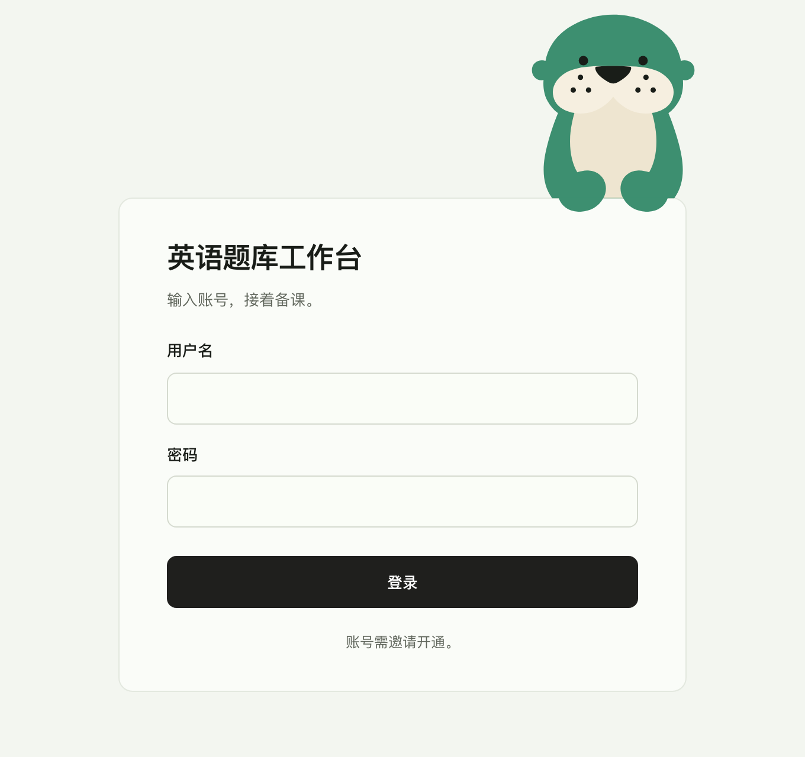
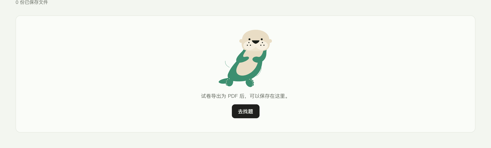

# 品牌设计

> v0.3 草稿 · 2026-10-13 · Owner 与 Droid 共写。品牌名未定，下文暂称「本产品」。

本文件是品牌层的规范：先定一组品牌底层规则，再写从它长出来的三部分，即标志与识别、IP 形象、界面视觉。

三份文件的分工（Owner 2026-10-13 已定）：

- [PRODUCT.md](PRODUCT.md) 只管产品：为谁、做什么、主线和边界。
- 本文件管品牌：北极星、性格、语气、标志、颜色、海獭和插画。
- [DESIGN.md](DESIGN.md) 只管界面执行：token、组件、间距、字号、动效和文案格式。

两份旧文件里的品牌条款已在 2026-10-13 移到本文件，DESIGN.md 和 PRODUCT.md 只留指针。逐条去了哪里，见旧规则清点表 `design/brand-2026-10-13/canon-audit.md`。

## 0. 怎么读

**状态标记.** 每节标题后标一个状态：

- **已定**：和 Owner 原话对得上，或经过真实页面验收。按此执行。
- **提案**：方案已写出，等 Owner 确认。可以先照着探索，不当定稿。Agent 的概括和推广，Owner 确认之前都算提案。
- **未开始**：只列要做什么。没定的内容不编。

「已定」的门槛是 Owner 2026-10-13 定的，清点旧条款也用这条门槛。

**素材位置.**

- 母版与证据：`design/brand-2026-10-13/`。`mascot/` 放分层矢量母版，`evidence/` 放真实页面截图，`canon-audit.md` 是旧规则清点表。
- 探索与对比画板：Paper 文件 [全科题库品牌 · 海獭](https://app.paper.design/file/01M4RC9KH52FMSC8XM2HG52M7G/p-1-0) 的「探索记录 · 00–M」页。其中 H 是水獭探索，I 是角色简报，J 是矢量微调和眼睛预设，K 是配色放进真实页面的对比，L 是 Paper Mono 放进真实页面的对比，M 是眼睛微调放进真实页面的对比。之后每个主题单开一页（第 20 条），第一个是 [主题 1 · 记忆点](https://app.paper.design/file/01M4RC9KH52FMSC8XM2HG52M7G/p-2-0)。Owner 给的真实水獭和海獭照片放在这一页的「参考 · 真实水獭和海獭」画板，只作内部参考，不进仓库。文件原名「全科题库品牌 · 水獭」，改物种以后跟着改了名（第 25 条）。
- 生成脚本在 `.scratch/brand-mascot/`，属于临时工作区，不是长期来源。

**与旧条款的冲突 · 已定.** Owner 已推翻两处「不做吉祥物」的旧规定：

- DESIGN.md §1「圆自形体法」中的「不做表情、不做拟人、不做吉祥物」；
- PRODUCT.md「Anti-references」里「幼稚的教育 App」一条中的「吉祥物与拟人形象」。

两处都是 2026-09-15 图标线程里 agent 的推广，不是 Owner 原话（清点表 D10、P09）。吉祥物可以做，但受 §4.9 的护栏约束，防止它滑向「幼稚的教育 App」。图标仍然不做表情、不做拟人，图标理念页的「不做」一节不变。2026-10-13 改写时，这两句已从 DESIGN.md 和 PRODUCT.md 删掉。品牌与吉祥物相关的事以本文件为准，界面执行以 DESIGN.md 为准。

## 1. 品牌底层（三部分共用）

三部分不是各自做好再拼到一起。下面几条先定，标志、海獭、插画、图标、界面都从这里长出来。任何一张图拿出来，都要说得出它守了哪几条。

### 1.1 北极星与一句话 · 部分已定

**北极星 · 已定**（Owner 2026-09-07，原 DESIGN.md §1，清点表 D05）：

> 一张熟悉而心爱的备课桌。

**北极星的补句 · 提案**（2026-09-15 图标线程，清点表 D06）：「简约、圆润而清爽，语义明确，张弛有度。出版物的编排是骨，胖而干净的线条是肉；该密的地方密，该空的地方空。安静，却不寡淡；精密，却不细弱；有分量，却不沉重。」开头四个词是 Owner 给图标定的理念（§1.4），推到全站和后面的对句是 agent 的推广。

**感受与审美 · 已定**（Owner 2026-09-07；原 DESIGN.md §1「产品感受与审美主张」和 PRODUCT.md Brand Personality，清点表 D17、P08）：

- **首页是归来，不是迎宾。** 老师打开时应感到「又回到我熟悉、喜欢的备课桌了」。稳定的秩序与工作连续性承载熟悉感，不做营销展示或数据管理后台。长期的吸引力来自值得读的材料、可信的专业内容，以及每天都愿意面对的界面。2026-09-15 补：「归来」归到的是**老师自己的工作**（最近看过的篇章、未完成的草稿卷、最近保存的卷），而不只是新上架的完整卷；库里有内容时，首页不得因为规则过严而变成空桌。
- **好看是独立要求。** 可用、正确、整齐不自动等于美，好看也不是功能做完以后的装饰。Owner 的 taste 是设计依据；色调、字体、比例、留白、控件触感都要值得每天看，不以通用的「高级感」、纯功能主义或旧视觉断言代替。
- **出版物主导，专业工具承托。** 篇章、卷目、答案和解析有编辑过的阅读层次与节奏，操作精确顺手。不是全站宋体、仿纸纹理或装饰横线，也不是把 Amp 的文字换成题库术语。
- **安静是照顾注意力。** 内容可以丰富，工具随手可得；不靠清空页面、淡化文字或隐藏必要操作制造极简。
- **精密是细节与行为准确。** 对齐、间距、文字层级、操作反馈和跨页连续性一起成立，让老师感觉顺手，而不是察觉设计在表演。
- **有分量是内容与呈现相称。** 扎实、可信的材料配得上认真阅读的排版；不是深色大块、粗重边框或庞大标题。
- **整体不违和。** 找题便于扫读，读题便于沉浸，组卷便于操作，讲评便于解释；密度可以不同，视觉语言必须相通。菜单、登录、空态及反馈也保持同等完成度。

柔和浅底与有力文字形成对照；细边、短而轻的阴影、细微的表面明度差建立层次。容器柔和，内部排列严整。允许轻微实体感，不追求彻底扁平，也不做厚重拟物。颜色本身是美感的一部分，不只是状态编码；色调、比例、字体与触感要在真实内容上一起判断。界面怎么落实，见 DESIGN.md §2、§4。

**一句话 · 提案**

> 替老师在题海里摸到对的题，再把好题收好。

标志讲这件事，海獭的状态演这件事，界面的空态和文案说这件事。

这句只讲了题库。Owner 2026-10-13 说明，题库是起点，后面要做教育 agent（§1.2）；定名字时，这句话一起改（§8）。

- **信念 · 提案**：AI 帮老师找，老师来定。依据是 PRODUCT.md 设计原则 3「身份分明，老师保有决定权」（已定，清点表 P11），以及 2026-06-03 初版的「AI 只建议，老师确认才生效」。海獭的状态 03「待确认」就是这句话的画面（§4.4）。
- **世界 · 提案**：水上的备课桌。备课桌来自上面的北极星（已定）。海獭住在水里，吃东西时仰躺漂着，把肚皮当桌子，把捞上来的东西摆在上面（§4.1 来历）；这和老师在备课桌上摆开材料、挑出要用的那几样，是同一个动作。插画、空态和宣传图都发生在这张桌子和四周的水里；水只用一两条细弧线暗示（§3.4）。物种改成海獭以前，这里写的是「水边的备课桌」。
- **来历 · 提案**：PRODUCT.md 写明第一用户是项目作者本人，一位高中英语老师（清点表 P01）。2026-06-03 初版的品牌描述是「温暖、有人味，但不幼稚。像一位认真、可信赖的老教师做的工具」，2026-09-14 被换掉（清点表 P08）。「老师给老师做的工具」可以当品牌故事的起点：做工具的是老师，海獭是工具里帮忙的伙伴。要不要对外讲，由 Owner 定。

### 1.2 为谁 · 已定

- 现在服务老师。海獭是老师身边安静的同事。
- 到伴学阶段（PRODUCT.md 的第 4 阶段），再做学生的学伴。还是同一只海獭，形体、配色和性格不变，只放宽表情和出场频率，见 §4.10。
- 全学科。英语是第一个学科，名字、标志和形象都不能只属于英语。
- **长远 · 已定（Owner 2026-10-13）**：以题库起家，后面要做教育 agent。由此推出的一条提案：名字、一句话和海獭的记忆点，都要能跟着长到 agent 阶段，不绑死在题库上。

### 1.3 性格、原则与语气 · 部分已定

**产品性格 · 已定**（Owner 2026-09-07，原 PRODUCT.md Brand Personality，清点表 P08）：**安静、精密、有分量；熟悉而喜欢。** 出版物的编排美感主导，成熟专业软件的顺手承托。不是冷冰冰的数据库，也不是需要反复介绍自己的营销页面。配色参考（Amp Daydream 和 Deadpan）与已验收的页面，见 DESIGN.md §1。

**两条品牌原则 · 已定**（原 PRODUCT.md 设计原则 1、2，清点表 P10）：

1. **内容是主角，界面值得喜欢。** 题目、篇章、解析得到充分的阅读空间；界面退后是减少干扰，不是放弃色调、比例、字体与触感的美感。
2. **专业与亲近同时成立。** 出版物的编排品质主导，细腻顺手的工具承托；整体协调，但不强求每个页面同一密度。温暖不靠卡通和糖果色。

**语气 · 已定**（原 PRODUCT.md Brand Personality 和 DESIGN.md §9 文案法，清点表 P08、D56）：克制、清楚、有温度，像工具对同事说话，不用系统报错腔或营销腔。祈使直说，不堆「请」凑客气，不用营销级形容词（「强大的」「智能的」）。文案格式见 DESIGN.md §9。

**海獭的性格 · 提案**：它是产品性格的角色版本，**安静、好奇、手巧。**

- 安静：话不多，不抢戏，只在等待和结果时刻出现。
- 好奇：会凑近看、会歪头，表示它在认真找。
- 手巧：用前爪翻书、递石头、把东西收好，对应找题和收题。

**温度从哪来 · 提案**：温度仍然主要来自排版、留白和文案；海獭只在等待和结果时刻出场，不负责制造温度（清点表 §1 第 10 条）。上面原则 2 的「温暖不靠卡通和糖果色」继续成立，守住 §4.9 的海獭不算卡通。

### 1.4 形状 · 提案（对图标已定）

Owner 2026-09-15 给图标定的理念是「简约、圆润但同时清爽、语义明确、具有教学领域的人文感」，2026-09-28 又补了「微妙、生动」（`design/icon-system-2026-09-15/principles.md` 开头和 §5）。这些对图标是已定的。这里提议把它们升格到全部品牌图形：标志、海獭、插画、图标。

1. **简约**：一件东西只说一件事，用最少的形说完。海獭只有七个部位：身体、脸、肚皮、鼻子、眼睛点、胡须点、爪尖。胡须只画成墨点，不画胡须线。
2. **圆润但清爽**：胖来自形体，不来自描边；圆来自轮廓，不来自把一切磨成球。Owner 第四轮评审的原话是「该挖空的地方挖空，该润的地方润」：眼睛点、胡须点四周的净空要留住。圆角形至少保留一段直边（图标标准，`principles.md` §2）；界面圆角只用 DESIGN.md §5 的一个圆角家族。
3. **语义明确**：在最小使用尺寸下仍然认得出。认不出就为这个尺寸单独画简化版，不硬缩。
4. **人文感（倾向，不是门槛）**：Owner 的原话是「人文感只做取舍时的偏好，不做硬限制」。偏 humanist，形从笔和纸来，允许一点不对称。两种画法同样清楚时，选更像纸和笔的那个。海獭的 v2 形体是自然轮廓，不是几何拼搭。
5. **微妙、生动**：保留熟悉的识别骨架，把最有表现力的特征轻轻放进轮廓、比例和留白里（principles.md §5 主旨）。落到海獭：最有表现力的是胖身体和短前爪的比例，以及仰躺漂着的姿势，情绪靠姿态和比例，不靠加记号。原来这里写的「粗尾巴」是水獭的特征，海獭的尾巴短而扁（§4.9）。principles.md 也写明「静态的生动不推导出添加动画」。

另加一条平面规则：平涂，无描边，无渐变，无纹理（海獭已定，插画沿用待确认）。

**可爱 · 提案**（原 DESIGN.md 圆自形体法和 PRODUCT.md 反例里的括注，2026-09-15 agent 的概括，清点表 D10）：可爱 = 够圆润 + 有自己的小特色 + 语义明确，不是卡通。圆润本身不是毛病。

### 1.5 颜色 · 部分已定

| 名字 | 色值 | 差事 | 状态 |
| --- | --- | --- | --- |
| 竹青 | `#3D8F70` | 品牌主色：海獭身体、标志图形、插画主体 | 已定 |
| 深竹青 | `#2C6E56` | 要承载文字的品牌色：头像圆（白字）等位置。即网站现有的身份色 | 提案 |
| 暖米白 | `#F6EFE0` | 第二色：海獭的脸、App 图标底 | 已定 |
| 米白 | `#EEE5D0` | 海獭的肚皮和爪尖 | 已定 |
| 墨 | `#191D18` | 海獭的眼睛点、鼻子、胡须点、状态插画里的石子；与界面正文同色 | 已定 |

竹青和深竹青的 OKLCH 色相都在 166° 左右（明度 0.59 对 0.49），是同一条色阶上的两档。所以网站身份色不用在「跟着提亮」和「保持不变」之间二选一：竹青管图形，深竹青管要写字的地方。

实测对比度（WCAG）：

| 组合 | 对比度 | 结论 |
| --- | --- | --- |
| 竹青 对 白 / 桌面 `#F3F6F0` / 内容面 `#FAFCF8` | 3.92 / 3.59 / 3.79 | 只够图形和大字（≥ 3:1），不能写正文 |
| 深竹青 对 白 / 桌面 | 6.05 / 5.55 | 可以写字 |
| 白字放在竹青上 | 3.79 | 小字不合格；带字的品牌色底一律用深竹青 |
| 暖米白 对 桌面 | 1.05 | 几乎一样亮：海獭的米白部分永远要被竹青包住，不直接贴在桌面底上 |
| 眼睛点（墨）对 竹青 | 4.36 | 图形可辨。原来的暖米白眼睛点是 3.42，又挨着同色的口鼻区，150px 时已经难认（M 画板） |
| 鼻子（墨）对 暖米白 | 14.91 | 清楚 |

**色必须有差事 · 已定**（原 DESIGN.md §2，2026-09-04 起执行，清点表 D30）：每一处非中性色都要能回答「它在帮老师做什么」，答不出就不上色。这条原来管界面；推到标志、海獭和插画是提案，上表的「差事」一栏就是照这条写的。

**不用蓝色和科技紫做强调 · 已定**（原 DESIGN.md §6，清点表 D52）：工具界面不用任何蓝色（比如 `#3B82F6`、`#2563EB`）或科技紫做强调色。

用色规则（提案）：

- 竹青只给品牌图形：标志、海獭、插画。不给按钮、选中态、焦点环、链接，与 DESIGN.md §2「墨做动作」「墨绿只做身份」一致。
- 暖米白和米白只用在角色和插画里，不做界面表面色。界面表面仍用 DESIGN.md §2 的 Daydream 桌面色阶；Owner 2026-08-28 实测后判定暖米底过暖（原 DESIGN.md「暖纸边界」，已删，清点表 D33）。
- 语义色（成功、提醒、危险）不进品牌色，也不进海獭和插画。题型六色已删除（Owner 2026-10-13，清点表 D03），历史留在 git。
- 不新增色相。插画需要更多层次时，先用这几色之间的组合；确实不够时在竹青色阶上加档。

### 1.6 克制：哪里不出现品牌 · 提案

专业品牌同样由「不做什么」来定义。

- 卷面上永远不出现海獭和品牌图形。四款 PDF（大字完整版、大字无听力版、省纸版、纯答案版）和网页上的卷面预览都算卷面（PRODUCT.md，Owner 2026-10-06）。
- 导出物靠排印说话：PDF 上的品牌只通过字体、版式和出版标记体现。
- **现有的出版标记 · 等命名**（清点表 D46）：配套解析 PDF 印「EQBANK 教师解析」，签名色是一组低饱和的松烟绿 `#596A58` / `#3B4E3D`（`server/exports/companionAnalysisRenderer.mjs`，由 `scripts/verify-companion-analysis-export.mjs` 钉住），不在 §1.5 的色板里。它的版式记录已移到 `docs/product/companion-analysis-adaptation.md`「打印版式」。四款 PDF 合同里，这个入口不再服务新产品（`docs/product/paper-pdf-products-v1.md`）。出版标记和签名色换不换，命名以后一起定。
- 读题、做题、编辑卷面时，海獭不出现。
- 界面不加品牌花纹、品牌点（原 DESIGN.md 公认形法里 agent 的推广，和 2026-09-14 验收的「先移除绿色品牌标记」方向一致，清点表 D12）。
- 图标不上品牌色，走 `currentColor`（DESIGN.md §5 图标配角法；principles.md「颜色永远来自内容」）。
- 海獭不说话，不用对话气泡讲道理，见 §4.9。

### 1.7 反面参照 · 已定

明确不要做成以下任何一种（原 PRODUCT.md Anti-references 和 DESIGN.md §6，清点表 P09、D49）：

- **AI 生成的千篇一律感**：紫色渐变、玻璃拟态、一眼假的「随手生成」质感。
- **花哨的营销 SaaS 风**：大渐变 banner、弹窗、堆动效和营销词，喧宾夺主。
- **塞满的后台管理系统**：密密麻麻的表格和按钮，把筛选控件做成视觉主角的表单墙，信息过载，让人不想用。
- **幼稚的教育 App**：糖果配色、同一视图里圆角失控，不够专业，不被老师当回事。角色画成 Q 版大头小身体、加腮红和超大眼睛，也算这一类；守住 §4.9 的海獭不算（这两句随 §4.9 是提案）。

第四条原来还有「吉祥物与拟人形象」，那是 2026-09-15 图标线程里 agent 的推广，Owner 2026-10-13 已推翻（§0）。

### 1.8 检验问题 · 部分已定

**设计验收问题 · 已定**（Owner 2026-09-07，原 DESIGN.md §1，清点表 D22）：老师是否愿意每天面对这个色调和排版？内容是否值得细读、操作是否顺手？从首页进入详情，再打开一个菜单，是否始终像同一个精心做好的产品？以真实页面回答，不以 token 合规或文字口号代替。

**品牌检验问题 · 提案**：

1. 把海獭从截图里拿掉，还认得出是本产品吗？界面本身就要是品牌。
2. 随便拿一张图，说得出它守了 §1.4 到 §1.7 的哪几条吗？
3. 老师会不会觉得它幼稚、抢戏，或者打扰工作？
4. 标志、海獭、插画、图标放在一起，像同一只手画的吗？

## 2. 命名 · 未开始（一起想）

**为什么要先定名字.** 字标、域名、App 名、出版标记都要等名字。图形标志（海獭头）可以先做。

**条件（提案）**

1. 全学科：不带「英语」，不只属于一个学科。
2. 老师现在用着体面，学生以后用着亲近。
3. 短：两个字最好，最多三个字。
4. 好读好写：读音不歧义，以常用字为主。比如「獭」有 16 画，在小尺寸字标里容易糊。
5. 不撞车：要查商标（软件、教育相关类别）、域名和应用商店重名。
6. 避开坏联想：海獭加「摸」，容易让人想到「摸鱼」「浑水摸鱼」。
7. 要有拉丁字母写法，用于域名和 App。现在的域名是 eqbank.cc，PDF 出版标记是 EQBANK；做全学科以后还要不要保留，跟命名一起定。

**方向和种子（脑暴用，未查重，不是推荐）**

| 方向 | 例子 | 好处 | 风险 |
| --- | --- | --- | --- |
| 从海獭来 | 小獭、书獭 | 和形象直接挂钩 | 「獭」笔画多；「小 X」偏幼 |
| 从「收好题」来 | 拾题、题塘 | 说清产品在做什么；「题塘」把「题海」收成一方好塘 | 偏功能，独特性要靠字标；塘是水獭住的地方，海獭住在海里，和形象对不上 |
| 从书桌来 | 案头 | 呼应「备课桌」北极星，有文气 | 常用词，商标难注册 |
| 从典故来 | 獭祭 | 故事好，见下 | 日本清酒「獺祭」名气大，直接用会撞；典故里是水獭，不是海獭 |

**典故「獭祭鱼」· 改成海獭以后不再贴切.** 《礼记·月令》记孟春「獭祭鱼」：水獭把捉到的鱼一条条摆在岸上，像在陈列祭品。宋人笔记里说，李商隐写文章时把书册摊满左右，人称「獭祭鱼」。备课也是把材料一样样摆开，再挑出要用的那几样。原来这里写「这个典故正好讲我们的水獭在做什么」，建议放进品牌故事。2026-10-13 物种改成海獭（§7 第 24 条），典故里的獭是水獭，它就讲不成我们这只海獭的故事了，最多当「獭」字的掌故。「把材料摆开、挑出要用的」这层意思，改由海獭把肚皮当桌子来讲（§1.1 世界）。另外它在文论里也有「堆砌典故」的贬义。

**口号 · 提案（和名字一起定）.** 反用熟语，让老话替我们说新意思。例子：「题海三千，只取一瓢」，化用「弱水三千，只取一瓢饮」。「题海」常和「题海战术」连在一起，这句反过来说：题再多，老师只要对的那一道。物种改成海獭以后，「题海」的海正好是海獭住的地方。口号只用在宣传、登录页这类品牌位置，不进工具界面的文案（文案法见 DESIGN.md §9）。

**流程（提案）**：长名单 → 按上面的条件筛到 5 个 → 查商标、域名、应用商店 → 每个做成字标草稿，放进顶栏、登录页、App 图标里看 → Owner 定。

## 3. 标志与识别

### 3.1 标志 · 未开始（图形可以先做，字标等名字）

2026-09-14 的页面验收记录（原 DESIGN.md §1，清点表 D20）写着「品牌名未定，先移除绿色品牌标记，不另造 logo」。Owner 2026-10-13 要求做整套品牌识别，包括标志，所以那句「不另造 logo」由本文件接替。图形标志定稿以前，现网顶栏继续只放文字。

要交付：

- **图形标志**：从海獭头像派生。K 画板在顶栏试用的是母版头像直接缩小（`design/brand-2026-10-13/mascot/otter-head.svg`，28px 高），只是占位。
- **16px 简化版**：16px 下脸部细节看不清（K 画板），要单独画：在 16×16 的像素网格上逐格画，不从大图缩小；减少部位，加大眼睛点和鼻子四周的净空。
- **字标**：等名字。在现成字体上改，见 §3.3。字形要符合 §1.4：胖而清爽，圆来自形体，带一点手写的人文感。
- **组合**：图形加字标的横排和竖排、安全距离、最小尺寸、单色版（墨色、反白）。
- **按场合用 · 提案**：宣传和登录页用完整组合，顶栏用图形加字标横排，App 图标和浏览器标签只用图形。尺寸越小，用越简的版本。
- **禁止用法**：拉伸、换色、加描边、加阴影、放在照片或花底上。

### 3.2 品牌色 · 部分已定

见 §1.5。待办：确认深竹青的差事；做一页色板，写清每个颜色在标志、海獭、插画、界面里的用法和对比度。

### 3.3 字体 · 部分已定

- **界面与卷面 · 已定**：工具界面用 Inter + PingFang SC，卷面用 EQB Termes / EQB Source Han Serif，两条字道各守一层（DESIGN.md §3）。
- **Paper Mono · 已定（Owner 2026-10-13，看过真实页面对比）**：Paper 出的等宽字，v1.000 发布于 2026-10-07，授权 SIL OFL 1.1，可以商用和嵌入网页。8 个字重，另有可变字重（100–800）；约 800 个字形，覆盖拉丁字母、数字、箭头和制表符号，没有中文。所以它当不了全站唯一的字：页面上的中文仍由系统中文字体显示（苹果设备上是 PingFang SC），卷面中文仍是思源宋体。Owner 要求的三种用法已放进真实页面并排看过（Paper 文件 L 画板），按 Droid 的建议定。替换 Inter、做整个界面的拉丁字母和数字：不做，因为等宽字里空格和「·」也各占一整格，中西混排的间隙变宽，用户名像代码。只用于数字、年份、页码和短标签：不单独做，因为真实界面里它和 Inter 几乎看不出差别；只有字标也用 Paper Mono 时，才考虑顺带用在数字上。只用于字标和宣传标题：留到定名字时再比，用同一个名字做三版字标（Inter、Paper Mono、在 Paper Mono 上改字），放进顶栏和登录页。卷面、四款 PDF 和词典卡的英文词头不在候选内，它们归试卷版式标准和 DESIGN.md §3 管。工具界面目前不用 Paper Mono，不进代码。
- **字标 · 未开始**：在现成字体上改（提案），不从零造字，也不直接用系统字。所选字体的授权要允许商用和修改，比如 SIL OFL。
- **宣传标题字 · 未开始**：要能中英混排，并与界面字道协调。DESIGN.md §3 的字号规则只管工具界面，宣传物料另定。

### 3.4 图形语言 · 提案

- **原语**：领域图形一律由卷面原语拼成：正文行、药丸空、折角纸、点、书签（DESIGN.md §5 公认形法；图标理念页「特色」）。插画里的卷子和书也用同一套形。
- **石子**：只在海獭的状态插画里当道具，不升格为全站装饰图形。界面不加品牌点和品牌花纹（§1.6）。
- **水**：只用一两条细弧线暗示，不画写实水面。

### 3.5 视觉规范手册 · 未开始

在 Paper 里每章做一组页面，最后导出 PDF。目录：品牌底层 → 命名与标志 → 颜色 → 字体 → 图形语言 → 海獭（设定、三视图、表情、状态、道具、动效、使用场景、禁止项）→ 界面视觉（插画、图标、动效、语气）→ 应用示例（登录页、空态、App 图标、PDF、宣传图）。

## 4. IP 形象：海獭

### 4.1 角色设定 · 部分已定

- **物种 · 已定（Owner 2026-10-13）**：海獭。原来定的是水獭，泛指，不做海獭（第 2 条）。Owner 拿真实照片对照时指出，用石头当工具是海獭的习性；Droid 一查，本文件的来历和状态表里，石头和仰躺漂浮都是从海獭借来的。Owner 认为海獭的习性在正向引导上更有借鉴价值，定为海獭（第 24 条）。现在的母版 v0 还是照水獭画的，海獭版母版在画（§4.2）。
- **来历 · 提案**：现实里的海獭潜到海底找吃的。海底常常又暗又浑，它主要靠灵敏的前爪和胡须去摸。浮上水面以后，它仰躺漂着，把肚皮当桌子，把捞上来的贝壳摆在上面，再拿一块石头敲开。海獭是少数会用工具的哺乳动物；顺手的那块石头用完不扔，收进前肢下面的皮袋里，下次再用。我们把这几件事变成它在产品里的工作：在题海里摸到对的题，摆开给老师看，再把好题收好（§1.1 一句话）。会用工具不等于替老师拿主意：留哪道题，仍由老师定（下面「使命」一条）。形象上胡须只画成墨点（§4.2）。还有一个现成的画面：海獭睡觉时有时手拉手，免得漂散，可以讲陪伴；但容易画甜，用不用到画状态时再定（§4.9）。物种改成海獭以前，这里还写了水獭爱把小石子在爪子间抛着玩；那是亚洲小爪水獭这类小型水獭的习性，状态 01 跟着改了（§4.4）。
- **使命 · 提案**：海獭必须有差事。它出场是为了把看不见的 AI 过程演出来：找、翻、递、收，以及如实说没找到。没有差事就不出场。老师等待时陪一下，结果出来时交代一下。不教学，不打分，不替老师做决定。
- **性格 · 提案**：安静、好奇、手巧（§1.3）。
- **语气 · 提案**：海獭不说话。界面文案是产品在说话，不是海獭在说话；文案法见 DESIGN.md §9。

### 4.2 造型 · 部分已定

- **母版 v0 · 已定**：v2 正面，`design/brand-2026-10-13/mascot/otter-front.svg`。2026-10-13 换上了 M 画板定下的眼睛（见下面「眼睛」一条），同一目录下四个母版文件（正面、头像、App 图标、捧石子变体）的眼睛图层一起换过。同一天又换上记忆点方向 A 定下的 A2 胡须点（见下面「胡须」和「记忆点」两条），四个母版的胡须图层一起换过，`evidence/` 里的三张真实页面截图也用新母版重拍了。物种改成海獭以后（第 24 条），v0 仍是母版，直到海獭版母版画好、Owner 确认。v0 是照水獭画的：尾巴粗长渐尖，圆顶，耳朵长在头顶两侧。海獭版从 v0 出发，脸、配色和七个图层带过去，改头、耳朵和尾巴（见下面「记忆点」里的「物种改成海獭以后」）。四个母版文件的标题和注释还写着「水獭」，换成海獭版时一起改。
- **部位与配色 · 已定**：身体竹青；脸（口鼻和脸颊）暖米白；肚皮和爪尖米白；眼睛点、鼻子和胡须点墨。母版里每个部位一个图层，图层名就是部位名（body、face、belly、nose、claws、eyes、whiskers）。
- **眼睛 · 已定（Owner 2026-10-13，M 画板选 e5）**：大小和位置用 J 画板的预设 p2：放大 1.15 倍，两眼各往脸中线收 24、往下移 12（母版坐标，半径 35.8）。颜色从暖米白改成墨。原因：暖米白眼睛对竹青只有 3.42:1，又挨着正下方同色的口鼻区，放进真实页面后 150px 已经难认，16px 完全消失，脸上最显眼的就成了鼻子和胡须点；墨色眼睛到 16px 还看得见，和鼻子、胡须点一起组成一张脸。几档大小和位置的差别在真实页面里几乎看不出。
- **胡须 · 已定（Owner 2026-10-13）**：胡须只画成口鼻上的墨点，不画胡须线（第 13 条：改文档，不改形象）。表情和动作里不再写「胡须前伸」「胡须轻动」。点的排法按记忆点方向 A 换成 A2（第 23 条）：每颊三个点排成一个 ∴（「所以」），一上两下，是等边三角形，点心距 116，点半径 20（母版坐标）；三角的中心和原来三个点的中心重合。
- **空手 · 已定**：基础形象空手，两只爪子分开搭在胸前。捧石子的变体 `design/brand-2026-10-13/mascot/otter-front-pebble.svg` 只给状态插画作参考。
- **记忆点 · 进行中（主题 1）**：Owner 2026-10-13 担心现在的样子没有记忆点，定为下一件事，排在三视图前面。
  - **诊断 · 提案（Droid，见 Paper「基线测试」画板）**：能被记住的只有颜色和米白口鼻。全身剪影靠那条粗长的尾巴，还看得出是水獭一类；头像剪影只剩圆顶加两侧小圆耳，小熊、海豹、仓鼠都说得通。头像到 32px 以下只剩眼睛、鼻子和米白口鼻；头像母版是方形裁切，放进圆形头像会切掉耳朵外缘。以后做教育 agent，最常出现的是头像，所以记忆点最好落在头上。单靠颜色也撑不住：教育类的绿色吉祥物，很多人先想到多邻国的绿猫头鹰。
  - **四个方向 · 按顺序一个一个试（顺序 Owner 定；物种改成海獭以后改过，见下面「物种改成海獭以后」）**，每个只改一处：
    - A「所以」胡须：两颊的胡须点原来一上两下，正好是 ∴。把这个巧合定成签名，再看它能不能动成「正在想」。要过两关：∴ 来自数学，要看其他学科的老师读不读得懂（§1.2 全学科）；要动起来，就要改 §4.3「胡须点不动」。
      - **结果 · 已定（Owner 2026-10-13「听你的」，采纳 Droid 批注里的三条建议）**：A2「舒展」留下，作近看的签名，四个母版的胡须点已换成 A2（上面「胡须」一条）。「正在想」先不定，两个候选记在 §4.6，到动效那一步再选；§4.3 暂时不改。方向 A 不画第 2 轮，进方向 B。画稿在 Paper「记忆点 · 方向 A」Astra 和 Droid 各一块画板，批注卡在两块中间。
      - **依据**：Astra 在 240px 头像上比了三档间距（A1、A2、A3），A2 三点拉开，两颊一眼看得出 ∴，又不抢眼睛和鼻子。Droid 把 A2 放进真实页面（Droid 画板的「03 续」，取景同 K、M 画板）：登录页（全身 240px）两颊都认得出 ∴；顶栏（头像 28px）每个点只剩约 1px，脸比原来干净，但看不出 ∴；空态（全身 150px）凑近才看出是三角。Astra 也记下 32px 圆头像上仍然弱，剪影没有变化。所以 A 是近看的签名，管不了小头像好不好记；小头像要靠改轮廓，正好是方向 B 要试的。Astra 给的一句话描述是「一只两颊各带一个『所以』的水獭」。
      - **还没过的关**：其他学科的老师读不读得出 ∴，还没有证据，放到最后的 5 秒测试里一起看（下面「评估」一条）。Astra 建议测试时不提示符号的意思，看 5 秒后请人复述或画出来，再问联想到哪个学科。
    - B 扁头低耳：真实水獭的头扁而宽，耳朵小而低，剪影更像水獭。要改母版形体（§7 第 3 条）和 §4.9「头身比例与母版一致」。
      - **第 1 轮 · Astra（2026-10-13）**：只改头顶和两只圆耳，脸、眼睛、鼻子和胡须点都没动。三档（母版坐标，原来头顶约 y=56）：B1 头顶压到 y=125、耳朵半径 65；B2 压到 y=185、半径 58；B3 压到 y=245、半径 44。推荐 B2：B1 的熊感退得不够，B3 的耳朵几乎没了，像海豹。Astra 也记下，B2 在 32px 圆裁里特征仍细，右耳外缘还会擦到圆裁边。画稿在 Paper「记忆点 · 方向 B · Astra · 第 1 轮」。
      - **之后 · 已定（Owner 2026-10-13，第 25 条）**：B 不再单独往下做，并进海獭版母版（下面「物种改成海獭以后」）；Droid 没有接着做 B2 的真实页面对比。
      - **怎么并 · 提案（Droid）**：海獭的头是圆的，耳朵比水獭还小，所以 B 的经验只用一半：耳朵可以小到 B3 那样，海獭本来就是这样；头顶不用压得像 B2、B3 那么扁。头像会不会像海豹，要靠脸和口鼻分开，不靠留大耳朵。
    - C 毛笔尾：尾巴本来粗而渐尖，尾尖蘸墨就是一支笔。但毛笔在 §4.5 是语文的学科道具，基础形象会带上语文味（§1.2 全学科）；头像里也看不到尾巴。
      - **作废 · 已定（Owner 2026-10-13，第 25 条）**：海獭的尾巴短而扁，做不成毛笔。
    - D 探头出场：不改样子，规定它总从卡片或页面边缘探头，像刚浮出水面。§4.7 的登录页和 §4.4 的状态 05 已经在探头，要做的是把它定成所有出场的规矩。
      - **物种改成海獭以后**：排在海獭版母版之后试（Owner 2026-10-13，第 25 条）。提案（Droid）：海獭本来就住在水里，「从水里浮上来」比水獭更自然；如果仰躺漂着当基础形象，D 可能直接定成出场的规矩。
  - **物种改成海獭以后 · 已定（Owner 2026-10-13 同意 Droid 的提议，第 25 条）**：先把母版改成海獭，再接着试记忆点。顺序改成：A（已定）→ 海獭版母版（并入 B）→ D → 5 秒测试；C 作废。
    - **海獭版母版 · 进行中（第 1 轮两人都交了，等 Owner 定）**：从现在的母版（e5 眼睛、A2 胡须点）出发，照真实海獭改形体，最多来回两轮（第 20 条）。
      - **原样带过去**：眼睛、鼻子、∴ 胡须点，§1.5 的颜色，七个部位的图层名，平涂无描边，基础形象空手、爪子搭在胸前。
      - **要改**：头圆而宽，耳朵小而低，几乎贴着头；尾巴短而扁，不再粗长渐尖。这会改母版形体（§7 第 3 条）和头身比例（§4.9），所以要等 Owner 确认才换母版。
      - **要并排试**：脸的米白要不要往上扩，包住眼睛。真实海獭的脸常发白，但 v3、v4 的骨白脸包住眼睛像土匪（第 3 条），所以两版都画，放进真实页面再判断。后脚画不画成鳍。站着还是仰躺漂着当基础形象：海獭站着时没有长尾巴撑剪影，可能比水獭更难认；仰躺漂着、爪子搭在胸前，是海獭最认得出的样子。
      - **第 1 轮 · Astra（2026-10-13）**：头顶从约 y=56 压到 y=90，头圆而宽；耳朵半径 44、中心 y=445，几乎贴着头；眼睛、鼻子和 A2 点的坐标不动。脸画两版：H1 只留口鼻，H2 米白往上包住眼睛。身体画三版：S 站着，F1、F2 仰躺漂着，F2 把两只后脚画成鳍、放在前景；水是能单独隐藏的第八个图层 water。推荐 H2 × F2。Astra 也记下，32px 圆裁的剪影仍接近海豹。画稿在 Paper「记忆点 · 海獭版母版 · Astra · 第 1 轮」。
      - **第 1 轮 · Droid（2026-10-13）**：Owner 问「海獭不是整个脸都是白的吗」，还没想好，要几种都放进真实页面看。Droid 在 Astra 画板的副本上加了两版：H2b 白到两颊边，绿只留在头顶、耳朵和越来越细的两侧；H3 整个头都白，耳朵也白。四张脸都配 F2，放进登录页 240px、顶栏 28px、空态 150px，另做 App 图标。结果：H2 三处都清楚，米白四周有竹青包着。H2b 白脸最大，但两颊下缘直接碰到页面，米白对桌面只有 1.05，那一段轮廓就没了。H3 只露头时（顶栏、登录页）头化进页面，眼睛和鼻子像浮着；全身时有绿身体托着才看得出；放在竹青底上最好看。Astra 交代的三项检查：白脸不像土匪（眼睛周围没有深色带），只是有点像兜帽；前爪清楚，后鳍在 150px 读成两只圆脚；28px 下耳朵小了，不再像熊，但海獭和海豹还分不开，留给 5 秒测试。画稿在 Paper「记忆点 · 海獭版母版 · Droid · 第 1 轮」，批注卡在两块画板中间。
      - **建议 · 提案（Droid）**：脸以 H2 为底，上沿抬到 H2 和 H2b 中间，减轻兜帽感；两侧和两颊一路留绿边，28px 时至少 1px（母版坐标约 40），守住 §4.7 的贴底规则。H3 不当母版：它离不开竹青底，浅色页面里每次只露头都要带一块绿底，海獭就成了一枚圆章；选它还要改 §4.7 的贴底规则和 App 图标的底色。H1 留作退路：小尺寸最结实，但没有白脸。身体同意 F2，后鳍加宽、压扁。Owner 同意以后由 Astra 画第 2 轮，Droid 再放进真实页面。
      - **待 Owner 定**：脸的米白停在哪（H1、H2、H2b、H3，或上面的建议）；身体用 F2 还是 S。换不换母版，等第 2 轮画完再定。
    - **撞车**：海獭形象的熟人比水獭多，比如 Chiikawa 里的海獭、《ぼのぼの》的主角。下面「评估」的一句话描述，要能把我们和它们分开。
  - **评估 · 提案**：剪影；头像圆裁到 32px；一句话描述（不提颜色，也能把它和别的海獭分开）；真实页面（登录页 240px、顶栏 28px、空态 150px）；能不能演 agent 的状态（想、找到、没找到）。最后 Owner 找两三个人看 5 秒，凭记忆画出来。
- **三视图与比例 · 未开始（记忆点定了再做）**：正面、侧面、背面、四分之三侧，加比例规范，以头高为单位写头身比、眼距、耳位、爪长、尾长。这是后面所有状态图不走样的前提。
- **小尺寸版本 · 未开始**：16px 和 32px 的简化头像，见 §3.1。

### 4.3 表情 · 提案

- 表情只靠四样：眼睛、头的角度、前爪、身体姿势。胡须点不动，不拿来做表情。
- 「正在想」时 ∴ 动不动、怎么动，两个候选记在 §4.6，到动效那一步再选。选定之前，胡须点照旧不动（Owner 2026-10-13）。
- 眼睛默认是圆点，完成时眯成两条弧线（状态 04）。
- 不做腮红、眼睛高光、眉毛、张嘴大笑、流泪、超大眼睛。
- 到伴学阶段可以放宽，见 §4.10。

### 4.4 状态与动作 · 提案（图未开始）

| 状态 | 动作 | 产品时刻 | 意思 |
| --- | --- | --- | --- |
| 01 空闲 | 浮在水里，两只前爪捧着那块顺手的石头慢慢转，眼睛跟着石头 | 空态、登录页 | 这里还空着，我在等你 |
| 02 找题中 | 仰躺漂着，肚皮上摊开一本书，用前爪翻页，鼻子凑近书页 | AI 找题加载、生成中 | 我在帮你翻 |
| 03 待确认 | 立在水里，双爪捧着一块石头递向你，头微微歪 | AI 结果请老师确认 | 我摸到这个，你看对不对 |
| 04 完成 | 仰躺，把书抱在胸前，眼睛眯成两条弧线 | 组卷完成、导出完成 | 收好了 |
| 05 没找到 | 从水里探出上半身，两只前爪摊开，空着 | AI 找题没有找到合适的题 | 这次没摸到，换个说法再试 |

规则：每个状态都用海獭真实的习性表达（仰躺漂着、肚皮当桌子、用石头、把东西收进皮袋），不靠夸张表情。石头和书用墨和米白，不用竹青。最后拿主意的永远是老师。

状态 05 是诚实的那一格：没找到就如实说没找到，不凑数（DESIGN.md §9「空态指向第一动作，宁缺勿假」）。海獭不哭、不道歉，文案指向下一步。

**物种改成海獭以后 · 提案（Droid）**：02、04 的仰躺漂浮本来就是海獭的习性，不变。01 原来是「坐着，把小石子在两只前爪间轻轻抛着玩」，抛石子是小型水獭的习性，改成捧着石头转；03 的「坐起来」改成「立在水里」。还有一处画状态时再定：海獭的石头是敲贝壳的工具，摸到的是贝壳。照这个，03 递给老师的更像一枚贝壳，石头留在皮袋里。加不加贝壳这件道具，到时候和 §4.5 一起定。

### 4.5 道具与服饰 · 提案

- 道具表示学科，服饰表示场合，可以叠加。每次最多一件道具加一件服饰。
- **学科道具**：通用（石头、书）、语文（毛笔）、数学（三角尺）、英语（字母卡）、物理（U 形磁铁）、化学（烧瓶）、生物（叶子）、历史（卷轴）、地理（地球仪）。
- **场合服饰**：圆框眼镜（阅读、考试）、小书包（开学）、毕业帽（毕业季）、围巾（冬天、节日）。
- **跟着教学日历换装 · 提案**：开学、期中、期末、高考、教师节、寒暑假，各配一件服饰或道具。只在登录页和空态出现，过了时间就换回，不做节日营销。
- 道具只用墨和米白，不新增颜色，也不用身体的竹青。身体比例和脸永远不变。
- 学科道具只在海獭插画里表示学科，不是题型图标，也不进图标套件（Owner 2026-09-30 定了「题型不搞图标」）。

### 4.6 动效 · 未开始（方向提案）

- 母版是分层矢量，可以直接在代码里动（SVG 加 CSS），不必做视频。
- **动作沿部件关系走**：Owner 2026-10-03 审图标动效时，否掉了第一轮的轻交替、旋转和填充（评语「不够灵性」），确认了第二轮的图标内部关系动作（`design/icon-system-2026-09-15/motion-rules.md`）。海獭照此办：石头在两爪之间转，爪子带着书页翻，眼睛跟着石头走；不做整体弹跳和旋转。
- **节奏有性格**：安静、好奇的海獭，动作起得慢、停得稳，不回弹；歪头之前先停一拍。界面控件的利落节奏不受影响。
- **循环只给等待**：状态 02 找题中可以循环，因为等待本身在持续。状态 01 转石头的动作在进入时演一两次就停。motion-rules.md 写明不给高频工具加弹跳、自动循环或无意义旋转。
- 候选小动作：偶尔眨眼、鼻子轻动、状态切换时一个短过渡。
- **「正在想」的两个候选 · 提案（Owner 2026-10-13 定为到这一步再选）**：记忆点方向 A 留下两种让 ∴ 动起来的办法（§4.2），到这一步并排比，也可以都不用。两个都要给 §4.3「胡须点不动」开例外，而且只用于 150px 以上的头像；§4.7 现在列的位置里还没有会动的大头像（App 图标不动）。画稿在 Paper「记忆点 · 方向 A」两块画板的「04」。
  - (a) 依次脉冲（Astra）：三个点轮流轻轻放大再复原，等待时循环。长处是等得再久也看得出还在想；像不像普通的加载三点，还没验证。
  - (b) 潜下去、浮上来（Droid）：两颊的上点沿直线沉到两个下点之间（距离等于三角的高），三点成一行，两颊合起来正好是省略号「……」；有了结果再浮上来，回到 ∴。潜 220ms、浮 160ms，缓入缓出，不回弹；点不放大、不变色、不闪；等待时停在省略号上，不循环，进度交给旁边的「生成中…」。减少动态时不移动，直接换。长处是只在状态改变时动，合本节「动作沿部件关系走」和「动势极省」两条，省略号不懂数学也认得；短处是停住以后，单看海獭看不出还在不在想。没用转动：试过把 ∴ 转 60° 变成 ∵（因为），但 Owner 否过图标的旋转，∵ 又多一个数学符号。
- 遵守 DESIGN.md §6 的动效 token，UI 动效不超过 300ms。海獭的循环属于签名时刻豁免，代码里要注释。`prefers-reduced-motion` 时完全静止。
- 动势极省：以静态为主，只在状态改变的那一瞬动（图标理念页「动势极省」）。

### 4.7 使用场景与尺寸 · 提案

- **出场**：只在等待和结果时刻，包括空态、找题加载、请老师确认、AI 没找到、组卷或导出完成、登录页、App 图标。
- **不出场**：读题、做题、编辑卷面时不出现；卷面上永远不出现。
- **一屏一只**：同一屏最多出现一只海獭。
- **贴底规则**：米白部分必须被竹青包住，不直接贴桌面底色（§1.5）。

尺寸以 K 画板的真实页面试用为准：

| 位置 | 形式 | 尺寸 |
| --- | --- | --- |
| 顶栏标志 | 头像 | 28px 高，以后换成 §3.1 的图形标志 |
| App 图标 | 头像加暖米白圆角底 | 192 / 64 / 32 / 16；32 和 16 要用简化版 |
| 空态 | 全身 | 150px 高 |
| 登录页 | 全身，站在登录框后面探头，爪子正好搭在框沿 | 240px 高 |

 

### 4.8 两种画法 · 提案

- **界面**：平涂矢量，只用从母版派生的矢量文件。
- **宣传**：3D 版，从同一母版派生，只用于开屏、宣传和周边。排在最后做。
- **换介质要重新设计**：贴纸、横幅、毛绒、3D 各自调整，不直接把 2D 放大或挤出。

### 4.9 永远保留 / 永远不做 · 提案（「永远保留」的前两条和空手一条已在 §4.2 定下）

**永远保留**

- 竹青身体，暖米白口鼻和脸颊，米白肚皮
- 墨点眼、小墨鼻、墨胡须点（每颊三个点排成 ∴，§4.2）
- 小圆耳、短前爪、短而扁的尾巴（2026-10-13 按海獭改；原来是水獭的粗而渐尖。具体形状以海獭版母版为准，§4.2）
- 平涂，无描边，无渐变，无纹理
- 头身比例与母版一致
- 基础形象空手，爪子搭在胸前；石子只在状态插画里出现

**永远不做**

- 腮红、眼睛高光、眉毛、张嘴大笑、流泪
- Q 版大头小身体、超大眼睛
- 整套拟人衣服，拿手机或电脑
- 新增颜色；身体用墨黑（像戴面具）；道具用竹青（和身体糊在一起）
- 出现在卷面上，或打断读题、编辑
- 用对话气泡讲道理、喊口号

### 4.10 伴学阶段的演进 · 未开始

- **时间**：PRODUCT.md 的第 4 阶段（伴学），排在教师任务之后。
- **不变**：物种、形体、配色、性格，以及 §4.9 里防幼稚的条款。
- **可以放宽**：表情范围（比如鼓励、陪练时的姿势）、出场频率、学生场景的新状态。
- **到时候要先回答**：在学生场景里，海獭说不说话。

## 5. 界面视觉

### 5.1 品牌怎么在界面里出现（不靠海獭）· 提案

老师每天看的是界面，海獭只偶尔出场，所以界面本身要认得出是本产品。下面这些 DESIGN.md 已经定义，本文件不重复写，只要求它们与品牌底层一致：

- **备课桌**：Daydream 桌面色阶，内容面只比桌面白一点，纸张像搁在桌面上（DESIGN.md §1、§2、§4）。
- **字**：工具字道与卷面衬线字道各守一层（DESIGN.md §3）。
- **线**：胖而干净的图标线，和旁边的中文同重（DESIGN.md §5 同重法）。
- **圆**：只用一个圆角家族 {4 / 8 / 12 / 16 / 999 / 0 / 50%}（DESIGN.md §5）。
- **墨**：黑填充只给短动作（DESIGN.md §2）。
- **竹青色阶**：竹青和深竹青只出现在标志、头像、海獭和插画里。
- **语气**：像同事说话（§1.3；格式见 DESIGN.md §9）。

### 5.2 插画体系 · 未开始（规则提案）

- **用在哪**：空态、错误、首次引导、完成时刻、宣传。读题、做题、编辑时不用。
- **怎么画**：遵守 §1.4 的形状和 §1.5 的颜色；以面为主，细线只用来暗示水面和动势；由卷面原语和海獭组成。
- **两类**：有海獭的，和只用原语的。比如「还没有草稿卷」可以只画一张空的折角纸。
- **尺寸档**：小图 64–160px（空态、提示），中图 240–480px（引导、完成），大图用于宣传。
- **怎么生成**：见 §6。

### 5.3 图标 · 已定（沿用 EQB 图标套件）

- **来源**：`app/src/icons`，源文件 `design/icon-system-2026-09-15/icons-v3.mjs`，理念见同目录的 `principles.md`。#497（2026-10-06）已把最新图标用到全站。
- **Owner 后来的决定**：图标要「微妙、生动」（2026-09-28，principles.md §5）；题型不搞图标（2026-09-30），首页已移除题型图形，只留文字；图标状态动效沿对象关系运动（2026-10-03，motion-rules.md）。
- **和品牌的关系（提案）**：图标是界面里的线条语言，海獭和插画是面的语言。两者共用圆润、清爽、留洞的形状规则，但图标不上品牌色，也不做表情和拟人。
- **边界**：图形标志（§3.1）不是图标，不进图标套件。海獭的学科道具也不是图标（§4.5）。

### 5.4 动效与语气 · 已定（沿用 DESIGN.md）

动效 token 见 DESIGN.md §6，图标状态动效见 `design/icon-system-2026-09-15/motion-rules.md`，文案法见 DESIGN.md §9。海獭动效的额外规则见 §4.6。

## 6. 工作方法 · 提案

两批参考文章的做法，落到本项目是这样：

1. 先定目的、出场位置和情绪，再画形象。先在小处证明：新东西先放进一个低风险的位置试，比如登录页或一个空态，站住了再推广。
2. 形体用简单的形，AI 才画得稳。人先定骨架（母版和三视图），AI 负责发散，人再把结果收成矢量。
3. 用滑杆调参数，不靠口头说「大一点、小一点」（调参页 `.scratch/brand-mascot/v5/tuner.html`，结果见 J 画板）。
4. 放进真实页面再判断：起临时本地环境，把形象注入真实页面截图（K 画板）。
5. 只有一个母版：所有派生都从 `design/brand-2026-10-13/mascot/` 的母版来，改一处，全部同步。
6. 状态对应产品语义（§4.4）。
7. 不再用代码手画角色：形象由 AI 出图，再描成矢量，在矢量上精确修改。
8. 在现有基础上长：不推翻已验收的界面，包括 Daydream 桌面色阶、图标套件和圆角家族。品牌长在它们上面，不替换它们。
9. 一种手感：标志、海獭、插画、图标出自同一套形状规则（§1.4），放在一起要像同一只手画的（§1.8 第 4 问）。

工具：

- **位图发散**：Codex 出图，再用 potrace 描成分层矢量。
- **矢量直出**：Paper 里的 QuiverAI Arrow 2 和 Arrow 2 Telos，可以吃参考图，直接出可编辑的 SVG。每张花 3 到 4 次生成额度，先小批试一致性。
- **出图后统一收口**：颜色收成 §1.5 的色值，去掉描边和渐变，对照三视图检查比例。

参考文章：

- Roman Yakovlev，[Making Complex Products Feel Human: Designing Mascots for B2B SaaS](https://uxmag.com/articles/making-complex-products-feel-human-designing-mascots-for-b2b-saas)，UX Magazine，2026-10-01
- Jess Riley，[How to Design a Mascot](https://elements.envato.com/learn/how-to-design-a-mascot)，Envato，2026-02-02
- Jack Watson，[How to Design a Brand Mascot with AI](https://www.youtube.com/watch?v=EEL4CAMWKSI)，YouTube，2026-10-05
- 第二批：Owner 2026-10-13 又转来一批文章，标题和链接没有记进仓库。从中得到的经验已写进 §1.1（信念、世界）、§1.6（导出物靠排印说话）、§2（口号）、§3.1（16px 像素网格、按场合用标志）、§3.3（字标在现成字体上改）、§4（差事、状态 05、教学日历换装、动效节奏）和本节第 1、8、9 条，全部是提案。

## 7. 决策记录（截至 2026-10-13）· 已定

1. **做吉祥物**：Owner 推翻 DESIGN.md 和 PRODUCT.md 里「不做吉祥物」的旧规定。
2. **物种**：先试鸭嘴兽，形象难看，放弃；改成水獭，泛指水獭，不做海獭。后来改成海獭（第 24 条）。
3. **形体**：以 v2 正面为母版。v3 和 v4（骨白脸包住眼睛、头罩式分色）越调越像土匪，放弃。
4. **配色打法**：身体就是品牌主色，两色加墨，墨只留给小细节。原因是墨黑身体和浅色脸的强对比会形成面具边。
5. **配色**：六组配色放进真实页面对比后，Owner 选 c3：竹青 `#3D8F70` 加暖米白 `#F6EFE0`。K 画板对 c3 的评语是更亮更活泼、16px 和 32px 小图标最好认，代价是比网站身份色亮一档；§1.5 的深竹青提案就是为了处理这个色差。其余几组在 K 画板上的评语：c0 墨黑（浅脸被黑头框住，像土匪）；c1 松烟青加暖米白（原推荐，主色就是网站现有的身份色）；c2 松烟青加冷纸白（偏冷，远看像熊猫）；c4 黛青（小尺寸几乎读成黑色）；c5 栗棕（和网站的绿色身份打架）。
6. **石子**：从基础形象拿掉，只在状态插画里出现。原来的位置并进肚皮，重新描成一整块。
7. **眼睛**：换色后，下一轮再调（第 19 条定下）。
8. **角色定位**：先服务老师，到伴学阶段再做学生的学伴。
9. **命名**：在本文件里一起想（§2）。
10. **文件分工**：BRAND.md 管品牌，DESIGN.md 只留界面执行，PRODUCT.md 只留产品。
11. **效力门槛**：和 Owner 原话对得上，或经过真实页面验收，才算已定；agent 的概括和推广一律是提案。
12. **文章经验**：两批参考文章的经验全部先记为提案，不直接当规定。
13. **胡须**：形象不改，改文档。胡须只画成墨点（§4.2）。点的排法后来按第 23 条换成 A2。
14. **旧条款整批确认**：清点表里标「提案（沿用中）」的条款（现网在用、但没有原话或验收记录的旧规则）整批确认为已定。
15. **题型六色**：删除，历史留在 git。
16. **三份文件改写**：按清点表最后一列改写 BRAND.md、DESIGN.md、PRODUCT.md；Owner 没有逐条提到的条目，照最后一列执行。
17. **Paper Mono**：三种用法放进真实页面并排对比，看过再定（§3.3）。
18. **Paper Mono 用法**：看过 L 画板后按建议定。整个界面不换；只换数字不单独做；字标和宣传标题留到定名字时，三版字标一起比（§3.3）。
19. **眼睛**：六个版本放进真实页面对比后（M 画板），Owner 选 e5：大小和位置用 J 画板的预设 p2，颜色从暖米白改成墨（§1.5、§4.2）。
20. **协作方式**：接下来的形象和视觉识别由 Astra 在 Paper 上先画；Droid 复制 Astra 的画板接着画（原稿留着对比），也写批注、做真实页面对比，并且只有 Droid 改仓库；Owner 拍板。四条约定：各画各的画板，批注放旁边，不改对方的节点；每个主题一页，第一块画板是协作看板，每人结束自己那一轮时更新；每个主题最多来回两轮（主题分几个方向时，每个方向最多两轮），两人一致只是提案，谈不拢的留成选项交给 Owner；画稿从现在的母版出发，保留七个部位的图层名，只用 §1.5 的颜色。
21. **先做记忆点**：Owner 担心现在的样子没有记忆点，主题 1 从三视图改成记忆点，三视图排到后面。四个方向按顺序一个一个做（§4.2）。顺序后来按第 25 条改过。
22. **长远定位**：以题库起家，后面要做教育 agent（§1.2）。
23. **记忆点方向 A**：Owner 看过 Astra 和 Droid 的第 1 轮后说「听你的」，采纳 Droid 批注里的三条建议。A2 留下，作近看的签名：每颊三个点排成 ∴，等边三角形，点心距 116，点半径 20；四个母版的胡须点换成 A2。「正在想」先不定，Astra 的依次脉冲和 Droid 的潜下去、浮上来记成两个候选，到 §4.6 动效那一步再选；§4.3「胡须点不动」暂时不改。方向 A 不画第 2 轮，进方向 B（§4.2）。
24. **物种改成海獭**：Owner 拿来 8 张照片作参考，指出其中 2 张是海獭，用石头当工具也是海獭的习性；Droid 一查，本文件的来历和状态表里，石头和仰躺漂浮都是从海獭借来的。Owner 认为海獭的习性在正向引导上更有借鉴价值；听完 Droid 列的好处和代价，说「那就还是海獭」。第 2 条的「不做海獭」作废。母版 v0 是照水獭画的，海獭版母版由 Astra 先画（§4.2）。跟着改的 §1.1 世界、§1.4 第 5 条、§2 的典故和口号、§4.1 来历、§4.4 状态 01 和 03、§4.9 尾巴，都是 Droid 的提案。记忆点的新顺序也是 Droid 提的，Owner 随后同意了（第 25 条）。
25. **记忆点的新顺序**：物种改成海獭以后，Owner 同意 Droid 的提议，记忆点改按这个顺序走：A（已定）→ 海獭版母版（方向 B 并进来）→ 方向 D → 5 秒测试。方向 C 毛笔尾作废，因为海獭的尾巴短而扁，做不成毛笔。这一条改的是第 21 条的顺序。同一天，Paper 文件从「全科题库品牌 · 水獭」改名为「全科题库品牌 · 海獭」。

## 8. 接下来（按顺序）

1. Owner 审 2026-10-13 的三份文件改写和清点表的更新。Owner 2026-10-13 选先本地提交、不推送；PR 等记忆点定了再一起开。
2. 记忆点（主题 1，Paper 页「主题 1 · 记忆点」）：按第 20 条的方式和 Astra 协作（§4.2）。方向 A 已定（第 23 条）。物种改成海獭以后（第 24 条），先做海獭版母版，方向 B 并进来。第 1 轮 Astra 和 Droid 都交了（§4.2），等 Owner 定脸的米白停在哪、身体用 F2 还是 S；之后 Astra 画第 2 轮，Droid 放进真实页面，Owner 再定换不换母版。再往后是方向 D → 5 秒测试，方向 C 作废（第 25 条）。
3. 三视图与比例规范（主题 2，记忆点定了再做）。
4. 五个状态：先用 Arrow 小批试画，再收成矢量。状态 03 递石头还是贝壳，到这一步定（§4.4）。
5. 命名：长名单 → 短名单 → 查重 → 字标草稿放进真实页面。字标草稿做三版：Inter、Paper Mono、在 Paper Mono 上改字（§3.3）。口号和名字一起定，要能跟着长到教育 agent 阶段（§1.2）。名字和形象的联系按海獭重看：「题塘」「獭祭」都对不上海獭（§2）。
6. 标志：图形标志、16px 简化版、字标、组合、按场合的用法、禁止用法。
7. 品牌色板定稿，包括深竹青的差事和对比度。
8. 插画体系。
9. 视觉规范手册（Paper 做页面，导出 PDF）。
10. 海獭动效（代码原生）。先在「正在想」的两个候选里选一个，或者都不用（§4.6）。
11. 3D 宣传版。
