# 品牌设计

> v0.3 草稿 · 2026-10-13 · Owner 与 Droid 共写。产品名还没定：中文「他石」「青玉案」两个都留，英文暂用 Touchstone，先放着（§2，第 47、60、61 条）。网站和 PDF 上的名字照旧，本文件多数段落仍称「本产品」。

本文件是品牌层的规范：先定一组品牌底层规则，再写从它长出来的三部分，即标志与识别、IP 形象、界面视觉。

三份文件的分工（Owner 2026-10-13 已定）：

- [PRODUCT.md](PRODUCT.md) 只管产品：为谁、做什么、主线和边界。
- 本文件管品牌：北极星、性格、语气、标志、颜色、海獭和插画。
- [DESIGN.md](DESIGN.md) 只管界面执行：token、组件、间距、字号、动效和文案格式。

两份旧文件里的品牌条款已在 2026-10-13 移到本文件，DESIGN.md 和 PRODUCT.md 只留指针。逐条去了哪里，见旧规则清点表 `design/brand-2026-10-13/canon-audit.md`。

## 0. 怎么读

**状态标记.** 每节标题后标一个状态：

- **已定**：和 Owner 原话对得上，或经过真实页面验收。按此执行。
- **提案**：方案已写出，等 Owner 确认。可以先照着探索，不当定稿。Agent 的概括和推广，Owner 确认之前都算提案。
- **未开始**：只列要做什么。没定的内容不编。

「已定」的门槛是 Owner 2026-10-13 定的，清点旧条款也用这条门槛。

**素材位置.**

- 母版与证据：`design/brand-2026-10-13/`。`mascot/` 放分层矢量母版，`evidence/` 放真实页面截图，`manual/` 放视觉规范手册的 PDF（§3.5），`canon-audit.md` 是旧规则清点表。
- 探索与对比画板：Paper 文件 [全科题库品牌 · 海獭](https://app.paper.design/file/01M4RC9KH52FMSC8XM2HG52M7G/p-1-0) 的「探索记录 · 00–M」页。其中 H 是水獭探索，I 是角色简报，J 是矢量微调和眼睛预设，K 是配色放进真实页面的对比，L 是 Paper Mono 放进真实页面的对比，M 是眼睛微调放进真实页面的对比。之后每个主题单开一页（第 20 条），第一个是 [主题 1 · 记忆点](https://app.paper.design/file/01M4RC9KH52FMSC8XM2HG52M7G/p-2-0)。Owner 给的真实水獭和海獭照片放在这一页的「参考 · 真实水獭和海獭」画板，只作内部参考，不进仓库。文件原名「全科题库品牌 · 水獭」，改物种以后跟着改了名（第 25 条）。
- 生成脚本在 `.scratch/brand-mascot/`，属于临时工作区，不是长期来源。

**与旧条款的冲突 · 已定.** Owner 已推翻两处「不做吉祥物」的旧规定：

- DESIGN.md §1「圆自形体法」中的「不做表情、不做拟人、不做吉祥物」；
- PRODUCT.md「Anti-references」里「幼稚的教育 App」一条中的「吉祥物与拟人形象」。

两处都是 2026-09-15 图标线程里 agent 的推广，不是 Owner 原话（清点表 D10、P09）。吉祥物可以做，但受 §4.9 的护栏约束，防止它滑向「幼稚的教育 App」。图标仍然不做表情、不做拟人，图标理念页的「不做」一节不变。2026-10-13 改写时，这两句已从 DESIGN.md 和 PRODUCT.md 删掉。品牌与吉祥物相关的事以本文件为准，界面执行以 DESIGN.md 为准。

## 1. 品牌底层（三部分共用）

三部分不是各自做好再拼到一起。下面几条先定，标志、海獭、插画、图标、界面都从这里长出来。任何一张图拿出来，都要说得出它守了哪几条。

### 1.1 北极星与一句话 · 部分已定

**北极星 · 已定**（Owner 2026-09-07，原 DESIGN.md §1，清点表 D05）：

> 一张熟悉而心爱的备课桌。

**北极星的补句 · 提案**（2026-09-15 图标线程，清点表 D06）：「简约、圆润而清爽，语义明确，张弛有度。出版物的编排是骨，胖而干净的线条是肉；该密的地方密，该空的地方空。安静，却不寡淡；精密，却不细弱；有分量，却不沉重。」开头四个词是 Owner 给图标定的理念（§1.4），推到全站和后面的对句是 agent 的推广。

**感受与审美 · 已定**（Owner 2026-09-07；原 DESIGN.md §1「产品感受与审美主张」和 PRODUCT.md Brand Personality，清点表 D17、P08）：

- **首页是归来，不是迎宾。** 老师打开时应感到「又回到我熟悉、喜欢的备课桌了」。稳定的秩序与工作连续性承载熟悉感，不做营销展示或数据管理后台。长期的吸引力来自值得读的材料、可信的专业内容，以及每天都愿意面对的界面。2026-09-15 补：「归来」归到的是**老师自己的工作**（最近看过的篇章、未完成的草稿卷、最近保存的卷），而不只是新上架的完整卷；库里有内容时，首页不得因为规则过严而变成空桌。
- **好看是独立要求。** 可用、正确、整齐不自动等于美，好看也不是功能做完以后的装饰。Owner 的 taste 是设计依据；色调、字体、比例、留白、控件触感都要值得每天看，不以通用的「高级感」、纯功能主义或旧视觉断言代替。
- **出版物主导，专业工具承托。** 篇章、卷目、答案和解析有编辑过的阅读层次与节奏，操作精确顺手。不是全站宋体、仿纸纹理或装饰横线，也不是把 Amp 的文字换成题库术语。
- **安静是照顾注意力。** 内容可以丰富，工具随手可得；不靠清空页面、淡化文字或隐藏必要操作制造极简。
- **精密是细节与行为准确。** 对齐、间距、文字层级、操作反馈和跨页连续性一起成立，让老师感觉顺手，而不是察觉设计在表演。
- **有分量是内容与呈现相称。** 扎实、可信的材料配得上认真阅读的排版；不是深色大块、粗重边框或庞大标题。
- **整体不违和。** 找题便于扫读，读题便于沉浸，组卷便于操作，讲评便于解释；密度可以不同，视觉语言必须相通。菜单、登录、空态及反馈也保持同等完成度。

柔和浅底与有力文字形成对照；细边、短而轻的阴影、细微的表面明度差建立层次。容器柔和，内部排列严整。允许轻微实体感，不追求彻底扁平，也不做厚重拟物。颜色本身是美感的一部分，不只是状态编码；色调、比例、字体与触感要在真实内容上一起判断。界面怎么落实，见 DESIGN.md §2、§4。

**一句话 · 提案**

> 替老师在题海里摸到对的题，再把好题收好。

标志讲这件事，海獭的状态演这件事，界面的空态和文案说这件事。

这句只讲了题库。Owner 2026-10-13 说明，题库是起点，后面要做教育 agent（§1.2）；定名字时，这句话一起改（§8）。

- **信念 · 提案**：AI 帮老师找，老师来定。依据是 PRODUCT.md 设计原则 3「身份分明，老师保有决定权」（已定，清点表 P11），以及 2026-06-03 初版的「AI 只建议，老师确认才生效」。海獭的状态 03「待确认」就是这句话的画面（§4.4）。
- **世界 · 提案**：水上的备课桌。备课桌来自上面的北极星（已定）。海獭住在水里，吃东西时仰躺漂着，把肚皮当桌子，把捞上来的东西摆在上面（§4.1 来历）；这和老师在备课桌上摆开材料、挑出要用的那几样，是同一个动作。插画、空态和宣传图都发生在这张桌子和四周的水里；水只用一两条细弧线暗示（§3.4）。物种改成海獭以前，这里写的是「水边的备课桌」。
  - **水下是巨藻林 · 提案（Droid，2026-10-14，第 55 条）**：Owner 说「加一个生态，巨藻林」，附了四张照片（巨藻林、潜水的海獭、裹着巨藻的海獭、林冠透光）。桌子漂在水面上，水下是一片巨藻林：海獭潜进林子里摸东西，浮上来摆在肚皮上；休息时把巨藻缠在身上，免得漂走。借来的意思有两层：「裹着巨藻不漂走」就是「把好题收好」；海獭吃海胆，巨藻林才长得起来（生态学里叫关键种），老师的工具照看着一片题库，题库才长得好。第二层只适合放进品牌故事，不进界面文案。巨藻怎么画，见 §3.4、§5.2。
- **来历 · 提案**：PRODUCT.md 写明第一用户是项目作者本人，一位高中英语老师（清点表 P01）。2026-06-03 初版的品牌描述是「温暖、有人味，但不幼稚。像一位认真、可信赖的老教师做的工具」，2026-09-14 被换掉（清点表 P08）。「老师给老师做的工具」可以当品牌故事的起点：做工具的是老师，海獭是工具里帮忙的伙伴。要不要对外讲，由 Owner 定。

### 1.2 为谁 · 已定

- 现在服务老师。海獭是老师身边安静的同事。
- 到伴学阶段（PRODUCT.md 的第 4 阶段），再做学生的学伴。还是同一只海獭，形体、配色和性格不变，只放宽表情和出场频率，见 §4.10。
- 全学科。英语是第一个学科，名字、标志和形象都不能只属于英语。
- **长远 · 已定（Owner 2026-10-13）**：以题库起家，后面要做教育 agent。由此推出的一条提案：名字、一句话和海獭的记忆点，都要能跟着长到 agent 阶段，不绑死在题库上。

### 1.3 性格、原则与语气 · 部分已定

**产品性格 · 已定**（Owner 2026-09-07，原 PRODUCT.md Brand Personality，清点表 P08）：**安静、精密、有分量；熟悉而喜欢。** 出版物的编排美感主导，成熟专业软件的顺手承托。不是冷冰冰的数据库，也不是需要反复介绍自己的营销页面。配色参考（Amp Daydream 和 Deadpan）与已验收的页面，见 DESIGN.md §1。

**两条品牌原则 · 已定**（原 PRODUCT.md 设计原则 1、2，清点表 P10）：

1. **内容是主角，界面值得喜欢。** 题目、篇章、解析得到充分的阅读空间；界面退后是减少干扰，不是放弃色调、比例、字体与触感的美感。
2. **专业与亲近同时成立。** 出版物的编排品质主导，细腻顺手的工具承托；整体协调，但不强求每个页面同一密度。温暖不靠卡通和糖果色。

**语气 · 已定**（原 PRODUCT.md Brand Personality 和 DESIGN.md §9 文案法，清点表 P08、D56）：克制、清楚、有温度，像工具对同事说话，不用系统报错腔或营销腔。祈使直说，不堆「请」凑客气，不用营销级形容词（「强大的」「智能的」）。文案格式见 DESIGN.md §9。

**海獭的性格 · 提案**：它是产品性格的角色版本，**安静、好奇、手巧。**

- 安静：话不多，不抢戏，只在等待和结果时刻出现。
- 好奇：会凑近看、会歪头，表示它在认真找。
- 手巧：用前爪翻书、递石头、把东西收好，对应找题和收题。

**温度从哪来 · 提案**：温度仍然主要来自排版、留白和文案；海獭只在等待和结果时刻出场，不负责制造温度（清点表 §1 第 10 条）。上面原则 2 的「温暖不靠卡通和糖果色」继续成立，守住 §4.9 的海獭不算卡通。

### 1.4 形状 · 提案（对图标已定）

Owner 2026-09-15 给图标定的理念是「简约、圆润但同时清爽、语义明确、具有教学领域的人文感」，2026-09-28 又补了「微妙、生动」（`design/icon-system-2026-09-15/principles.md` 开头和 §5）。这些对图标是已定的。这里提议把它们升格到全部品牌图形：标志、海獭、插画、图标。

1. **简约**：一件东西只说一件事，用最少的形说完。海獭只有七个部位：身体、脸、肚皮、鼻子、眼睛点、胡须点、爪尖。胡须只画成墨点，不画胡须线。
2. **圆润但清爽**：胖来自形体，不来自描边；圆来自轮廓，不来自把一切磨成球。Owner 第四轮评审的原话是「该挖空的地方挖空，该润的地方润」：眼睛点、胡须点四周的净空要留住。圆角形至少保留一段直边（图标标准，`principles.md` §2）；界面圆角只用 DESIGN.md §5 的一个圆角家族。
3. **语义明确**：在最小使用尺寸下仍然认得出。认不出就为这个尺寸单独画简化版，不硬缩。
4. **人文感（倾向，不是门槛）**：Owner 的原话是「人文感只做取舍时的偏好，不做硬限制」。偏 humanist，形从笔和纸来，允许一点不对称。两种画法同样清楚时，选更像纸和笔的那个。海獭的 v2 形体是自然轮廓，不是几何拼搭。
5. **微妙、生动**：保留熟悉的识别骨架，把最有表现力的特征轻轻放进轮廓、比例和留白里（principles.md §5 主旨）。落到海獭：最有表现力的是胖身体和短前爪的比例，以及仰躺漂着的姿势，情绪靠姿态和比例，不靠加记号。原来这里写的「粗尾巴」是水獭的特征，海獭的尾巴短而扁（§4.9）。principles.md 也写明「静态的生动不推导出添加动画」。

另加一条平面规则：平涂，无描边，无渐变，无纹理（海獭已定；插画沿用，提案，§5.2，第 54 条）。

**可爱 · 提案**（原 DESIGN.md 圆自形体法和 PRODUCT.md 反例里的括注，2026-09-15 agent 的概括，清点表 D10）：可爱 = 够圆润 + 有自己的小特色 + 语义明确，不是卡通。圆润本身不是毛病。

### 1.5 颜色 · 已定（五色定稿，Droid 定，2026-10-14，第 59 条）

> **2026-10-15 更新（第 67 条）**：网站调性换成「08 雾海」。界面只用石板墨一种动作色，雾的颜色只活在插画里；登录页的海獭是白身石板墨线稿（v11）。下面的五色表仍是 H1 竹青母版和已有插画的色板，留着备查；网站界面和登录页以第 67 条为准。

| 名字 | 色值 | 差事 | 状态 |
| --- | --- | --- | --- |
| 竹青 | `#3D8F70` | 品牌主色：海獭的头、耳朵、背、手臂、尾巴和脚，标志图形、插画主体 | 已定 |
| 深竹青 | `#2C6E56` | 要承载文字的品牌色：头像圆（白字）等位置。即网站现有的身份色。插画里另有两件差事：巨藻（§3.4，第 55 条）；林冠透光中图的那块水（§5.2，第 58 条）。海獭身上没有它 | Droid 定（第 59 条） |
| 沙白 | `#E9DDC5` | 已不用：原来是海獭头、耳朵、喉咙、胸口和肚子的浅色（第 28 条）；换成 H1 以后海獭身上没有这一色（第 33 条） | 停用（Owner 2026-10-13，第 33 条） |
| 暖米白 | `#F6EFE0` | 海獭口鼻和脸颊的里层；App 图标底（§4.7） | 已定（图标底：第 34 条） |
| 米白 | `#EEE5D0` | 海獭的喉咙、胸口和肚子（围兜），和脸斑之间隔一道竹青下巴；后脚的趾尖 | 已定（第 33、44 条） |
| 墨 | `#191D18` | 海獭的眼睛点、鼻子、胡须点、状态插画里的石子；与界面正文同色 | 已定 |

竹青和深竹青的 OKLCH 色相都在 166° 左右（明度 0.59 对 0.49），是同一条色阶上的两档。所以网站身份色不用在「跟着提亮」和「保持不变」之间二选一：竹青管图形，深竹青管要写字的地方。

沙白、米白和暖米白的 OKLCH 色相都在 85°–88°（明度 0.90、0.92、0.95），是同一条米白色阶上的三档，沙白最深。沙白是 Owner 2026-10-13 从 D2 的浅沙 `#DCCBAA` 往暖米白走一半选定的（「往白 ½」，§4.2）；名字是 Droid 起的。2026-10-13 换成海獭版母版时，三个浅色的差事一起换了：原来是「暖米白：海獭的脸、App 图标底；米白：海獭的肚皮和爪尖」。同一天母版又换成 H1 大鼻子（第 33 条）：头回到竹青，肚皮和口鼻外圈用米白，沙白在海獭身上不再出现，色值留在表里备查，不删。

实测对比度（WCAG）：

| 组合 | 对比度 | 结论 |
| --- | --- | --- |
| 竹青 对 白 / 桌面 `#F3F6F0` / 内容面 `#FAFCF8` | 3.92 / 3.59 / 3.79 | 只够图形和大字（≥ 3:1），不能写正文 |
| 深竹青 对 白 / 桌面 | 6.05 / 5.55 | 可以写字 |
| 白字放在竹青上 | 3.92 | 小字不合格；带字的品牌色底一律用深竹青（原来误记成 3.79，那是竹青对内容面，第 59 条订正） |
| 白字 / 暖米白字 / 米白字 放在深竹青上 | 6.05 / 5.28 / 4.83 | 都能写字；深竹青底上的反白字标用暖米白 |
| 墨 对 深竹青 | 2.82 | 不够：眼睛、鼻子和胡须点不放在深竹青上，这也是海獭身上不用深竹青的原因 |
| 暖米白 / 米白 对 桌面 | 1.05 / 1.15 | 几乎一样亮：暖米白和米白不直接贴在桌面底上；H1 里口鼻四周是竹青的头，肚皮两边是竹青的手臂和身子（§4.7） |
| 竹青的头 对 桌面 / 内容面 | 3.59 / 3.79 | 头直接放在页面上，边清楚，只露头时不用垫底 |
| 米白 / 暖米白 对 竹青 | 3.12 / 3.42 | 口鼻和肚皮在绿头、绿身子上清楚 |
| 暖米白 对 米白 | 1.09 | 口鼻里层和外圈几乎一样亮，口鼻靠四周的竹青显形 |
| 眼睛点（墨）对 竹青 | 4.36 | H1 的眼睛长在竹青的头上，和水獭 v0 一样，看得见；D2 时眼睛在沙白上是 12.69。原来的暖米白眼睛点对竹青只有 3.42，又挨着同色的口鼻区，150px 时已经难认（M 画板） |
| 竹青 对 暖米白图标底 | 3.42 | App 图标底上，绿头的边清楚 |
| 鼻子（墨）对 暖米白 | 14.91 | 清楚 |
| 深竹青巨藻 对 桌面 / 内容面 / 米白肚皮 / 竹青身子 | 5.55 / 5.86 / 4.83 / 1.54 | 巨藻在页面上和缠过米白肚皮时都清楚；压在竹青身子上只靠形状分开，所以巨藻缠在肚皮上，不贴着背和手臂走（第 55 条） |

D2 沙白的几行（沙白对桌面 1.23、对竹青 2.91 等）在 git 历史里。五色互相、对白、桌面、内容面的完整矩阵见 §3.2 的色板图。

**色必须有差事 · 已定**（原 DESIGN.md §2，2026-09-04 起执行，清点表 D30）：每一处非中性色都要能回答「它在帮老师做什么」，答不出就不上色。这条原来管界面；推到标志、海獭和插画是提案，上表的「差事」一栏就是照这条写的。

**不用蓝色和科技紫做强调 · 已定**（原 DESIGN.md §6，清点表 D52）：工具界面不用任何蓝色（比如 `#3B82F6`、`#2563EB`）或科技紫做强调色。

用色规则 · Droid 定（第 59 条；原来是提案，色板这一轮按真实图和对比度矩阵核过后定下）：

- **五色，两条色阶加墨**：竹青阶（深竹青、竹青，色相 166°）、米白阶（米白、暖米白，色相 86–88°）、墨（带一点绿的近黑，色相 139°）。沙白停用，留在表里备查。2026-10-14 清点：仓库里 43 个品牌 SVG 全部只用这五色（墨色单色版里的 `#000` / `#FFF` 是遮罩，不上色）。
- **写字只用三种组合**：墨字或深竹青字放在浅色上；白字或暖米白字放在深竹青上。竹青底不写字，竹青也不当字的颜色。
- **两档米白外面要有竹青**：米白和暖米白对桌面只有 1.15 / 1.05，不直接贴页面。例外三处：远处的米白巨藻只当景深（§3.4）；App 图标的暖米白底在系统桌面上，不在网页桌面上；宣传大图的暖米白天是一整张图的底，贴在别人的页面上，不是网页桌面上的一块（§5.2，第 63 条）。
- **墨点只放在竹青或米白上**：墨对深竹青只有 2.82，所以海獭身上不用深竹青。
- **竹青和深竹青之间垫米白**：两档绿只差 1.54。巨藻缠在米白肚皮上，不贴着竹青的背和手臂走；林冠透光里的竹青巨藻对深竹青水也是 1.54，只当背景景物。
- **两档米白只做里外层**：暖米白对米白 1.09，只用来分口鼻的里层和外圈、光和巨藻这类同一件东西的两层，不拿它们区分两件不同的事。
- **用量**（从仓库里的图量出来）：海獭身上竹青约 2/3（母版 69%），两档米白合计 1/4 到 1/3（母版 27%，直立打招呼 37%），墨不超过 4%。插画不定比例，但深竹青只在巨藻场景里出现、不超过 1/6（巨藻林中图 16%）；林冠透光那块水（69%）是例外；宣传大图的水占画面下部约一半（横版 48%、竖版 40%），也是例外（第 63 条）。
- 竹青只给品牌图形：标志、海獭、插画。不给按钮、选中态、焦点环、链接，与 DESIGN.md §2「墨做动作」「墨绿只做身份」一致。
- 暖米白和米白只用在角色、插画和 App 图标底里，不做界面表面色。界面表面仍用 DESIGN.md §2 的 Daydream 桌面色阶；Owner 2026-08-28 实测后判定暖米底过暖（原 DESIGN.md「暖纸边界」，已删，清点表 D33）。
- 语义色（成功、提醒、危险）不进品牌色，也不进海獭和插画。题型六色已删除（Owner 2026-10-13，清点表 D03），历史留在 git。
- 不新增色相。海、天、光也用这五色画，不画蓝。插画需要更多层次时，先用这几色之间的组合；确实不够时在竹青色阶或米白色阶上加档，先写进本节和色板页再用。

### 1.6 克制：哪里不出现品牌 · 提案

专业品牌同样由「不做什么」来定义。

- 卷面上永远不出现海獭和品牌图形。四款 PDF（大字完整版、大字无听力版、省纸版、纯答案版）和网页上的卷面预览都算卷面（PRODUCT.md，Owner 2026-10-06）。
- 导出物靠排印说话：PDF 上的品牌只通过字体、版式和出版标记体现。
- **现有的出版标记 · 待定（名字还没定，§2）**（清点表 D46）：配套解析 PDF 印「EQBANK 教师解析」，签名色是一组低饱和的松烟绿 `#596A58` / `#3B4E3D`（`server/exports/companionAnalysisRenderer.mjs`，由 `scripts/verify-companion-analysis-export.mjs` 钉住），不在 §1.5 的色板里。它的版式记录已移到 `docs/product/companion-analysis-adaptation.md`「打印版式」。四款 PDF 合同里，这个入口不再服务新产品（`docs/product/paper-pdf-products-v1.md`）。名字先放着（第 61 条）；出版标记和签名色换不换、怎么换，等名字定了、做字标时一起定 · 提案。
- 读题、做题、编辑卷面时，海獭不出现。
- 界面不加品牌花纹、品牌点（原 DESIGN.md 公认形法里 agent 的推广，和 2026-09-14 验收的「先移除绿色品牌标记」方向一致，清点表 D12）。
- 图标不上品牌色，走 `currentColor`（DESIGN.md §5 图标配角法；principles.md「颜色永远来自内容」）。
- 海獭不说话，不用对话气泡讲道理，见 §4.9。

### 1.7 反面参照 · 已定

明确不要做成以下任何一种（原 PRODUCT.md Anti-references 和 DESIGN.md §6，清点表 P09、D49）：

- **AI 生成的千篇一律感**：紫色渐变、玻璃拟态、一眼假的「随手生成」质感。
- **花哨的营销 SaaS 风**：大渐变 banner、弹窗、堆动效和营销词，喧宾夺主。
- **塞满的后台管理系统**：密密麻麻的表格和按钮，把筛选控件做成视觉主角的表单墙，信息过载，让人不想用。
- **幼稚的教育 App**：糖果配色、同一视图里圆角失控，不够专业，不被老师当回事。角色画成 Q 版大头小身体、加腮红和超大眼睛，也算这一类；守住 §4.9 的海獭不算（这两句随 §4.9 是提案）。

第四条原来还有「吉祥物与拟人形象」，那是 2026-09-15 图标线程里 agent 的推广，Owner 2026-10-13 已推翻（§0）。

### 1.8 检验问题 · 部分已定

**设计验收问题 · 已定**（Owner 2026-09-07，原 DESIGN.md §1，清点表 D22）：老师是否愿意每天面对这个色调和排版？内容是否值得细读、操作是否顺手？从首页进入详情，再打开一个菜单，是否始终像同一个精心做好的产品？以真实页面回答，不以 token 合规或文字口号代替。

**品牌检验问题 · 提案**：

1. 把海獭从截图里拿掉，还认得出是本产品吗？界面本身就要是品牌。
2. 随便拿一张图，说得出它守了 §1.4 到 §1.7 的哪几条吗？
3. 老师会不会觉得它幼稚、抢戏，或者打扰工作？
4. 标志、海獭、插画、图标放在一起，像同一只手画的吗？

## 2. 命名 · 先放着（中文「他石」「青玉案」两个都留，英文暂用 Touchstone；Owner 2026-10-14，第 61 条）

**为什么要先定名字.** 字标、域名、App 名、出版标记都要等名字。图形标志（海獭头）可以先做。

**条件（提案；第 9 条已定）**

1. 全学科：不带「英语」，不只属于一个学科。最好也不带「题」字，因为以后要做教育 agent。
2. 老师现在用着体面，学生以后用着亲近。
3. 短：两个字最好，最多三个字。
4. 好读好写：读音不歧义，以常用字为主。比如「獭」有 16 画，在小尺寸字标里容易糊。
5. 不撞车：要查商标（软件、教育相关类别）、域名和应用商店重名。
6. 避开坏联想：海獭加「摸」，容易让人想到「摸鱼」「浑水摸鱼」。谐音、方言和网络俗语里的坏意思也要查。
7. 要有拉丁字母写法，用于域名和 App。现在的域名是 eqbank.cc，PDF 出版标记是 EQBANK；做全学科以后还要不要保留，跟命名一起定。
8. 不要 AI 腔和教育 App 的套路名：带「智」「慧」「AI」「学霸」「宝」「帮」「猿」的不要，和「作业帮」「猿题库」「学而思」一个路数的也不要。
9. **不讲故事也成立 · 已定（Owner 2026-10-14）**：不解释典故，也不讲海獭的故事，名字本身也要像一个愿意每天打开的产品。故事可以让名字更有意味，但不能是理解名字的前提。这条来自第二个外部 AI 的回答，Owner 说「加」。

第 1、6 条的后半句和第 8 条，是 2026-10-14 写外部 AI 的提示词时补的，和提示词一致。

**方向和种子（脑暴用，未查重，不是推荐）**

| 方向 | 例子 | 好处 | 风险 |
| --- | --- | --- | --- |
| 从海獭来 | 小獭、书獭 | 和形象直接挂钩 | 「獭」笔画多；「小 X」偏幼 |
| 从「收好题」来 | 拾题、题塘 | 说清产品在做什么；「题塘」把「题海」收成一方好塘 | 偏功能，独特性要靠字标；塘是水獭住的地方，海獭住在海里，和形象对不上 |
| 从书桌来 | 案头 | 呼应「备课桌」北极星，有文气 | 常用词，商标难注册 |
| 从典故来 | 獭祭 | 故事好，见下 | 日本清酒「獺祭」名气大，直接用会撞；典故里是水獭，不是海獭 |

**典故「獭祭鱼」· 改成海獭以后不再贴切.** 《礼记·月令》记孟春「獭祭鱼」：水獭把捉到的鱼一条条摆在岸上，像在陈列祭品。宋人笔记里说，李商隐写文章时把书册摊满左右，人称「獭祭鱼」。备课也是把材料一样样摆开，再挑出要用的那几样。原来这里写「这个典故正好讲我们的水獭在做什么」，建议放进品牌故事。2026-10-13 物种改成海獭（§7 第 24 条），典故里的獭是水獭，它就讲不成我们这只海獭的故事了，最多当「獭」字的掌故。「把材料摆开、挑出要用的」这层意思，改由海獭把肚皮当桌子来讲（§1.1 世界）。另外它在文论里也有「堆砌典故」的贬义。

**口号 · 提案（和名字一起定）.** 反用熟语，让老话替我们说新意思。例子：「题海三千，只取一瓢」，化用「弱水三千，只取一瓢饮」。「题海」常和「题海战术」连在一起，这句反过来说：题再多，老师只要对的那一道。物种改成海獭以后，「题海」的海正好是海獭住的地方。口号只用在宣传、登录页这类品牌位置，不进工具界面的文案（文案法见 DESIGN.md §9）。名字还没定（第 61 条）。如果最后用「他石」（第 47 条），「他山之石，可以攻玉」就不做口号，免得和名字重复；「题海三千，只取一瓢」留作候选 · 提案。

**流程（提案）**：长名单 → 按上面的条件筛到 5 个 → 查商标、域名、应用商店 → 每个做成字标草稿，放进顶栏、登录页、App 图标里看 → Owner 定。

**进度 · 提案（2026-10-14）.** 长名单来自 Droid 和两个外部 AI（Owner 拿 Droid 写的提示词去问，条件就是上面第 1–8 条）。Droid 核对了出处，按条件和谐音初筛，短名单提案：青案第一，桌边第二，拾贝作参照。青案：竹青是品牌主色，案是备课桌，对老师也是「教案」的案，不讲故事也成立；风险是拉丁写法弱，`qingan` 可能被拆成 qin-gan。桌边：最像日常说话，但太普通，商标和搜索都难占住，也当不了句子主语。因谐音淘汰的例子：叩石（扣十）、腹案（负案在逃）、袖石（锈蚀）、取一（曲艺）、观水（灌水）、字里（自理）。这几个名字的 .com 都已注册，商标和应用商店还没查。Owner 接着要玉、石相关的典故，Droid 列了一轮：能和青案比的只有青玉（同出「青玉案」，和「清誉」同音）；琢玉、琢磨可以进短表，但教育行业已有人用「琢玉」；「他山之石，可以攻玉」「石韫玉而山辉」这类句子更适合做口号或品牌故事。

**结果 · 已定（Owner 2026-10-14，第 47 条）.** 产品名「他石」，读 tāshí；拉丁写法 Tashi；吉祥物名「獭獭」，只在品牌位置用（§4.1）。经过：Owner 先提「不如就叫他石？然后吉祥物叫獭獭」；Droid 按上面 9 条评估后改推他石，不再推青案。Owner 在问卷里选了「定为獭獭，只在品牌位置用」和「用 Tashi」，又问「它石」还是「他石」；听完 Droid 的想法，选了「他石」。

**定名的理由 · 提案（Droid）.** ① 出处人人熟：《诗经·小雅·鹤鸣》「他山之石，可以攻玉」，汉典的释义是「后比喻能帮助自己改正缺点的人或意见」。工具是石头，玉是老师和学生自己的，对上 §1.1 的信念「AI 帮老师找，老师来定」。② 和海獭是同一件东西：海獭用石头敲贝壳，顺手的那块收进皮袋，下次再用（§4.1）。名字里有了石头，标志不必再画石头，§3.4 里石子只当道具的规矩照旧。③ 不讲故事也成立（第 9 条）：读出来几乎就是「踏实」。④ 他、石各 5 画，都是最常用的字（第 4 条）；青案是 18 画。不用「它石」的理由：原诗常写作「它山之石」，「它」也可以指海獭，但通行的成语写「他」，「它石」第一眼像错字，转述时会被写成「他石」；「它」在商业里常指宠物（「它经济」、抖音的「它博会」）；名字的主角也会从老师变成海獭。「它」的这两层意思可以放进品牌故事。

**新候选 · 暂定，未定（Owner 2026-10-14，第 60 条）.** Owner：「刚刚想了一个中文名：青玉案，英文名是 Touchstone。宣传语是他山之石，可以攻玉。或者是选一些琢磨的。暂定吧，后面定商标再说，现在真的决定不太好。」所以第 47 条的「他石 / Tashi」不作废，两套名字都等商标查完再定；字标草稿可以两套各做一版。Droid 的初步看法（提案）：

- **青玉案的好处**：① 案是备课桌，青是竹青，和北极星、主色直接对上，这也是原来短名单第一的「青案」那层意思（见上面「进度」）。② 辛弃疾《青玉案·元夕》的「众里寻他千百度，蓦然回首，那人却在，灯火阑珊处」，正好是在题海里找到对的那一道，可以放进品牌故事；不讲故事时也读得出是个雅致的名字（第 9 条）。③ 口号「他山之石，可以攻玉」重新可用：名字里不再有石，口号里的玉又接上名字里的玉；石头留给海獭（§4.1）。
- **青玉案的风险**：① 三个字，到第 3 条的上限；「案」10 画、「玉案」连读时 yù'àn 要停一下。② 它首先是一个词牌名，搜索结果会被诗词占满，商标也可能有人在别的类别注册过（这次没查）。③ 拉丁写法不能用拼音 qingyuan，会被读成「青源」「清远」。
- **Touchstone 的风险较大**：剑桥大学出版社有一套成人英语教材就叫 Touchstone（和 Viewpoint 一起是六级课程），正好在英语教学这一行；另外迪士尼有 Touchstone Pictures。意思（试金石，检验成色的标准）很贴题库，但作英文名要先查 9、16、41、42 类，大概率要换写法或换词。
- **口号候选**：「他山之石，可以攻玉」（《诗经·小雅·鹤鸣》，主推）；「如切如磋，如琢如磨」（《诗经·卫风·淇奥》，讲反复打磨，适合讲评、组卷的语境）；「玉不琢，不成器」（《礼记·学记》，教育味最正，但有把学生当毛坯的说教感，不推）。原来的「题海三千，只取一瓢」也留着。

**命名先放着 · 已定（Owner 2026-10-14，第 61 条）.** Owner：「其实我在想，先不查商标网，先不干这些，先定个大概吧。这个真的很难定品牌名。」Droid 建议先定一个中文工作名（推荐青玉案）、英文先空着；Owner 在问卷里选了「两个都留，先不管名字」和「暂用 Touchstone」。所以：

- 中文名「他石」和「青玉案」都留着，不选，也不再往下比；第 47 条「他石」不作废，也不算最终名。
- 英文暂用 Touchstone，只是工作名。和剑桥英语教材同名的风险（上一段）照旧记着，对外用之前要处理。
- 商标网官方查询、请代理检索、域名都先不做。下面「风险和待办」里的初查结果留着，到时候接着用。
- 不等名字的活照常做：标志的图形部分、插画、动效、规范手册。必须写名字的地方（字标、口号、PDF 出版标记、一句话）先不动。

**风险和待办 · 提案（Droid）.** ① 口头会听成「踏实」「他是」，要补一句「他山之石的他石」；输入法打 tashi，排在前面的多半是「他是」「踏实」。② 商标和应用商店（第 5 条）2026-10-14 做了一轮第三方初查，不等于官方近似检索。Droid 逐条打开阿里云商标详情页核对过的在先商标：「它石」91609509，9 类 0901/0902/0908/0909/0924，上海它石智航技术有限公司（具身智能机器人公司，融资充足），2026-05-07 申请，经驳回后 2026-09-13 初审公告，商品是智能手表、穿戴式计算机、摄像头、家用类人机器人等，没列软件，但和「可下载的应用软件」同在 0901 群；「踏实科技」60899028，9 类，南京踏实信息科技有限公司，2022-07-28 注册，商品含可下载的手机和计算机应用软件、可下载电子出版物；「他山石智库」24703868，41 类 4101/4102/4104/4105，北京开元智汇管理咨询有限公司，2019-12-14 注册，服务含培训、教学、教育信息、书籍和在线电子出版；「TASHI」73772012，16 类，四川嘎玛亚餐饮管理有限公司，笔记本、文具、卡片等，没列教材；「嗨口獭獭」36211784，41 类教育、培训、在线电子出版物，已注册。判断：9 类 0901 风险最高，「它石」和「他石」读音相同、只差一个偏旁，申请在先；41 类有「他山石智库」，中等；42 类这轮没查到结果。应用商店里没有叫「他石」的教育 App；Tashi 有婚礼规划、通信运营商、藏文学习、印度一所学校的 App；獭獭有菜谱 App 和微信小游戏。没做完的：中国商标网官方近似查询（要登录和验证码），9、41、42 类的「他石」「TASHI」完整结果，小米、OPPO、微信小程序和公众号、抖音、小红书的名称检查。对外用之前，要由 Owner 登录中国商标网查一次，或者请商标代理做近似检索，看「他石」在 0901 和 42 类能不能注册。③ Tashi 在英文里多被当成藏语的「扎西」（吉祥），也是常见人名，重名不少；国内老师会先按拼音读。④ 域名（2026-10-14 用 RDAP 和 whois 查）：tashi 的 .com、.cn、.cc、.app、.net、.org、.co、.ai，以及 tatashi.com、tatashi.cn 都已注册；查不到注册记录的有 tashidesk.com、tashiapp.com、usetashi.com、tatashi.cc、tatashi.app（溢价和保留没查）。域名等商标查完再定，eqbank.cc 先照常用（Owner 选「用 Tashi」的那道题里写着这一句）。服务器在香港，不涉及备案。⑤ 跟着要改的：字标（§3.3）、一句话（§1.1）、口号（上面一段）、PDF 出版标记（§1.6）。

## 3. 标志与识别

### 3.1 标志 · 图形标志 Droid 定（2026-10-14，第 62 条）；字标和组合等名字

2026-09-14 的页面验收记录（原 DESIGN.md §1，清点表 D20）写着「品牌名未定，先移除绿色品牌标记，不另造 logo」。Owner 2026-10-13 要求做整套品牌识别，包括标志，所以那句「不另造 logo」由本文件接替。2026-10-15 网站顶栏换成了下面第 62 条的图形标志（`app/src/components/AppTopbar.tsx`，图在 `app/public/brand/`），浏览器标签换成了 App 图标的 16 格、32 格画版（`app/public/favicon-16.png`、`favicon-32.png`、`favicon.ico`）。

要交付：

- **图形标志 · Droid 定（2026-10-14，第 62 条）**：平切头。獭獭的头浮出水面，平切的下沿就是水面，和登录页、03、05 的探头（第 29 条）是同一个动作。
  - **和头像怎么分**：头像是半身像，带米白围兜，是角色出场；标志只有头，是品牌签名。做法：母版头像 `mascot/otter-head.svg` 去掉围兜，在竹青下巴下沿（母版坐标 y=700）平切；头、耳朵、眼睛、脸斑、鼻子和 ∴ 的路径一笔没改，0 次生成。宽高约 1.56:1。
  - **比过的三版**（`evidence/logo-candidates.png`）：L1 平切头，定这一版：留住侧耳，这是和海豹分开的那条线索，顶栏里贴着文字很稳。L2 圆脸章，竹青圆里只放脸：没有耳朵，读成海豹；顶栏右边的用户头像也是墨绿圆，两个圆撞在一起，不用。L3 圆标，暖米白圆裁头像：圆对桌面只有 1.05，等于头像加了个看不见的框，和头像分不开，不用。
  - **文件**（`design/brand-2026-10-13/logo/`）：`mark.svg` 彩色；`mark-mono.svg` 墨色单色（竹青变墨，脸斑和两眼挖空透底，鼻子和 ∴ 是墨；只能印一色的地方用）；`mark-32`、`mark-16` 逐格画版和它们的墨色版，各有 SVG 和 PNG。
  - **不做反白版**：暖米白一色、脸斑挖空以后，脸上成了一条深色眼罩，像土匪（第 3 条）。墨底上直接用彩色版（竹青对墨 4.36）；竹青、深竹青底上不放（1.0 / 1.54），要放就先垫暖米白圆角底，那就是 App 图标。
  - **安全距离和最小尺寸**：四周留白至少 ¼ 标志高。矢量最小 20px 高（约 31px 宽）；更小用逐格画版，只按原尺寸显示，挑法同 §4.7「小尺寸怎么挑文件」：普通屏的顶栏用 32 格版（画出来 32 × 20），高清屏用矢量。
  - **按场合用（实景 `evidence/logo-real.png`，本地临时服务，截图脚本只替换图片）**：顶栏用标志，20px 高，换掉 K 画板那个 28px 的头像占位，标志比半身像更像签名。浏览器标签和 App 图标不换，仍用 App 图标（第 34、45 条）：标志 16 在深色标签上发闷，墨色版在深色标签上看不见，暖米白圆角底在浅色、深色标签上都清楚。登录页：SL 已经在卡片边探头，标题前再放标志就是两张脸；有海獭出场的那张卡片里不放标志。顶栏的标志是品牌签名，不算 §4.7「一屏一只」里的那只。
  - 规范图 `evidence/logo-sheet.png`（各种底、逐格画版放大、安全距离），Paper「主题 11 · 图形标志」页，核对卡在同一画板。

 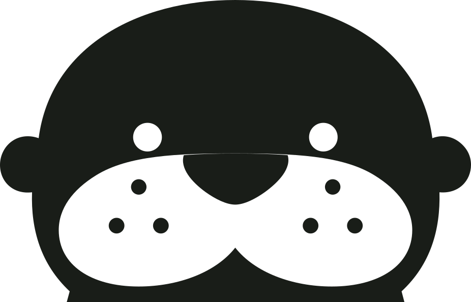

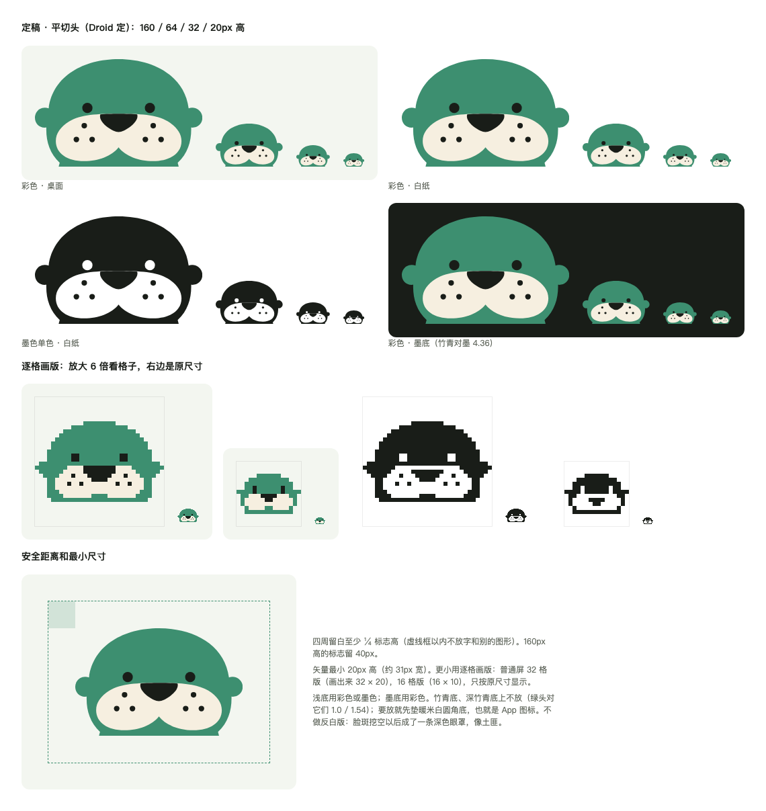 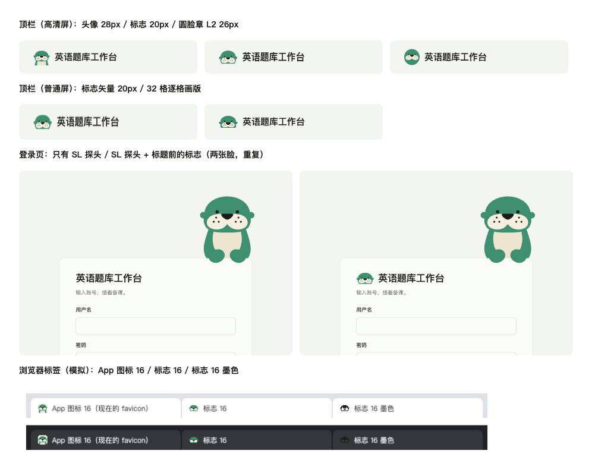

- **16px 简化版**：16px 下脸部细节看不清（K 画板），要单独画：在 16×16 的像素网格上逐格画，不从大图缩小；减少部位，加大眼睛点和鼻子四周的净空。2026-10-14 已按这条画了 16px 和 32px 的头像和 App 图标（Droid 定，第 45 条，§4.2「小尺寸版本」）。图形标志的 16 格、32 格版就从这两张头像取头到下巴的几行，去掉围兜、上下居中（第 62 条）；墨色版里鼻子和头之间留一行缝，16 格版的鼻子往下挪一行。
- **字标**：名字先放着（第 61 条），字标等重新拿起命名时再做。第 47 条曾定中文「他石」、拉丁 Tashi（§2）。在现成字体上改，见 §3.3。字形要符合 §1.4：胖而清爽，圆来自形体，带一点手写的人文感。
- **组合**：图形加字标的横排和竖排、安全距离、最小尺寸、单色版（墨色）。等字标。图形标志自己的安全距离、最小尺寸和单色版已定（上面第 62 条）；顶栏实景里先拿现在的页面标题「英语题库工作台」配标志：标志 20px 高配 14px/600 标题，间距 8px，上下居中。
- **头像的单色版 · 提案（Droid，2026-10-14，第 53 条）**：借 Owner 转来的复古头像组（深底白线、填色／浅色／线稿三种瓦片）的「一个形象配一套变体」，不借它的蓝色、描边主画法和多角色。用 Arrow 2 从母版头像直出三种，收了两种：
  - **墨色单色版** `design/brand-2026-10-13/mascot/variants/otter-head-mono.svg`：墨 `#191D18` 一色：竹青的部分变墨，脸斑和胸口挖空透底，眼睛挖成两个小孔，鼻子和 ∴ 仍是墨，鼻子四周留一道缝。用于传真、盖章、单色印刷和只能用一色的地方，16px 起可用。第一次出的鼻子和头粘在一起，第二次留了缝才收。
  - **墨线稿** `design/brand-2026-10-13/mascot/variants/otter-head-line.svg`：1.3 宽墨线，只用在 64px 以上的单色介质（刺绣、贴纸描边、单色周边），小于 64px 线会糊成一团。它是 §4.9「无描边」的唯一例外，界面里不用。
  - **竹青底反白版**：不用。Arrow 2 出的脸斑和五官变了形，和母版对不上；App 图标继续用暖米白底（第 34 条）。
  - 这两张只管头像。图形标志的墨色版另做了（`logo/mark-mono.svg`，第 62 条）；墨线稿标志没做，要用时再出。

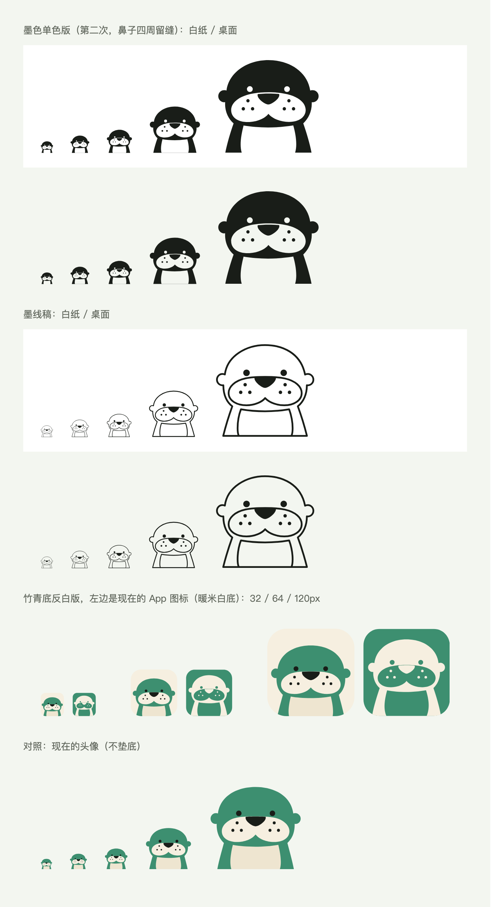
- **按场合用 · 提案**：宣传用完整组合，顶栏用图形加字标横排。尺寸越小，用越简的版本。第 62 条按实景改了两处：App 图标和浏览器标签用 App 图标（暖米白圆角底的头像），不用光的图形标志；登录页有 SL 探头，卡片里不放标志。
- **禁止用法**：拉伸、换色、加描边、加阴影、放在照片或花底上。

### 3.2 品牌色 · 已定（色板 Droid 定，第 59 条；印刷色未做）

见 §1.5（色值、差事、对比度、用色规则）。色板页 · Droid 定（2026-10-14，第 59 条）：Paper「主题 10 · 色板」页，导出在 `design/brand-2026-10-13/evidence/palette.png`。

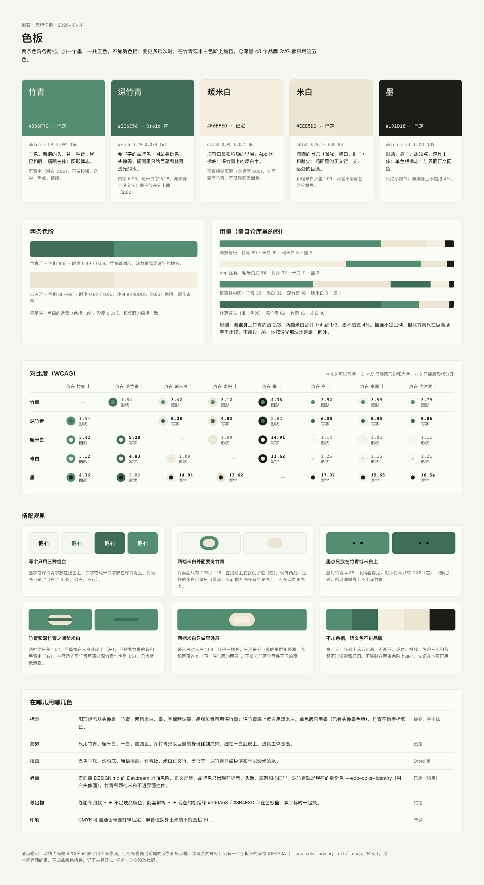

在哪儿用哪几色：

| 地方 | 用哪几色 | 状态 |
| --- | --- | --- |
| 标志 | 图形标志：竹青、暖米白、墨（没有围兜，所以不用米白）；单色版只用墨；不做反白版，墨底用彩色版，竹青和深竹青底上不放（§3.1，第 62 条）。字标默认墨，品牌位置可用深竹青；深竹青底上的字用暖米白 | 图形 Droid 定；字标提案，做字标时定 |
| 海獭 | 竹青、暖米白、米白、墨四色。深竹青只以巨藻的身份碰到海獭，缠在米白肚皮上。道具主体是墨（§4.5） | 已定 |
| 插画 | 五色平涂。原语插画：竹青纸、米白正文行、墨书签。深竹青只给巨藻、林冠透光的水和宣传大图的水（§5.2） | Droid 定 |
| 宣传大图 | 天暖米白，水深竹青，光米白，巨藻竹青，海獭照原样；标题墨，副句深竹青（§5.2，第 63 条） | Droid 定 |
| 界面 | 表面照 DESIGN.md 的 Daydream 桌面色阶，正文是墨。品牌色只出现在标志、头像、海獭和插画里。深竹青就是现在的身份色 `--eqb-color-identity` | 已定（沿用） |
| 导出物 | 卷面和四款 PDF 不出现品牌色；配套解析 PDF 的松烟绿不在色板里，做字标时一起换（§1.6） | 待定 |
| 印刷 | CMYK 和潘通色号要打样后定，屏幕值换算出来的不能直接下厂 | 未做 |

- **清点附记**：网站代码里 `#2C6E56` 除了用户头像圆，还用在卷面当前题的竖条和焦点框（`app/src/shared-ui/papersurface/PaperSurface.css`）、浏览页的角标；另有一个色板外的深绿 `#1E4A3A`（`--eqb-color-primary-text` / `--eqb-color-primary-deep`，14 处）。这些归界面和 DESIGN.md 管，不归品牌色板；记下来另开 UI 任务，这次没改代码。

### 3.3 字体 · 部分已定

- **界面与卷面 · 已定**：工具界面用 Inter + PingFang SC，卷面用 EQB Termes / EQB Source Han Serif，两条字道各守一层（DESIGN.md §3）。
- **Paper Mono · 已定（Owner 2026-10-13，看过真实页面对比）**：Paper 出的等宽字，v1.000 发布于 2026-10-07，授权 SIL OFL 1.1，可以商用和嵌入网页。8 个字重，另有可变字重（100–800）；约 800 个字形，覆盖拉丁字母、数字、箭头和制表符号，没有中文。所以它当不了全站唯一的字：页面上的中文仍由系统中文字体显示（苹果设备上是 PingFang SC），卷面中文仍是思源宋体。Owner 要求的三种用法已放进真实页面并排看过（Paper 文件 L 画板），按 Droid 的建议定。替换 Inter、做整个界面的拉丁字母和数字：不做，因为等宽字里空格和「·」也各占一整格，中西混排的间隙变宽，用户名像代码。只用于数字、年份、页码和短标签：不单独做，因为真实界面里它和 Inter 几乎看不出差别；只有字标也用 Paper Mono 时，才考虑顺带用在数字上。只用于字标和宣传标题：留到定名字时再比（宣传标题已先用思源宋体，见下面「宣传标题字」，字标比完再回看），用同一个名字做三版字标（Inter、Paper Mono、在 Paper Mono 上改字），放进顶栏和登录页。卷面、四款 PDF 和词典卡的英文词头不在候选内，它们归试卷版式标准和 DESIGN.md §3 管。工具界面目前不用 Paper Mono，不进代码。
- **字标 · 未开始**：在现成字体上改（提案），不从零造字，也不直接用系统字。所选字体的授权要允许商用和修改，比如 SIL OFL。名字是中文以后（第 47 条）· 提案：Paper Mono 没有中文，上一条说的三版（Inter、Paper Mono、在 Paper Mono 上改字）只用来比拉丁写法 Tashi；中文「他石」另找一款能商用、能修改的中文字体来改，比如思源黑体（SIL OFL）。
- **宣传标题字 · Droid 定（第 63 条）**：思源宋体 CN（Source Han Serif，SIL OFL，仓库里已有，`app/public/fonts/paper/source-han-serif/`）。标题用 Bold，副句和标志旁的名字用 Regular；英文和数字用它自带的拉丁字形，所以「AI」和中文同一套笔画。为什么用宋体：宣传图讲的是卷子和备课，宋体接的是卷面字道和「出版物主导」（DESIGN.md §1），一眼像印出来的东西；Inter / 苹方是工具界面的字，放进宣传图像软件截图。字号按画幅定：横版 1200×630 标题 48px、副句 22px、名字 20px；竖版 1080×1440 标题 76px、副句 32px、名字 26px（`illustration/promo/promo.html`）。DESIGN.md §3 的字号规则只管工具界面，不管这里。字标定了以后，名字换成字标；字标要是另选了字体，回头再看标题要不要跟着换。

### 3.4 图形语言 · 提案

- **原语**：领域图形一律由卷面原语拼成：正文行、药丸空、折角纸、点、书签（DESIGN.md §5 公认形法；图标理念页「特色」）。插画里的卷子和书也用同一套形。
- **石子**：只在海獭的状态插画里当道具，不升格为全站装饰图形。界面不加品牌点和品牌花纹（§1.6）。
- **水**：只用一两条细弧线暗示，不画写实水面。唯一的例外是林冠透光中图（第 58 条，提案）：米白光束在桌面上看不见，所以那张画一块深竹青平涂的水，上沿平直就是水面、下两角 16px 圆角，水里不画波纹、气泡和渐变。
- **巨藻 · 提案（Droid，2026-10-14，第 55 条）**：插画里唯一的植物形，`design/brand-2026-10-13/illustration/kelp.svg`。一株从底下的固着器长上来，茎上交替长着圆头叶片，平涂深竹青一色，不画气囊和叶脉。近处的巨藻用深竹青；远处的可以整株换成米白，只当景深，不承载主体的边（这是 §5.2「米白不直接贴桌面」的唯一例外）。画在深竹青的水里时，巨藻整株换成竹青（第 58 条）。巨藻和石子一样只在插画里出现，不当界面底纹、不铺满页面边，不升格为品牌花纹（§1.6）。

### 3.5 视觉规范手册 · 草案 0.4（版式 Droid 定，2026-10-15，第 64 条；0.2 补进第 65 条，0.3 补进第 66 条，0.4 记顶栏上线；内容的状态照各节）

手册是本文件的图版。每页讲一件事：先给图，再写规则，页脚注明出处条目。手册不另定规矩，页上的状态标记照各节抄；图和字对不上时，以本文件为准。

- **在哪里**：Paper「主题 13 · 规范手册」页，23 页：00 封面、01 目录与怎么读、02–22 内页。PDF 在 `design/brand-2026-10-13/manual/视觉规范手册-草案0.4.pdf`。0.2 改了 14 页的动效和「还没做的」；0.3 新加 21 页「3D 宣传版」，「还没做的」顺延到 22 页，15 页的平涂例外、01 页目录和页眉的草案号跟着改；0.4 网站顶栏换上了标志、浏览器标签换上了 App 图标，22 页「要改网站」去掉「顶栏和浏览器标签」一项。
- **目录**：品牌底层（02–03）→ 命名与标志（04–05）→ 颜色（06–07）→ 字体（08）→ 图形语言（09）→ 獭獭（10–15：设定与母版、三视图与小尺寸、表情与状态、道具与直立、日历与动效、场景与禁止项）→ 界面视觉（16–18：不靠海獭、插画体系、中图）→ 应用示例（19–21：登录页与空态、小尺寸与宣传、3D 宣传版）→ 附 · 还没做的（22）。原先计划里的图标、动效、语气沿用 DESIGN.md（§5.3、§5.4），并进 16 页；PDF 并进 19 页的导出物；App 图标并进 20 页的浏览器标签和小尺寸。
- **版式**：横版 1600×1132，长宽比约 √2，和 A4 横放一样。页眉左边是图形标志和「视觉规范手册 · 草案号」，右边是章名；页脚左边是出处，右边是页码。标题用 Noto Serif SC（和思源宋体同一套字形，接 §3.3 的宣传标题字），正文用苹方，数字和页码用 Inter。同一页里的「壳 · 内页模板（不导出）」是内页模板，加页从它复制。
- **怎么改**：先改本文件，决定写进对应一节和 §7；再改 Paper 里对应的那一页，页脚的出处跟着改；最后重新导出 PDF 放进 `manual/`，封面和页眉的草案号加一。Paper 只能把当前打开的那一页上的画板导出成 PDF，导出前先在 Paper 里切到这一页；按页序选 23 块画板合成一份，不选内页模板。
- **没放进的**：字标、横竖组合、口号和 PDF 出版标记等名字（第 61 条）；印刷色等打样（§3.2）。这些都列在 22 页。

## 4. IP 形象：海獭

  

### 4.1 角色设定 · 部分已定

- **物种 · 已定（Owner 2026-10-13）**：海獭。原来定的是水獭，泛指，不做海獭（第 2 条）。Owner 拿真实照片对照时指出，用石头当工具是海獭的习性；Droid 一查，本文件的来历和状态表里，石头和仰躺漂浮都是从海獭借来的。Owner 认为海獭的习性在正向引导上更有借鉴价值，定为海獭（第 24 条）。母版已在 2026-10-13 换成海獭版（第 27、28 条），同一天又换成 H1 大鼻子（第 33 条，§4.2）。
- **名字 · 已定（Owner 2026-10-14，第 47 条）**：獭獭，读 tǎtǎ，只在品牌位置用；工具界面的文案不用这个名字。用在哪 · 提案（Droid）：介绍、登录页、宣传物料、贴纸这类品牌位置；不让它用第一人称说话，不写「獭獭帮你找到了」（和下面「语气」一条一致）。「獭」的声旁是「赖」（《说文》「从犬，赖声」），不是人人读得准，科普文章常给它注音，第一次出现时注上拼音。叠字名谁都能用，很难单独注册成商标；吉祥物主要靠形象来认。§2 第 4 条担心的「獭」16 画说的是字标，吉祥物名不进小尺寸字标。
- **来历 · 提案**：现实里的海獭潜到海底找吃的。海底常常又暗又浑，它主要靠灵敏的前爪和胡须去摸。浮上水面以后，它仰躺漂着，把肚皮当桌子，把捞上来的贝壳摆在上面，再拿一块石头敲开。海獭是少数会用工具的哺乳动物；顺手的那块石头用完不扔，收进前肢下面的皮袋里，下次再用。我们把这几件事变成它在产品里的工作：在题海里摸到对的题，摆开给老师看，再把好题收好（§1.1 一句话）。会用工具不等于替老师拿主意：留哪道题，仍由老师定（下面「使命」一条）。形象上胡须只画成墨点（§4.2）。它常在巨藻林里觅食；休息时把巨藻缠在身上，免得睡着时漂走，这一条画成了「裹藻仰躺」（§4.4，第 55 条）。还有一个现成的画面：海獭睡觉时有时手拉手，免得漂散，可以讲陪伴；但容易画甜，用不用到画状态时再定（§4.9）。物种改成海獭以前，这里还写了水獭爱把小石子在爪子间抛着玩；那是亚洲小爪水獭这类小型水獭的习性，状态 01 跟着改了（§4.4）。
- **使命 · 提案**：海獭必须有差事。它出场是为了把看不见的 AI 过程演出来：找、翻、递、收，以及如实说没找到。没有差事就不出场。老师等待时陪一下，结果出来时交代一下。不教学，不打分，不替老师做决定。
- **性格 · 提案**：安静、好奇、手巧（§1.3）。
- **语气 · 提案**：海獭不说话。界面文案是产品在说话，不是海獭在说话；文案法见 DESIGN.md §9。

### 4.2 造型 · 部分已定

- **母版 · 已定（H1 大鼻子，Owner 2026-10-13，第 33 条）**：`design/brand-2026-10-13/mascot/` 下三个文件。`otter-front.svg` 是正面浮姿，仰躺漂着；2026-10-14 起是矢量 P，换掉了原来的 F2（第 39 条，见本条末尾）；`otter-head.svg` 是头像，裁到胸口，像半身像，不垫底；`app-icon.svg` 是 App 图标，暖米白圆角底（第 34 条，§4.7）。形体照 Astra 第 2 轮的 S+（宽鼻、侧耳、短扁尾巴、带趾的后脚），毛色是 H1：绿头，米白肚皮接进口鼻。图层：body（竹青的头、两只耳朵、背、手臂和尾巴），belly（米白的喉咙、胸口和肚子），muzzle（口鼻外圈，米白：肚皮那块形状落在头里的部分，用头的轮廓裁出，和肚皮同色连成一片），face（口鼻和脸颊里层，暖米白），nose（宽鼻，墨），claws（全身图里是两只带趾的后脚，竹青加米白趾尖），eyes，whiskers，water（两条水线，只在全身图里，可以单独隐藏）；App 图标另有 tile（圆角底）。头像原来的 disc（竹青圆底）去掉了。上面这套九层说的是头像、App 图标和原来的 F2。正面浮姿换成矢量 P 以后分八组，按原来的上下顺序：body（竹青：头和耳朵、身子、手臂、两只后脚和尾巴；头和身子是一整块），belly（米白），paw（竹青：抱在胸口的圆爪），face（暖米白脸斑），nose，eyes，whiskers，water（四条实心水线，可以单独隐藏）。P 没有单独的 muzzle 和 claws：口鼻的米白在 belly 里，后脚是四趾、无趾垫，归在 body。分组只是给路径加组名，路径和颜色一笔没改，渲染和 Paper 里的 P 逐像素一致。**2026-10-14 第 4 轮（第 44 条）**：三个文件都换成加了竹青下巴的重描版（§4.4 第 4 轮）：头像和 P 由 GPT Image 2.5 编辑只加下巴，再交 Telos 描；App 图标用新头像加原来的暖米白圆角底拼出，位置不变。新文件是 Telos 的路径，没有按上面的部件分组；头像的大小和框取按两眼间距对齐上一版。五官整体保持，但有重描偏差：Astra 量过，240px 头像的眼径大约 0.6px，胡须点整体往下约 1.3px，眼距和框取基本不变，∴ 仍是一上两下。上一版在提交 `2ccae0cb` 里。
- **换成 H1 大鼻子（Droid，2026-10-13）**：D2 母版本来就是 S+ 的宽鼻和 H1 的轮廓，和 H1 只差浅色放在哪里。所以 Droid 没有重画，只改颜色：头和两只耳朵从沙白换成竹青，喉咙、胸口、肚子从沙白换成米白；形体、眼睛、∴、鼻子和九个图层的坐标一笔没动。换完的配色和 Astra 第 2 轮的 G+ 一一对得上。登录页 P2 探头的两张图（身子在框后、前爪在框前）用同一条规则换了色。`evidence/` 的三张截图（登录页 240px P2、个人空间空态 150px、顶栏 28px）用新母版重拍，框取不变。
- **母版 D2 · 已换下（第 27、28 条）**：D2 是沙白 `#E9DDC5` 的头、喉咙、胸口和肚子连成一片，竹青只留在背、手臂、尾巴和脚上；头像垫竹青圆底，App 图标竹青圆角底。最后一版在提交 `8e4bd673` 里。
- **母版 v0 · 已换下**：v0 是照水獭画的 v2 正面：站着，尾巴粗长渐尖，圆顶，耳朵长在头顶两侧。v0 期间定下的 e5 眼睛和 A2 胡须点原样带进海獭版。v0 的四个文件（正面、头像、App 图标、捧石子变体）留在 git 历史里，最后一版在提交 `c36560bb`。
- **部位与配色 · 已定（Owner 2026-10-13，第 33 条改；2026-10-14 加竹青下巴，第 44 条）**：头、耳朵、下巴、背、手臂、尾巴和脚竹青；脸斑暖米白；喉咙、胸口、肚子米白；后脚趾尖米白；眼睛点、鼻子和胡须点墨。只露头时（顶栏）不垫底。
  - **两块浅色各是什么 · 已定（Owner「要下巴」，第 44 条）**：脸斑是口鼻和两颊，属于五官，和眼睛、鼻子、∴ 一起组成脸；喉咙到肚子的米白是身体的围兜。竹青下巴把两块隔开：脸斑四周都被竹青包住，下沿是一道中间略厚、两头接进脖子的竹青。所以两块浅色不连成一片，脸斑也不往下接进喉咙。「围兜」只是胸腹毛色区的叫法，不要求它画得像衣服（Astra 审稿建议）。暖米白另外只用在道具（02 的书页、03 的贝壳、04 合上的书的纸页边）和 App 图标的底上。
  - **为什么要隔开 · 提案（Droid）**：暖米白对米白只有约 1.1:1，挨在一起会糊成一块浅色，脸的下沿就没了；隔一道竹青，小尺寸也认得出脸。米白被竹青包住，也和 §4.7 的贴底规则一致。第 43 条曾按「米白往上接进口鼻外圈」统一成不留绿，Owner 看了全套以后改成要下巴，第 43 条作废。上一版是 D2（第 27、28 条）：「竹青只留在背、手臂、尾巴和脚上；头、耳朵、喉咙、胸口和肚子连成一片沙白；只露头时垫竹青」。再早是「身体竹青；脸（口鼻和脸颊）暖米白；肚皮和爪尖米白」。图层名见上面「母版」一条。
- **眼睛 · 已定（Owner 2026-10-13，M 画板选 e5）**：大小和位置用 J 画板的预设 p2：放大 1.15 倍，两眼各往脸中线收 24、往下移 12（母版坐标，半径 35.8）。颜色从暖米白改成墨。原因：暖米白眼睛对竹青只有 3.42:1，又挨着正下方同色的口鼻区，放进真实页面后 150px 已经难认，16px 完全消失，脸上最显眼的就成了鼻子和胡须点；墨色眼睛到 16px 还看得见，和鼻子、胡须点一起组成一张脸。几档大小和位置的差别在真实页面里几乎看不出。
- **胡须 · 已定（Owner 2026-10-13）**：胡须只画成口鼻上的墨点，不画胡须线（第 13 条：改文档，不改形象）。表情和动作里不再写「胡须前伸」「胡须轻动」。点的排法按记忆点方向 A 换成 A2（第 23 条）：每颊三个点排成一个 ∴（「所以」），一上两下，是等边三角形，点心距 116，点半径 20（母版坐标）；三角的中心和原来三个点的中心重合。
- **空手 · 已定**：基础形象空手，两只爪子分开搭在胸前。海獭版仰躺漂着，两只前爪收在胸口。原来另有一个捧石子的变体，只给状态插画作参考；它是照水獭画的（站着捧石子），换母版时 Droid 把它从 `mascot/` 拿掉了，留在提交 `c36560bb` 里。海獭捧石头的样子到画状态插画时从海獭版母版画（§4.4）。
- **记忆点 · 已结束（主题 1）**：Owner 2026-10-13 担心现在的样子没有记忆点，定为下一件事，排在三视图前面。同一天做完 A、海獭版母版和 D 以后，Owner 说「不搞 5s 测试，下一个议程」，记忆点到此结束，进主题 2 三视图（第 32 条）。
  - **诊断 · 提案（Droid，见 Paper「基线测试」画板）**：能被记住的只有颜色和米白口鼻。全身剪影靠那条粗长的尾巴，还看得出是水獭一类；头像剪影只剩圆顶加两侧小圆耳，小熊、海豹、仓鼠都说得通。头像到 32px 以下只剩眼睛、鼻子和米白口鼻；头像母版是方形裁切，放进圆形头像会切掉耳朵外缘。以后做教育 agent，最常出现的是头像，所以记忆点最好落在头上。单靠颜色也撑不住：教育类的绿色吉祥物，很多人先想到多邻国的绿猫头鹰。
  - **四个方向 · 按顺序一个一个试（顺序 Owner 定；物种改成海獭以后改过，见下面「物种改成海獭以后」）**，每个只改一处：
    - A「所以」胡须：两颊的胡须点原来一上两下，正好是 ∴。把这个巧合定成签名，再看它能不能动成「正在想」。要过两关：∴ 来自数学，要看其他学科的老师读不读得懂（§1.2 全学科）；要动起来，就要改 §4.3「胡须点不动」。
      - **结果 · 已定（Owner 2026-10-13「听你的」，采纳 Droid 批注里的三条建议）**：A2「舒展」留下，作近看的签名，四个母版的胡须点已换成 A2（上面「胡须」一条）。「正在想」先不定，两个候选记在 §4.6，到动效那一步再选；§4.3 暂时不改。方向 A 不画第 2 轮，进方向 B。画稿在 Paper「记忆点 · 方向 A」Astra 和 Droid 各一块画板，批注卡在两块中间。
      - **依据**：Astra 在 240px 头像上比了三档间距（A1、A2、A3），A2 三点拉开，两颊一眼看得出 ∴，又不抢眼睛和鼻子。Droid 把 A2 放进真实页面（Droid 画板的「03 续」，取景同 K、M 画板）：登录页（全身 240px）两颊都认得出 ∴；顶栏（头像 28px）每个点只剩约 1px，脸比原来干净，但看不出 ∴；空态（全身 150px）凑近才看出是三角。Astra 也记下 32px 圆头像上仍然弱，剪影没有变化。所以 A 是近看的签名，管不了小头像好不好记；小头像要靠改轮廓，正好是方向 B 要试的。Astra 给的一句话描述是「一只两颊各带一个『所以』的水獭」。
      - **还没过的关**：其他学科的老师读不读得出 ∴，还没有证据，放到最后的 5 秒测试里一起看（下面「评估」一条）。Astra 建议测试时不提示符号的意思，看 5 秒后请人复述或画出来，再问联想到哪个学科。Owner 后来定不做 5 秒测试（第 32 条），这一关没有测；∴ 照旧是近看的签名。
    - B 扁头低耳：真实水獭的头扁而宽，耳朵小而低，剪影更像水獭。要改母版形体（§7 第 3 条）和 §4.9「头身比例与母版一致」。
      - **第 1 轮 · Astra（2026-10-13）**：只改头顶和两只圆耳，脸、眼睛、鼻子和胡须点都没动。三档（母版坐标，原来头顶约 y=56）：B1 头顶压到 y=125、耳朵半径 65；B2 压到 y=185、半径 58；B3 压到 y=245、半径 44。推荐 B2：B1 的熊感退得不够，B3 的耳朵几乎没了，像海豹。Astra 也记下，B2 在 32px 圆裁里特征仍细，右耳外缘还会擦到圆裁边。画稿在 Paper「记忆点 · 方向 B · Astra · 第 1 轮」。
      - **之后 · 已定（Owner 2026-10-13，第 25 条）**：B 不再单独往下做，并进海獭版母版（下面「物种改成海獭以后」）；Droid 没有接着做 B2 的真实页面对比。
      - **怎么并 · 提案（Droid）**：海獭的头是圆的，耳朵比水獭还小，所以 B 的经验只用一半：耳朵可以小到 B3 那样，海獭本来就是这样；头顶不用压得像 B2、B3 那么扁。头像会不会像海豹，要靠脸和口鼻分开，不靠留大耳朵。
    - C 毛笔尾：尾巴本来粗而渐尖，尾尖蘸墨就是一支笔。但毛笔在 §4.5 是语文的学科道具，基础形象会带上语文味（§1.2 全学科）；头像里也看不到尾巴。
      - **作废 · 已定（Owner 2026-10-13，第 25 条）**：海獭的尾巴短而扁，做不成毛笔。
    - D 探头出场：不改样子，规定它总从卡片或页面边缘探头，像刚浮出水面。§4.7 的登录页和 §4.4 的状态 05 已经在探头，要做的是把它定成所有出场的规矩。
      - **物种改成海獭以后**：排在海獭版母版之后试（Owner 2026-10-13，第 25 条）。提案（Droid）：海獭本来就住在水里，「从水里浮上来」比水獭更自然；如果仰躺漂着当基础形象，D 可能直接定成出场的规矩。
      - **第 1 轮 · Astra（2026-10-13）**：从海獭版母版出发比了五件事。① 从哪条边出来：跟着内容走，从当前任务的容器边出来，不固定在屏幕边上。② 露多少：推荐露到前爪搭边，空间小的容器露到肩。③ 边怎么画：E1 容器边就是水面、E2 另画一条水线、E3 直接裁切，推荐 E1；没有容器的空态可以借一条水线。④ 小尺寸：原样、下沿截断、加水线三种并排，28px 和 16px 都看不出探头，保留母版。⑤ 状态：S1 全部直起搭边；S2 只让回应型的状态探头，阅读和等待保留 F2，推荐 S2。为探头另画了直起上身的姿势 P1：去掉躯干的倾斜，两只前爪左右搭在边上，下沿被边裁掉；头、眼睛、鼻子和 ∴ 的坐标、大小、分色都没动，F2 照旧负责仰躺漂浮和阅读。范围比了三档：R1 所有出场都探头；R2 回应时探头，用在登录入口、结果末尾、没找到和容器空态；R3 只用在登录和没找到，作 R2 的退路。合起来推荐 P1 + E1 + R2。Astra 记下三个疑点：在真实页面里像浮上来还是像被截断；摊手读不读得出「没找到」，手腕是不是还太垂；五秒后记不记得住这种出场。她也提醒，D 不改头部剪影，代替不了物种识别测试；「基线测试」画板还是水獭 v0，所以这一轮另加了海獭版母版作直接对照。一句话提案是「它把两颊的『所以』带到卡片边，空着手探出头来」。九个图层保留。画稿在 Paper「记忆点 · 方向 D · Astra · 第 1 轮」。
      - **第 1 轮 · Droid（2026-10-13）**：Droid 复制 Astra 的画板接画。画法只改一处：P2 把 claws 里最后两条前爪路径挪到新图层 paws，画在边的前面，路径一笔没动，身子照旧在边上裁掉。然后把 P1、P2、两版「没找到」和加水线的小尺寸放进登录页 240px、个人空间空态 150px、顶栏 28px，和现在的母版并排。Astra 交代的三件事：① 不挡操作：登录页几种摆法都在卡片上沿以外，不碰标题和输入框；空态探头也不挡「去找题」。② P1 像被截断：真实页面的边只是一条 1px 浅线（`#E3E8DF`），卡片和桌面几乎一样亮，P1 的前爪下沿正好被这条线切平，像图被裁了一刀。P2 的前爪越过边约 85 个母版单位（登录页约 9px、空态约 6px），像扒着卡片沿往外看。试过把前爪再抬 30，身子轮廓会在爪子外侧露出一个台阶，所以不抬。③ S2 的摊手还读不出：在真实页面里读成两条胳膊搭在墙头，像歇着或泄了气，不是 §4.4 的「两只前爪摊开，空着」。Droid 试着把前爪从肘部朝外抬开，方向对，画法没过：爪子仍被边切平，脚趾在 240px 看不见；前爪路径从 y≈1008 起就包着整条前臂，没法直接左右翻，留给第 2 轮。另外两项：空态 150px 探头时，海獭离开了文案和「去找题」，卡片里空出一大块；顶栏 28px 加的水线只有约 0.26px，和原样看不出差别。画稿在 Paper「记忆点 · 方向 D · Droid · 第 1 轮」，批注卡在两块画板中间。
      - **建议 · 提案（Droid）**：① D 不当所有出场的规矩，定成回应时刻的出场方式：登录页、03 待确认、05 没找到探头；空态照 §4.4 的 01 空闲，F2 留在容器里；02 找题中和 04 完成要完整动作，用 F2 仰躺；顶栏、App 图标和 32px 以下用母版头像，垫竹青。相当于 Astra 的 R2 去掉容器空态。② 姿势用 P2，前爪在边前；登录页靠右，和现在同一位置。③ 边照 Astra 的 E1：卡片边就是水面，不另画水线。④ Owner 定了以后画第 2 轮（最后一轮）：Astra 沿用 P2 的搭边，画 05 的摊手（掌心朝上、往两边摊开，两爪中间什么都没有）和 03 把东西递过边，两张放在一起看；Droid 再放进真实页面，交 Owner。⑤ 一句话接 Astra 的句子，只改动作：一只两颊各带一个「所以」、扒着卡片边探出头来的海獭。记不记得住，和母版一起交给 5 秒测试。
      - **结果 · 已定（Owner 2026-10-13，第 29 条）**：Owner 选了 Droid 的建议。D 不当所有出场的规矩，只在三处探头：登录页、03 待确认、05 没找到；其余地方都不探头。姿势用 P2，两只前爪画在边的前面。所以上面 D 那一行「把它定成所有出场的规矩」不再成立。还是提案的：E1「卡片边就是水面，不另画水线」，两人一致，Owner 没有单独定；05 的摊手和 03 把东西递过边，照「建议」第 ④ 条画第 2 轮（最后一轮）。
      - **第 2 轮 · Astra（2026-10-13）**：沿用 Owner 定的 P2，只画 05 和 03，登录页不再画。05 的前臂留在身子两侧，掌面朝上、往外翻开，两边对称，中间空出一整块；掌根比肘部高，趾尖又比掌根高，手腕不再往下垂；越过边的是前臂，保留圆弧，不被卡片边切平；脚趾改成短圆趾，带米白趾尖。03 两只前爪托着一块墨色石头越过边，两边的趾尖扣住石头，整个头轻轻歪 3°。九个图层和 paws 都保留，03 在 paws 里另有 stone 图层。两张都交了 420px 高的标准图，并按 240px、150px 实际像素看了爪子：240px 看得出短圆趾和米白趾尖，150px 只剩小亮点，她不把「数得出几个趾」当作小图的标准。Astra 的判断：05 读得出「空着」，手腕不再垂，推荐这版；03 读得出「递给你看」，也推荐这版，但单看图仍可能读成「捧着一块石头」，不能保证读出「你看对不对」，要放进真实的确认卡片核对，不靠加问号、眉毛或气泡补意思。石头还是贝壳留到五个状态。这是最后一轮。画稿在 Paper「记忆点 · 方向 D · Astra · 第 2 轮」。
      - **第 2 轮 · Droid（2026-10-13）**：Droid 复制 Astra 的画板接画，Astra 的稿一笔没改，只把导出的矢量放进真实页面。05 放进 AI 找题的「没找到匹配」：首页搜「讲恐龙灭绝的阅读」，本地题库真的没有。03 放进 AI 找题的结果卡：现在没有单独的确认界面，结果卡里列着 AI 找到的卷和每套的推荐理由，老师挑了才加入草稿卷，最接近 §4.4 的「AI 结果请老师确认」。登录页 P2 用 Astra 的导出重拍，和第 1 轮一样。页内用空态的 150px，240px 只作对照。Astra 交代的两件事：① 越边：两处都不挡字。05 的肘部越过卡片边约 91 个母版单位（150px 下约 6px），03 的前爪约 125 个（约 9px），都落在卡片 20px 的上内边距里。页面要跟着改两处：「没找到匹配」现在只是一行字，没有卡片边，Droid 把它放进和结果卡同款的卡片，上面多留 32px，海獭露出卡片上沿约 90px；结果卡上面有一条通栏的提示，海獭的头和上身会压住它的右端，提示收到文字那么宽以后就什么都不挡。05 用 240px 更清楚，但上面要多留 86px，比一行字的卡片还抢眼。② 动作：05 读得出「这次没摸到」，两只前爪在卡片沿上往两边打开，中间空着，和下面那句「没找到匹配」连着读。03 的位置成立，动作读成「抱着一颗黑球」：石头约 420×300 个母版单位（150px 下约 29×21px），是全图最黑、最大的一块；米白高光让它像球；头歪 3°，150px 下两只眼睛只差约 1.6px，看不出歪。Droid 在副本上试了两版：石头和前爪下移 90，读成把球按在桌沿，不比原稿好；石头去掉高光、缩到 0.8，不再像球，但还是「拿着」，不是「递过来」。所以「递过来，你看对不对」靠正面一个姿势在 150px 里撑不起来，要靠语境：海獭出现在 AI 结果卡的边上，卡里写着找到了什么、为什么推荐。这和 Astra 的判断一致。画稿在 Paper「记忆点 · 方向 D · Droid · 第 2 轮」，批注卡在两块画板中间。
      - **第 2 轮的建议 · 提案（Droid）**：① 05 照 Astra 的稿定，页内 150px；做进页面时，「没找到匹配」那行字改成和结果卡同款的卡片，上面给海獭留约 90px。② 03 的姿势和位置照 Astra 的稿定：两爪和石头画在边的前面，靠右；结果卡上面的提示不再通栏，右边留出约 100px 宽、90px 高给海獭。③ 03 那件东西的样子（高光、大小、石头还是贝壳）和歪头的角度，到五个状态一起定，可以从去高光、缩到 0.8 起步（§4.4、§8 第 4 条）。④ 登录页继续 P2，Owner 看过以后重拍 §4.7 的截图。⑤ 方向 D 不再加轮次；做进代码是以后的事，这一轮没碰 app。
      - **结果（Owner 2026-10-13，第 30 条）**：03 已定。Owner 在问卷里选了「照提案定，石头留到五个状态」：03 的姿势和位置照 Astra 的稿子，两只前爪和石头画在边的前面，靠右；结果卡上面的提示不占满整行；石头的样子（高光、大小、石头还是贝壳）和歪头的角度留到五个状态。05 没定：Owner 说「先不定，再看看」，画稿和实景照旧在两块第 2 轮画板里。登录页截图选「现在重拍」，已用 P2 重拍（§4.7）。还是提案的：03、05 在页内用 150px；05 居中，「没找到匹配」改成卡片。
      - **结果（Owner 2026-10-13，第 31 条）**：Droid 列出还开着的问题后，Owner 说「听你的」，即照 Droid 的提案定。05 照 Astra 的稿子，页内 150px，居中；「没找到匹配」改成和结果卡同款的卡片，上面给海獭留约 90px。03 也用 150px。E1 卡片边就是水面，不另画水线。「你看对不对」靠 AI 结果卡的语境，不加问号、眉毛或气泡。方向 D 到这里全部定了；做进代码是以后的事。
  - **物种改成海獭以后 · 已定（Owner 2026-10-13 同意 Droid 的提议，第 25 条）**：先把母版改成海獭，再接着试记忆点。顺序改成：A（已定）→ 海獭版母版（并入 B）→ D → 5 秒测试；C 作废。
    - **海獭版母版 · 已定，已换（Owner 2026-10-13，第 27、28 条）**：从现在的母版（e5 眼睛、A2 胡须点）出发，照真实海獭改形体，最多来回两轮（第 20 条），第 2 轮是最后一轮。
      - **原样带过去**：眼睛、鼻子、∴ 胡须点，§1.5 的颜色，七个部位的图层名，平涂无描边，基础形象空手、爪子搭在胸前。
      - **要改**：头圆而宽，耳朵小而低，几乎贴着头；尾巴短而扁，不再粗长渐尖。这会改母版形体（§7 第 3 条）和头身比例（§4.9），所以要等 Owner 确认才换母版。
      - **要并排试**：脸的米白要不要往上扩，包住眼睛。真实海獭的脸常发白，但 v3、v4 的骨白脸包住眼睛像土匪（第 3 条），所以两版都画，放进真实页面再判断。后脚画不画成鳍。站着还是仰躺漂着当基础形象：海獭站着时没有长尾巴撑剪影，可能比水獭更难认；仰躺漂着、爪子搭在胸前，是海獭最认得出的样子。
      - **第 1 轮 · Astra（2026-10-13）**：头顶从约 y=56 压到 y=90，头圆而宽；耳朵半径 44、中心 y=445，几乎贴着头；眼睛、鼻子和 A2 点的坐标不动。脸画两版：H1 只留口鼻，H2 米白往上包住眼睛。身体画三版：S 站着，F1、F2 仰躺漂着，F2 把两只后脚画成鳍、放在前景；水是能单独隐藏的第八个图层 water。推荐 H2 × F2。Astra 也记下，32px 圆裁的剪影仍接近海豹。画稿在 Paper「记忆点 · 海獭版母版 · Astra · 第 1 轮」。
      - **第 1 轮 · Droid（2026-10-13）**：Owner 问「海獭不是整个脸都是白的吗」，还没想好，要几种都放进真实页面看。Droid 在 Astra 画板的副本上加了两版：H2b 白到两颊边，绿只留在头顶、耳朵和越来越细的两侧；H3 整个头都白，耳朵也白。四张脸都配 F2，放进登录页 240px、顶栏 28px、空态 150px，另做 App 图标。结果：H2 三处都清楚，米白四周有竹青包着。H2b 白脸最大，但两颊下缘直接碰到页面，暖米白对桌面只有 1.05，那一段轮廓就没了。H3 只露头时（顶栏、登录页）头化进页面，眼睛和鼻子像浮着；全身时有绿身体托着才看得出；放在竹青底上最好看。Astra 交代的三项检查：白脸不像土匪（眼睛周围没有深色带），只是有点像兜帽；前爪清楚，后鳍在 150px 读成两只圆脚；28px 下耳朵小了，不再像熊，但海獭和海豹还分不开，留给 5 秒测试。画稿在 Paper「记忆点 · 海獭版母版 · Droid · 第 1 轮」，批注卡在两块画板中间。
      - **建议 · 已收回（Droid）**：原来建议脸以 H2 为底，上沿抬一点，四周一路留绿边（28px 时至少 1px），守住 §4.7 的贴底规则；H3 不当母版，H1 留作退路；身体用 F2，后鳍加宽、压扁。Owner 看了说像海豹，留绿边也纠结（下一条），Droid 收回。
      - **Owner 的反馈（2026-10-13）**：看着有点像海豹；「如果是说有一个绿边的话，好像有点纠结」。Droid 复查的原因 · 提案：① 耳朵等于没有：最外沿 x=646，和脸颊最宽处（约 645）一样宽，只在侧面鼓起约 22，28px 时约半个像素。方向 B 时 Droid 说耳朵可以小到 B3、靠脸来和海豹区分，这个判断错了。② 白色圆脸配墨点眼和小鼻子，正是海豹宝宝的画法。③ F2 的后脚画成鳍，也是海豹的特征；读成脚反而像海獭，所以「后鳍加宽、压扁」一起收回。④ 那圈绿是为贴底规则加的，海獭身上没有，所以看着像兜帽；白脸配一圈绿或只有头顶绿，小尺寸看像戴了顶绿帽子。⑤ 根子上：只有竹青和暖米白两色时，白头要在浅色页面上看得见边，旁边只能是绿。
      - **第 2 轮 · 已定（Owner 2026-10-13，第 26 条）**：三条路都画，放进同样的真实页面比。① 白头，头（连耳朵）换成浅沙色，候选 `#DCCBAA`，口鼻和脸颊仍是暖米白，不留绿边。浅沙色对桌面约 1.46:1（暖米白只有 1.05:1），但暖米白口鼻对它只有约 1.39:1。浅沙色不在 §1.5 里，只在这一轮试，算第 20 条「只用 §1.5 的颜色」的一次例外。② 白头保持暖米白（即 H3），只露头时（App 图标、头像）垫竹青底，全身时靠绿身体托着。③ 绿头 H1 作对照。每条路再试一版大一号的鼻子：真海獭的鼻头又大又宽。三条都要改：耳朵伸出脸颊最宽处约 80（28px 时约 2px），长在头的两侧、不上头顶（上头顶像熊）；尾巴多露一点（海豹看不到尾巴）；后脚画成带趾的脚。身体这一轮继续画 F2。H2、H2b 这种白脸配绿顶或绿圈的分法，这一轮不画。Astra 先画（第 20 条）。
      - **第 2 轮 · Astra（2026-10-13）**：三条路各画原鼻和宽鼻两版，共六稿：S0、S+ 浅沙头，W0、W+ 暖米白头，G0、G+ 绿头。W 只露头时垫竹青圆底，App 图标用竹青底。宽鼻比原鼻宽约 35%、高约 20%。耳朵伸出脸颊、长在头的两侧；尾巴往左后方多露一截，仍短而扁；后脚改成五趾的短脚。身体仍是 F2，眼睛和 A2 点原位，七个图层保留。推荐 S+（浅沙头 × 宽鼻 × F2），代价是小尺寸分色偏弱：浅沙对桌面约 1.46:1，暖米白口鼻对浅沙约 1.39:1。W+ 最清楚但像圆章，G+ 留作对照。画稿在 Paper「记忆点 · 海獭版母版 · Astra · 第 2 轮」。
      - **Owner 的反馈（2026-10-13）**：看了 Astra 的第 2 轮说「我觉得有点怪怪的，就是绿衣服，然后沙环领。哎，我真的觉得前有狼后有虎。」
      - **第 2 轮 · Droid（2026-10-13）**：Droid 在 Astra 画板的副本上接画，把六稿放进登录页 240px、顶栏 28px、空态 150px，另做 App 图标（64、32、16px）。Droid 查的原因 · 提案：毛病不在选哪种浅色，在颜色从哪里断开。S+ 的头和身子分界横在脖子上，浅沙又从两颊下面绕回来围住口鼻，就读成领子和衣服。只把头换成竹青色阶上浅一档的 `#9CC1B0`（D1），卡其制服的感觉没了，脖子那条线还在，像浅绿帽子配绿衣服。Droid 于是只改颜色、不动形体，做了两版。D2 把肚皮那一个形状也换成浅沙，头、喉咙、胸口、肚子连成一片，竹青只留在背、手臂、尾巴和脚上，分界顺着身子竖着走；成年海獭本来就是头、喉咙和胸口比身上浅。口鼻照旧是 Astra 的两层米白。D3 结构相同，颜色换成 `#9CC1B0`。结果：D2、D3 在登录页和空态不再像穿衣服。顶栏 28px 里 S+ 和 D2 几乎一样，海獭和海豹仍要靠 5 秒测试分。浅沙头不垫时对桌面 1.46:1，垫竹青后浅沙对竹青 2.46:1；W 不垫时头化进页面。尾巴和趾缝在 150px 看得见。画稿在 Paper「记忆点 · 海獭版母版 · Droid · 第 2 轮」，批注卡在两块画板中间。
      - **建议 · 提案（Droid）**：毛色用 D2；只露头时（顶栏、App 图标）垫竹青，接受圆章感；宽鼻、侧耳、尾巴、带趾的脚和 F2 都照 Astra 的 S+。备选一是 G+ 绿头：最省事，不加颜色，本节的「部位与配色」和 §4.7 的贴底规则都不用改；但没有浅色的头，海獭的线索只剩宽鼻和侧耳。备选二是 D3：在竹青色阶上加档，§1.5 本来允许；但全身都是绿色调，浅头不像毛色。
      - **已定（Owner 2026-10-13，第 27 条）**：Owner 看过两人的第 2 轮后说「那我决定是你推荐的那个」，即上一条 Droid 的建议：毛色用 D2，头、喉咙、胸口、肚子连成一片浅色，竹青只留在背、手臂、尾巴和脚上；只露头时（顶栏、App 图标）垫竹青；宽鼻、侧耳、尾巴、带趾的脚和 F2 照 Astra 的 S+；换成海獭版母版。
      - **D2 往白调 · Droid（2026-10-13）**：Droid 开始换母版时，Owner 又问：「W+ 跟 D2 之间有没有搞头？W+ 够白……D2 是沙白，能不能沙白多一点点，再白多一丢丢？」Droid 不动形体，只把那片浅色沿 OKLCH 从浅沙往暖米白走了三档：往白 ¼ `#E2D4B7`、往白 ½ `#E9DDC5`、米白 `#EEE5D0`。走到四分之三正好落在米白上，所以第三档直接用色板里的米白。三档和 D2、W+ 一起放进登录页 240px、空态 150px、顶栏 28px 和 App 图标。结果：只露头时垫着竹青，越白越清楚，对竹青从浅沙的 2.46 升到往白 ½ 的 2.91、米白的 3.12。全身直接放在页面上时，越白，头顶和耳朵的边越淡，对桌面从 1.46 降到往白 ½ 的 1.23、米白的 1.15，W+ 是 1.05。口鼻也越来越不显：往白 ½ 还看得出（暖米白对头 1.17）；到米白，口鼻外圈和头同色，只剩里面一小块暖米白（1.09），口鼻几乎没了；再往白就是 W+，外圈反过来比头深。往白 ¼ 和 D2 几乎看不出差别。画稿在 Paper「记忆点 · 海獭版母版 · Droid · D2 往白调（Owner 追问）」。
      - **建议 · 提案（Droid）**：用往白 ½：比 D2 明显白，三个页面里头的边和口鼻都还在。另一个选法是米白：一种颜色都不加，代价是口鼻几乎看不出，头的边也开始发虚。
      - **已定（Owner 2026-10-13，第 28 条）**：Droid 把四档摆给 Owner 选，Owner 选了往白 ½ `#E9DDC5`，即 Droid 的建议。§1.5 把它记作沙白，是米白色阶上最深的一档，色相和米白、暖米白相同。
      - **换母版（Droid，2026-10-13）**：Droid 随后换了 `mascot/` 的母版文件，重拍了 `evidence/` 的三张截图（上面「母版」一条），并跟着改了 §1.5 的色板和对比度、本节的「部位与配色」、§4.7 的贴底规则和头像、App 图标的底色、§4.9 的「永远保留」和「永远不做」。改动里直接复述 Owner 决定的部分记为已定，Droid 推出来的规则记为提案。
    - **撞车**：海獭形象的熟人比水獭多，比如 Chiikawa 里的海獭、《ぼのぼの》的主角。下面「评估」的一句话描述，要能把我们和它们分开。
  - **评估 · 提案**：剪影；头像圆裁到 32px；一句话描述（不提颜色，也能把它和别的海獭分开）；真实页面（登录页 240px、顶栏 28px、空态 150px）；能不能演 agent 的状态（想、找到、没找到）。最后 Owner 找两三个人看 5 秒，凭记忆画出来。
    - **5 秒测试 · 不做（Owner 2026-10-13，第 32 条）**：没有测的两件事留作已知的局限：28px 头像里海獭和海豹分不太开；其他学科的老师读不读得出 ∴，没有证据。
- **三视图与比例 · 已定（主题 2，Owner 2026-10-13 开始，2026-10-14 定 V2，第 32、40 条）**：正面、侧面、背面、四分之三侧，加比例规范，以头高为单位写头身比、眼距、耳位、爪长、尾长。这是后面所有状态图不走样的前提。照第 20 条和 Astra 协作，Paper 里新开一页「主题 2 · 三视图」，第一块画板是协作看板。
  - **怎么画 · 提案（Droid）**：① 转面用直立的姿势：上身直起，像 03「立在水里」，下半身、后脚和尾巴都画出来，不画水线；母版的 F2 仰躺另放一张，作姿势参考，不转面。理由是仰躺的背面就是水底下看上去的样子，没用；状态里「立在水里」和探头（P2）都要看得到侧面和四分之三侧。② 从海獭版母版出发，头、眼睛、鼻子、∴ 和配色都不改；侧面和背面上沙白和竹青的分界照 §4.2「部位与配色」走：背、手臂、尾巴和脚是竹青，喉咙、胸口、肚子是沙白。③ 四张同一高度，用水平参考线对齐眼睛、鼻子、肩、肘、脚底；比例写在旁边，以头高为 1。④ 侧面要回答两个母版正面看不出的问题：口鼻往前伸多少，尾巴从哪里长出来、多长。⑤ 交完照惯例放进真实页面看：侧面和四分之三侧能不能用在登录页和状态图里。
  - **第 1 轮 · Astra（2026-10-13）**：Astra 建了 Paper 页「主题 2 · 三视图」和协作看板，交了直立空手、前爪收在胸前的四面，各 420px 高，五条水平参考线（眼心、鼻心、肩、肘、脚底），四张都不画水线；F2 仰躺原母版另放一张作参考。九个图层保留，看不到的部位隐藏，不删层。比例以头高 H 为 1（头顶到下颌，不含耳朵）：全高约 2.97H（头 1 : 身 1.97），头宽 1.30H、连耳 1.51H，眼距 0.57H（两眼中心）、眼径 0.088H，耳心在头顶下 0.52H、耳径 0.18H；提案值：前爪约 0.30H（腕到爪尖），尾长约 0.85H（沿中线），尾根在头顶下约 2.60H 的后腰，口鼻前伸 0.20H（脸的前缘到鼻尖）。她的理由：再长像黄鼠狼，再短又回到海豹。未决：转面读不读得出同一只、后颈分界像不像衣领、尾根和尾长、爪长和口鼻深度。画稿在 Paper「三视图 · Astra · 第 1 轮」。
  - **第 1 轮 · Droid（2026-10-13）**：复制 Astra 的画板接画，比例表照抄，只改两处。① 侧面：原稿口鼻的顶是一条平线，鼻子是朝前的尖三角，侧看像鸟嘴；改成从额头顺下来的弧线，鼻子换成扣在口鼻尖上的圆鼻垫，不伸出口鼻外沿，口鼻前伸照旧约 0.20H。② 背面：头和背在一条平线上相接，像头盔或衣领；改成后颈的沙白往下弯一点，两边和正面的下颌角同高，中间低约 0.13H。尾巴原来往侧面甩，背对我们时朝后就是朝我们，改成两脚跟中间短短一截，同色、不加描边。放进个人空间空态 150px 和登录页 240px（身子在框后面）看：四分之三侧还是同一只，脸、∴ 和肚皮都在；纯侧面在 150px 变瘦，像在站岗；Astra 的尖鼻子在 240px 仍读成鸟嘴，圆鼻垫读成鼻子。新发现：转面都朝右，放在卡片右边时脸背对内容。画稿和实景在 Paper「三视图 · Droid · 第 1 轮」，批注卡在两块画板中间。
  - **第 1 轮的建议 · 提案（Droid）**：① 侧面用斜口鼻加圆鼻垫；② 背面用弧形后颈，尾巴朝向看的人；③ 四分之三侧作状态图的常用角度，纯侧面只在「看向某处」时用；④ 转面图可以左右镜像，让脸朝向内容，海獭左右对称，镜像不改身份；⑤ 比例照 Astra 的数字。下一步是 Astra 第 2 轮（最后一轮）核对这两处，她认同的话可以直接交 Owner。母版文件没有替换。
  - **换 H1 以后 · 提案（Droid）**：母版换成 H1 大鼻子（第 33 条），第 2 轮改用 H1 配色：头、耳朵、背、手臂、尾巴和脚竹青，喉咙、胸口、肚子米白，接进口鼻外圈。第 1 轮的形体和比例照旧。背面因此只剩竹青一色，第 1 轮「后颈像衣领」的问题跟着消失，后颈的弧线可以留作轮廓，不再是分色线；侧面的米白从下巴顺着喉咙往下走到肚子。
  - **第 2 轮 · Astra（2026-10-13）**：四面和 F2 参考换成 H1 大鼻子配色，停用的沙白清掉了；四面同高 420px，五条参考线和比例表保留，比例全部沿用第 1 轮。Droid 的五条建议她都认同：斜口鼻加圆鼻垫、背面朝向看的人的短尾、四分之三侧作常用角度、整只左右镜像（带道具或文字时另查持物和文字方向）、第 1 轮的比例。她自己只改一处：侧面喉咙上端的尖角顺圆，让米白接进口鼻，不像小领口；背面不再单独画后颈分色。按全身 240px、150px 自查：鼻子不再像鸟嘴，没有断开的领圈；纯侧面偏瘦，背面单看身份弱，背面尾尖和脚跟在 150px 容易并成一块，她接受这些局限，不加标记。画稿在 Paper「三视图 · Astra · 第 2 轮」，批注卡在它右边。
  - **Owner 的反馈（2026-10-13，第 35 条）**：Astra 第 2 轮交了以后，Owner 说 SVG 画的手指和脚趾有点怪，水里的躺姿也不自然，让 Astra 先用 AI 生图（「你直接叫他先生个图」）。这就是 §6 第 7 条「形象由 AI 出图，再描成矢量」。所以 Droid 第 2 轮先不做，先补一步生图：Astra 出前爪和后脚、仰躺漂浮、四面转面的图，挑好的描成 H1 配色的矢量，Droid 再接着放进真实页面。头、眼睛、鼻子和 ∴ 照母版不动。仰躺是母版的 F2，新姿势要 Owner 定了才换母版。
  - **生图补充 · Astra（2026-10-13）**：用 H1 母版的两张图作参考，生了 3 张仰躺漂浮、2 张前爪和后脚、1 张直立四面，又生了 2 张描摹底稿，共 8 张，原图、模型和提示词都留在画板上。她推荐 01「横向小船」，描成 F3：整只横躺在水面上，头在左、尾巴在右，后脚竖出水面；前爪用连指（一个拇指包，不分手指），后脚用五趾宽蹼。清掉了生图里的双尾、多出来的脚趾、暗线和点状趾尖，头换回母版。四面沿用她的第 2 轮，只换了爪、脚和尾巴。她按 240px、150px 自查：浮姿清楚，但 150px 时脚趾边并在一起，直立的脚不好认，她没有说已经解决。画稿在 Paper「生图 · Astra · 三视图补充」。
  - **第 2 轮 · Droid（2026-10-13）**：认同 Astra 选 01 横向小船。复制她的 F3 接画：头、耳朵、口鼻、鼻子、眼睛和 ∴ 是她导出文件里原样的几行，没动；身体、肚皮、前爪、后脚、尾巴和水线重画成几块顺滑的形，代替描摹出来的轮廓。① 身体去掉毛边和肚皮边上的缺口；米白从喉咙接进口鼻，补上头底下的接缝。② 前爪：两条短手臂，一条从肚皮上沿（远侧）、一条从下沿（近侧）伸到胸口，各收成一个圆爪，中间留一道米白。仰躺时看到的是握着的爪背，所以不画手指；Astra 稿里 C 形的远侧爪去掉了。③ 后脚：两只五趾宽蹼脚竖在尾巴根前面，脚趾只在轮廓上鼓出五个圆头，不贴米白趾尖（B 稿）；A 稿另加一块米白脚掌作对照。④ 尾巴是平放在水面上的短扁桨。放进个人空间空态，F3 的高度按「头和现母版 150px 时一样大」算，约 207 × 103px（F2 是 142 × 150px）：横躺比 F2 自然，Owner 说的躺姿问题，这个姿势解决了；Astra 的 F3 在 103px 时，毛边、C 形爪和米白趾尖糊在一起；B 的前爪读得出搭在胸口，蹼脚读成脚，不像举起的手；A 的米白脚掌像两块浅色小旗。四面照 Astra 的补充稿，没改；登录页 P2 的爪子是圆豆形，不带手指，不受影响。局限：手臂和腿现在是带圆头的描边，进仓库前要转成填充形状，图层照母版对齐。画稿、实景和批注卡在 Paper「三视图 · Droid · 第 2 轮（F3 整理）」。
  - **交 Owner 的选项 · 已收回（Droid）**：原来列了三个选项：① 母版的全身姿势从 F2 换成 F3（Droid 整理的 B 稿）；② F3 只作第二个姿势；③ 都不换，F2 照 B 重画前爪和后脚。Owner 看了说复制的不太行（下一条），三个选项都以 B 稿为底，一起收回。Droid 的 B 稿是用代码手画的，本来就违反 §6 第 7 条。
  - **Owner 的反馈（2026-10-13，第 36 条）**：「我觉得你这个复制的不太行」。Owner 认为 Paper 里的生图模型 Arrow 和 Banana 出得挺好，「我们搞 SVG 的话就交给 Arrow」，Astra 自己也能生图；说的是 Paper 里的模型（「我这里说的是我们 Paper 里面的生图模型 SVG」）。所以 F3 改成：图由 Paper 里的 Banana（`google-nano-banana-2-1`）或 GPT 图像（`openai-gpt-image-edit-2-5`）生，矢量由 Paper 里的 Arrow 2（`quiver-arrow-edit`，要细节用 `quiver-arrow-edit-telos`）出；要改也回 Arrow 2 改，不在代码里改形体。Owner 随后补充：Astra 就是 GPT 模型，自己能生图，可以直接调用 GPT Image 2.5；所以位图由 Astra 自己用 GPT Image 2.5 生，Banana 作备选。Astra 生图补充里的 07、08 描摹稿用的就是 Arrow 2，之后她和 Droid 都用代码改过形体，问题出在这一步。Droid 不再用代码画身体，只负责放进真实页面看、写批注。头、眼睛、鼻子和 ∴ 照母版不动；新的仰躺姿势还是要 Owner 定了才换母版（第 35 条）。
  - **GPT 生图 + Arrow 2 · Astra（2026-10-13）**：Astra 用自己的生图出了 6 张位图（接口没有返回版本号，她核实不了是不是 2.5），用 Paper 里的 Arrow 2 跑了 6 次（普通 2 次、Telos 4 次）；只改图层名，没改路径、没补形、没删趾、没调色。她推荐 Arrow 05 的连指前爪和五趾宽蹼特写，两色平涂，但腕长、趾端像指甲点还待看。F3 她判为不达标：Arrow 01、06 两版横向小船都是四趾，01 的头和 H1 不完全一致、头身合成一路径，06 颜色也偏了；Arrow 04 四面喉咙断开、带描边，不采用。模型没有稳定分出九层，改名不算九层验收。画稿在 Paper「矢量 · Astra · GPT 生图 + Arrow 2」。
  - **Owner 点选 02、03（2026-10-13）**：Owner 看了 Astra 生图补充里的原图后说「这两个也可以让 telo 画一画吗？挺可爱的」，指 02 浅斜漂浮和 03 肚皮当桌子。Astra 直接拿这两张原图各跑一次 Telos：两版都保住了姿势和圆润比例；02 四色准确、没有渐变，03 带渐变和近似色，口鼻到喉咙之间有一道绿；两版后脚都是四趾，水线是描边，九层没齐。她更喜欢 02 的活泼，03 更放松。画稿在 Paper「矢量 · Astra · Telos 浮姿 02–03」。
  - **实景对照 · Droid（2026-10-13）**：四版（Arrow 01、06，Telos 02、03）原样导出，不改路径、颜色和图层，只把 viewBox 收到看得见的轮廓，等比放进个人空间空态 220 × 150 和 140 × 96 两个位置，底边对齐，F2 作对照。F2 斜着，更像站在水里。Arrow 01、06 躺姿对但太宽：220 × 150 里只剩约 94px 高，头比 F2 小一圈；140 × 96 时头约 25px，前爪看不清，后脚的米白趾垫像一排小圆点。Telos 02 最好认：两个位置都填得满，头最大，歪头、胸口抱着一个圆爪、两只后脚翘起，140 × 96 也读得出是一只仰躺的海獭。Telos 03 上身直，像坐在水里；朝向我们的两只脚是深绿渐变，不在 H1 四色里，小尺寸时并成两块深色。画稿、实景和批注卡在 Paper「实景 · Droid · Arrow 2 浮姿候选」。
  - **交 Owner 的选项 · 提案（Droid）**：① 推荐：浮姿方向定 Telos 02。Astra 再用 Telos 照 02 修一轮，只改三处：后脚五趾、外侧最长；水线改成填充；头身分层。姿势和歪头保留。② 定 Telos 03，同样修一轮，另外去掉渐变和深绿脚。③ 母版仍用 F2，这些只作参考。另要 Owner 一起定：浮姿里的头能不能像 02 这样歪着、略转向，还是必须用母版正脸。头像和 App 图标照旧用母版正脸，不受影响。
  - **Telos 修 02 · Droid 提示词（2026-10-13）**：Owner：「接下来你来吧……提示词你来，让你用提示词让 Telos 再修一次。我相信你的提示词。」Droid 把 Telos 02 原样导出成白底 PNG 作参考，用 Paper 里的 Telos（图生矢量）跑了两次、四版，共 16 usage。第 1 次只给 02，要求姿势、歪头不变，只改五趾外侧最长、水线填充、头身分层、只用四色。第 2 次参考里再放 Arrow 05 的五趾脚掌，提示词写明「1, 2, 3, 4, 5」。结果四版每只后脚仍是 4 趾 4 垫，没有一版合格；姿势和头部都保住了。水线第 1 次 B 版、第 2 次 D 版已填充；C 版有描边，D 版用了渐变；B 版最干净。判断：Telos 图生矢量会照抄参考里的形状，文字改不动趾数。Droid 建议换顺序：先用位图模型在 02 上画出五趾，再让 Telos 照这张图描成矢量。没有合格版本，实景对照没做。画稿、提示词全文和核对卡在 Paper「修订 · Droid 提示词 · Telos 02」。
  - **位图先画五趾、Telos 再描 · Droid（2026-10-13）**：Owner 选了「位图先画五趾，Droid 来做」，并定浮姿可以歪头。Droid 用 GPT Image 2.5 编辑在 Telos 02 上出了两张位图（4 usage）：E 两只后脚都是五趾五垫，水线实心，姿势和歪头不变；F 一只脚还是四趾。再让 Telos 照 E 描了两版矢量（8 usage）：G 两只后脚都是五趾五垫，只用四色，没有描边、渐变和透明，水线实心；H 颜色偏离四色。G 的趾垫、眼、鼻、胡须点、脸斑、肚皮、后脚、手臂各自独立，头和身体是一整块绿；五个趾差不多长，外侧趾没有明显更长。实景对照：G 原样放进个人空间空态，220 × 150 里五趾和趾垫都看得清，140 × 96 里趾垫还在、脚趾连成一簇；水线比 Telos 02 粗，底部更重一点。Droid 推荐 G 作浮姿候选，等 Owner 看实景定。这一步共用 12 usage，加上前两次，本轮共 28 usage。
  - **四趾、弱化趾垫 · Droid（2026-10-13）**：Owner 看了 G：「其实我觉得 5 个脚趾有点抓注意力了，很密密麻麻，我觉得要不就搞四个，要不就弱化点例如一个小四大？」外侧趾要不要更长、头和身体要不要分开画，「听你的」。Droid 把第 1 次的修订 B（四趾、八个趾垫）放进实景再看，判断密集感主要来自米白趾垫：B 的八个亮点小尺寸下仍是一排小点，和脸上的胡须点抢眼。Droid 的决定：四趾，不做「一小四大」（小尺寸下第五个小趾只多一个碎点）；外侧趾不加长（会多出一个不对称的视觉焦点）；头和身体不强求分开（按第 36 条，形体改动回模型重出，不手改路径，分层在页面上看不出来）。做法同上：GPT Image 2.5 编辑在 B 上出两张位图（4 usage），P 去掉全部趾垫、Q 每只脚只留一块小掌垫，两张都是四趾；Telos 各描一版（8 usage），两版都只用四色，没有描边、渐变和透明。实景对照（B、P、Q、G）：P 的脚是纯绿轮廓，视线回到脸上，140 × 96 下最安静，脚趾略细长；Q 的单块掌垫小尺寸下像一个白洞；B、G 的趾垫仍读成一排小点。Droid 推荐矢量 P 作浮姿候选。Owner 说 P、Q「都挺好的」，问 Droid 建议；Droid 建议 P（小尺寸最安静、米白亮点只留给脸、只留一个版本），Owner：「那就P」（第 38 条）。这一步 12 usage，修 02 至今共 40 usage。位图、矢量 P 和 Q、实景图和核对卡都在 Paper「修订 · Droid 提示词 · Telos 02」。
  - **脸部对照 · 换母版 · Droid（2026-10-14）**：换母版前按第 35 条（头、眼睛、鼻子和 ∴ 照母版）核对 P 的脸。做法：P 和头像 `otter-head.svg` 按两眼间距缩放，P 绕两眼中点转正 9°，并排一张、叠一张；路径和颜色不改，五官坐标从 SVG 读，以两眼间距为 1。一致：鼻宽 0.615 / 0.614、位置相同；∴ 六个点位置相差都在 0.02 以内，同样一点在上、两点在下；脸斑宽相差约 2%；颜色同为 H1 四色。有差别：P 的眼睛大约 13%、胡须点大约 20%；鼻子是半圆，母版是圆角倒三角、下沿更尖；头顶和左耳略大一圈。头宽约 60px 的实际尺寸下看不出，点稍大对小尺寸反而有利，不需要修脸（0 usage）。Owner 同意换（第 39 条）。对照图和核对卡在 Paper 同一画板。
  - **直立四面照 P 重出 · Droid（2026-10-14）**：Owner：「继续做其他姿态和三视图」。四面还是 Astra 第 2 轮手画的矢量，爪脚就是 Owner 说怪的那版，所以照第 36、37 条重出：先出位图，再让 Telos 描。参考三张：Astra 四面（姿势、比例、排法），矢量 P（画法、四趾无趾垫、四色），头像（正脸）。R1 用 GPT Image 2.5 编辑：姿势和比例照 Astra，后脚四趾、无趾垫，但鼻子比 H1 小。R2 用 Nano Banana，只出了一条小图，不用。R3 在 R1 上只放大鼻子。Telos 照 R3 描了 V1、V2，同一提示词。共 13 usage：R1 2、R2 1、R3 2、Telos 8。两版都只用四色，没有描边、渐变和透明。核对时只按看得见的轮廓把整张拆成四个视图，拆分只改 viewBox，路径一笔没动。脸部用正面对头像，以两眼间距为 1：鼻宽 V2 0.63、V1 0.64、H1 0.61；鼻高 0.36、0.35、0.28，三角更尖一点；眼径 0.072、0.073、0.078；每颊 3 个胡须点，大小相同；脸斑宽 1.94、1.92、1.99。比例取正面，H 从头顶量到脸斑下沿：全高 V2 2.99H、V1 3.08H，Astra 的表是 2.97H；连耳宽 1.58H、1.62H，表是 1.51H；眼距 0.61H、0.63H，表是 0.57H。V2 更贴比例表。实景放在个人空间空态，P 和四面各 150px 高排成一行：两版和 P 都认得出是同一只。V1 侧面喉咙上多出一条绿带，150px 下也看得见；V2 侧面干净。V2 正面两爪合在胸前，读成抱着手；V1 是两只分开的圆爪。两版后脚都和 P 一样，四趾、无趾垫。局限：四分之三侧的脸颊鼓出头的轮廓；侧面的鼻子是略尖的圆头；背面只有剪影，单看身份弱，Astra 第 2 轮已记过。**提案（Droid）**：四面整张用 V2，不和 V1 拼，因为两张的比例不完全一样。位图、矢量、实景和核对卡在 Paper「三视图 · Droid · 第 3 轮（GPT 生图 → Telos）」。Owner 回「ok」，四面定 V2（第 40 条）。
- **小尺寸版本 · Droid 定（2026-10-14，第 45 条）**：16px 和 32px 的简化头像和 App 图标，在 `design/brand-2026-10-13/mascot/small/` 下，各有 SVG（每格一个方块，`shape-rendering="crispEdges"`）和同尺寸 PNG。照 §3.1 在像素网格上逐格画，不从母版缩小，0 usage。每格只用 H1 四色之一，没有半透明的边。
  - **16px**（`otter-head-16`）：只留头形、两耳、眼睛、鼻子、口鼻、竹青下巴和围兜，不画 ∴：缩小后三个点只剩几粒灰点，比过的草稿里每颊留一点就读成了第二双眼睛。眼睛是 1×2 的墨点，和鼻子之间至少空一格；鼻子上 4 格、下 2 格，是倒三角；口鼻下沿中间留 2 格竹青，就是下巴往上的那道缺口。耳朵挪到眼睛那一行，口鼻顶上不再横着一整条绿。2×2 的眼睛比过，太重，不用。
  - **32px**（`otter-head-32`）：眼睛 2×2；鼻子按 H1 的大鼻子画成 8／8／6／4 格的倒三角；两颊各三个 1px 的点排成 ∴；口鼻、下巴和围兜的分界和母版一样。
  - **App 图标**（`app-icon-16`、`app-icon-32`）：同一个头放在暖米白圆角底上（第 34 条），圆角半径 16px 时 3.5 格、32px 时 7 格，按格心判断，不抗锯齿；32px 的头往下挪 1 格。口鼻和底同色，靠口鼻四周的竹青分开。
  - **实景**（`evidence/small-sizes-1x.png`、`small-sizes-2x.png`）：浏览器标签（浅色和深色）、卡片里的 16px 行内头像、列表里的 32px 头像和图标、深色底上的图标，上面是逐格画版，下面是母版直接缩小。普通屏上母版缩到 16px 时眼睛和鼻子的边糊成灰，脸只剩一块浅色；逐格画版两只眼睛、鼻子和口鼻都分得开。32px 时母版的 ∴ 缩成灰斑，逐格画版是三个清楚的点。高清屏上 16 CSS px 的位置用 32px 版，差距小一些，逐格画版的眼睛和鼻子更实。局限：16px 认不出 ∴，也分不清水獭和小熊，这是尺寸的限制，记忆点留给大尺寸。草稿、放大对照和核对卡在 Paper「主题 3 · 五个状态」页的「小尺寸 · 16 / 32 简化头像和 App 图标 · Droid」。

### 4.3 表情 · 提案

- 表情只靠四样：眼睛、头的角度、前爪、身体姿势。胡须点不动，不拿来做表情。
- 唯一的例外是状态 02 找题中的「正在想」：两颊的上点潜下去成省略号，有了结果再浮上来（Droid 定，第 52 条，§4.6）。别的状态、别的尺寸，胡须点都不动。
- 眼睛默认是圆点，完成时眯成两条弧线（状态 04）。
- 不做腮红、眼睛高光、眉毛、张嘴大笑、流泪、超大眼睛。
- 到伴学阶段可以放宽，见 §4.10。

### 4.4 状态与动作 · 图已定（Owner 2026-10-14，第 41 条），其余提案

    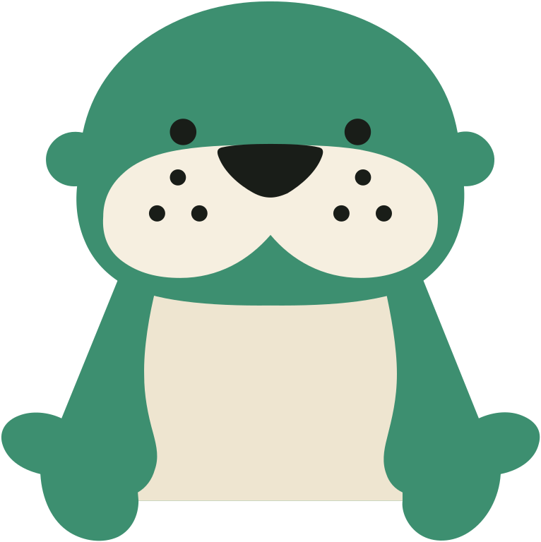 

| 状态 | 动作 | 产品时刻 | 意思 |
| --- | --- | --- | --- |
| 01 空闲 | 浮在水里，两只前爪捧着那块顺手的石头慢慢转，眼睛跟着石头 | 空态 | 这里还空着，我在等你 |
| 02 找题中 | 仰躺漂着，肚皮上摊开一本书，用前爪翻页，鼻子凑近书页 | AI 找题加载、生成中 | 我在帮你翻 |
| 03 待确认 | 立在水里，双爪捧着一枚贝壳递向你（第 41 条：用贝壳，不歪头） | AI 结果请老师确认 | 我摸到这个，你看对不对 |
| 04 完成 | 仰躺，把书抱在胸前，眼睛眯成两条弧线 | 组卷完成、导出完成 | 收好了 |
| 05 没找到 | 从水里探出上半身，两只前爪摊开，空着 | AI 找题没有找到合适的题 | 这次没摸到，换个说法再试 |

规则：每个状态都用海獭真实的习性表达（仰躺漂着、肚皮当桌子、用石头、把东西收进皮袋），不靠夸张表情。石头和书用墨和米白，不用竹青。最后拿主意的永远是老师。

状态 05 是诚实的那一格：没找到就如实说没找到，不凑数（DESIGN.md §9「空态指向第一动作，宁缺勿假」）。海獭不哭、不道歉，文案指向下一步。

**探头 · 已定（Owner 2026-10-13，第 29 条）**：03 待确认和 05 没找到从卡片边探头，姿势用 P2，两只前爪画在边的前面（§4.2 方向 D、§4.7）；02 找题中、04 完成和空态不探头。表里 01 的产品时刻原来写着空态和登录页；登录页改用 P2 探头以后，01 只留给空态 · 提案（Droid）。

**探头的实景（方向 D 第 2 轮）**：03 的姿势和位置已定（Owner 2026-10-13，第 30 条）：两只前爪和石头画在边的前面，靠右，结果卡上面的提示不占满整行。石头在 150px 读成一颗黑球，它的样子（高光、大小）和歪头的角度，和下一段的「石头还是贝壳」一起，到五个状态再定（同一条）。「你看对不对」靠 AI 结果卡的语境，不加问号、眉毛或气泡。05 照 Astra 的稿子，摊手在 150px 读得出「空着」；「没找到匹配」改成卡片，海獭居中探头（这两句 Owner 2026-10-13 定，第 31 条；§4.2 方向 D）。

**物种改成海獭以后 · 提案（Droid）**：02、04 的仰躺漂浮本来就是海獭的习性，不变。01 原来是「坐着，把小石子在两只前爪间轻轻抛着玩」，抛石子是小型水獭的习性，改成捧着石头转；03 的「坐起来」改成「立在水里」。还有一处画状态时再定：海獭的石头是敲贝壳的工具，摸到的是贝壳。照这个，03 递给老师的更像一枚贝壳，石头留在皮袋里。加不加贝壳这件道具，到时候和 §4.5 一起定。

**五个状态 · 第 1 轮 · Droid（2026-10-14，主题 3）**：四面定了以后（第 40 条），Owner 让 Droid 接着做其他姿态。Paper 新开「主题 3 · 五个状态」页和协作看板。做法同 P 和 V2：先用 GPT Image 2.5 编辑出位图，再让 Telos 描成矢量，不手改路径（第 36、37 条）。01、02、04 直接在矢量 P 上改，只改爪里的东西和眼睛。03、05 的探头姿势取自 Astra 方向 D 第 2 轮的稿，她那版还是旧的沙白配色，这里只借姿势，配色换成 H1，画法照 P 和 V2。03 另出一版贝壳。每个状态各出一次，没有重跑：位图 6 张 12 usage，Telos 6 次 24 usage，共 36。六版都只用四色，没有渐变和透明。03 两版 Telos 自己给胡须点加了暖米白细描边，贝壳版的贝壳纹也有，约 1.7 个单位粗，页面里约 0.2px，看不见；如果选中，进仓库前回 Telos 重描去掉。实景按两眼间距缩放，让头和母版 P 在 150px 时一样大：01、02、04 和 P 并排放进个人空间空态；05 放在改成卡片的「没找到匹配」上；03 放在 AI 结果卡右上。探头画两份：整只放在卡片后面，裁到卡片边以下的部分放在前面，所以只有越过边的爪和手里的东西压在卡片上（E1）。结果：01 两爪在胸口捧着墨色扁石，读得出「捧着一样东西」，石头一半被爪挡住，不像球。02 一眼认得出是书，但书的墨线细，150px 还清楚，再小会断。04 抱着合上的书，眼睛眯成两道向上的弧，四张里情绪最清楚。05 两爪越过卡片边往两边摊开，中间空着，读得出「这次没摸到」。03 的石头越过边是一块墨色半圆，又读成黑球，和方向 D 第 2 轮一样；贝壳靠几道墨色放射纹认得出，贝壳本身是米白，在胸口和卡片上不显。两版 GPT 都没画出歪头。**提案（Droid）**：01、02、04、05 照这一轮的矢量定，02 只用在 150px 及以上。03 用贝壳：更好认，也合上一段「摸到的是贝壳，石头留在皮袋里」；方向 D 已量过歪 3° 在 150px 看不出，所以不歪头，状态表里 03 的「头微微歪」删掉。另外，登录页的 P2 探头还是旧画法，爪子是豆形，和这批放在一起画风不一，要不要照 05 的画法重出，等 Owner 定。位图、矢量、实景和核对卡在 Paper「五个状态 · Droid · 第 1 轮（GPT 生图 → Telos）」。

**五个状态 · 结果 · 已定（Owner 2026-10-14，第 41 条）**：Owner 说「上面四条提案同意，照 05 的画法重出」。① 01、02、04、05 照第 1 轮的矢量定，02 只用在 150px 及以上。② 03 用贝壳，石头留在皮袋里；贝壳是米白加墨色放射纹（§4.5 的道具表跟着加上贝壳 · 提案）。③ 03 不歪头，状态表里的「头微微歪」已删。④ 03 的细描边进仓库前去掉（做法见下一段）。⑤ 登录页的 P2 探头照 05 的画法重出。定稿放在 `design/brand-2026-10-13/mascot/states/`：`state-01-idle.svg`、`state-02-searching.svg`、`state-03-offer.svg`、`state-04-done.svg`、`state-05-not-found.svg` 和登录页的 `peek-login.svg`。都是 Telos 的原路径，只把 viewBox 收到画出来的边，去掉 Paper 导出带的宽高；只用四色，没有描边、渐变和透明。探头三张是整只的图，做进页面时画两份：整只放在卡片后面，卡片边以下的部分放在前面（E1）。卡片边落在图高的这个比例上：03 约 0.82，05 约 0.92，登录页约 0.92（05 和登录页是第 3 轮的值）· 提案（Droid，实景里用的值）。登录页这个值 2026-10-14 订正为 0.93：SL 身体的平切线在 0.929，卡片边要压在切线下 1px，切线才藏得住（第 51 条，§4.5）；`evidence/login.png` 照原来的框取重拍，头的大小和位置不变。

**五个状态 · 第 2 轮 · Droid（2026-10-14）**：按第 42 条，审美由 Droid 定，Owner 可以推翻。① 登录页：GPT 编辑和 Nano Banana 各出一张位图，参考都是 05 的位图加现在的 P2。Nano Banana 那张爪子还是 P2 的豆形，不用；GPT 那张两只圆爪向里搭过框沿，和 05 一个画法，选它。Telos 第一次直接拿生成的节点当参考，生成失败；把位图存成白底图片再描就成了，七条路径，四色，没有描边。Telos 自己在脸斑和胸口之间留了一道竹青下巴，和 05 一样，保留。放进登录页（框取和 `evidence/login.png` 一样，按两眼间距缩放，头和 P2 一样大，头心仍离卡片右边 62px）：卡片边落在身子的直切口上面一点，只有两只圆爪压在卡片上，切口看不见；和 05 放在一起像同一只手画的。Droid 定用它（SL），替换 P2，`evidence/login.png` 已重拍。② 03 贝壳：回 Telos 重描了一次，新稿还是给胡须点和贝壳纹加了暖米白描边，头也歪了，不用。改用第 1 轮的稿，照 §6「出图后统一收口：去掉描边和渐变」只删描边属性和一个没用上的渐变定义，路径一笔没动；600px 渲染只有约 0.13% 的像素（点的边缘）不同。用量 11 usage（GPT 编辑 2，Nano Banana 1，Telos 两次各 4）；另有一次 Telos 失败，看不到扣没扣量。位图、矢量、实景和核对卡在 Paper「五个状态 · Droid · 第 2 轮（登录页探头重出 · 03 贝壳重描）」。

**五个状态 · 第 3 轮 · 统一下巴 · Droid（2026-10-14，第 43 条）**：Owner 看了登录页新旧探头的对照，说有的有绿下巴、有的没有，要统一。Droid 清点了全套：母版 P、头像、App 图标、四面 V2、01、02、03、04 都没有绿下巴，喉咙的米白在两颊之间接进脸斑；只有 05 和登录页 SL 在脸斑和胸口之间多一道竹青。05 的那道来自 GPT 位图；SL 的位图没有，是 Telos 描的时候加的。照母版的「部位与配色」统一成不留绿。05 回 GPT 编辑去掉那道绿（参考加了母版头像），爪子和姿势不变，再交 Telos 描；Telos 把脸斑和胸口的两种米白对调了，照 §6「颜色收成 §1.5 的色值」换回来，形状没动。SL 从原位图重描，提示词写明下巴不留绿，叫 SL2。两张都只用四色，没有描边。放回登录页和「没找到匹配」卡片，头的大小和位置都不变。`state-05-not-found.svg`、`peek-login.svg` 和 `evidence/login.png` 已替换。用量 10 usage（GPT 编辑 2，Telos 两次各 4）。清点、重出、实景和核对卡在 Paper「五个状态 · Droid · 第 3 轮（统一下巴）」。第 4 轮把这一轮的方向反过来，见下一段。

**全套加下巴 · 第 4 轮 · Droid（2026-10-14，第 44 条）**：Owner 看了第 3 轮问：「没有下巴的话，那个脸那个白色意味着是什么？统一理论。」Droid 给了两种说法：甲，脸斑是围兜往上长出来的一块，下巴不留绿；乙，脸斑是口鼻，属于五官，米白是身体的围兜，竹青下巴把两块隔开。Droid 推荐乙，Owner 说「要下巴要下巴」，理论写进 §4.2「部位与配色」。做法：05 和登录页 SL 本来就有下巴，换回第 2 轮的版本（`state-05-not-found.svg`、`peek-login.svg`、`evidence/login.png`）。其余七张（头像、P、四面 V2、01、02、03、04）把现在的矢量渲成白底图，参考里另放 SL 作下巴的样子，用 GPT Image 2.5 编辑只加下巴，其余不动；七张位图都加上了，再压白上传，交 Telos 描。七张一起交给 Telos 时全部生成失败，一张一张、三张一批再交就都成了。收口只动颜色和格式，形状不改：头像、P、03 的两种米白被 Telos 放错，收回原位；P 删了 Telos 加的白底；02 删了书上和填充同色的描边，03 删了胡须点和贝壳纹的细描边，600px 渲染只差约 0.2% 的像素；04 的两条闭眼是描边弧线，删掉眼睛就没了，转成同形的填充（为此重描过一次，Telos 还是画成描边，没用上）。全部只用四色，没有描边和渐变。放进真实页面：顶栏 28px、个人空间空态 150px（P）、P 和 01、02、04 按两眼间距并排、03 在结果卡边、05 在「没找到匹配」卡片上，每张都有下巴，头一样大，像同一只手画的；登录页没变。`mascot/` 的三个母版、`states/` 的 01–04 和 `evidence/` 的顶栏、个人空间两张已替换；四面 V2 不进仓库。用量 50 usage（GPT 编辑 7 张各 2，Telos 9 次各 4，含下面 V2 的重描）；另有七次 Telos 失败，看不到扣没扣量。位图、白底参考、矢量、实景和核对卡在 Paper「全套加下巴 · Droid · 第 4 轮」。

**第 4 轮 · Astra 独立审稿（2026-10-14）**：Astra 核对了 `ffd5507c` 和 `2ccae0cb`、Paper 成稿和实景截图，并实际渲染了小尺寸。结论：保留下巴的方向可以定，这套先不直接定稿。八项里理论、配色、小尺寸三项过；一致、会不会像别的动物两项存疑；没被改坏、真实页面、局限可否接受三项不过。必须改的三处：① 04 的闭眼从圆头弧线变成了带尖角的形状；② V2 侧面下巴以下大片变绿，手臂和身子之间的米白细缝在 150px 仍看得见，像一道裂缝；③ 实景里 03 结果卡的上边线穿过贝壳、05 卡片的上边线穿过前爪。28px 头像和 32px 图标里，下巴让脸和胸口分得更清楚；16px 认不出 ∴，是尺寸的限制。头像单看仍有小熊、海豹的歧义，下巴改善的是脸部分区，不解决物种辨认。

**审稿后的修正 · Droid（2026-10-14）**：三处都照 Astra 的意见改了。① 04：转填充时圆头的方向算反了，两头成了尖角；改正后和 Telos 原稿逐像素一致（2048px 渲染只差 2 个像素），`state-04-done.svg` 已替换。② V2：GPT 位图的侧面本来是对的（喉咙一路米白到脚、下巴是一道细绿），是 Telos 描坏了。只重描一次（4 usage），提示词写明侧面喉咙的米白从下巴一直走到脚、手臂贴着身子不留缝；新稿下巴还在，细缝没了。V2 不进仓库，新稿在 Paper。③ 03／05：截图脚本里前面那份图从边线下面才开始画，1px 的边线漏在贝壳和前爪上面；改成前面那份多盖 2px 以后，边线退到了贝壳和前爪后面，角色不用重画。这两张实景不在 `evidence/` 里，只放在 Paper 核对卡上。Astra 的另两条建议写进了 §4.2：「围兜」只是胸腹毛色区的叫法，暖米白另用在道具和 App 图标底上；五官写成「整体保持，有重描偏差」。以后再说 · 提案（Droid）：01 的下巴偏薄，头像、03、SL 偏厚，P、02 跟着头歪成斜带，差别还不至于像不同角色，先不重出；部件分组、下巴厚度写进比例规范、头像的物种辨认测试，都放到以后。修正的对照在核对卡下面的「审稿后修正」一栏。

**直立场景 · 第 1 轮 · Droid 定（2026-10-14，第 49 条）**

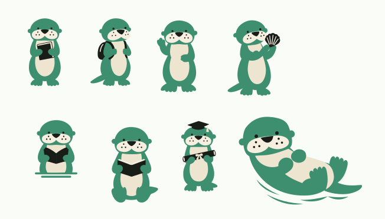

Owner：「能不能做多点直立场景，单单躺着有点单调」。五个状态里只有 03、05 和登录页是直起来的，而且都是探头；其余都是仰躺。这一轮画了七张全身直立或坐着的场景，底图是直立四面 V2 的正面和四分之三侧（第 40、44 条）。

| 编号 | 场景 | 文件 | 适合的时刻 · 提案 |
| --- | --- | --- | --- |
| U1 | 正面站着，把一本厚书斜抱在胸前 | `upright-01-hug-book.svg` | 空态、开学 |
| U2 | 四分之三侧，背墨色小书包，两爪抓着背带 | `upright-02-backpack.svg` | 开学（§4.5 的小书包） |
| U3 | 正面站着，一只前爪举到耳边打招呼 | `upright-03-wave.svg` | 第一次登录、欢迎回来 |
| U4 | 四分之三侧，把墨色贝壳举在脸旁端详 | `upright-04-shell.svg` | 宣传图、关于页 |
| U5 | 立在水里，腰以下在水里，捧着摊开的书 | `upright-05-wade-read.svg` | 空态（贴近「水上的备课桌」，§1.1） |
| U6 | 坐着，书摊在腿上 | `upright-06-sit-read.svg` | 空态、寒暑假 |
| U7 | 戴毕业帽，横抱墨色证书筒 | `upright-07-graduate.svg` | 毕业季、高考后 |
| U8 | 正面站着，两爪捧一块系米白丝带的墨色石头（2026-10-14 日历换装补画，第 51 条） | `upright-08-gift-stone.svg` | 教师节（§4.5） |

- **直立不改身份 · Droid 定（第 49 条）**：脸、配色、下巴、四趾无趾垫和比例都照 V2，只改姿势和手里的东西。道具规则照 §4.5：主体是墨，至少和脸一样宽；每张最多一件道具加一件服饰。
- **直立和仰躺怎么分 · 提案（Droid）**：仰躺是海獭在水里工作的样子，留给和找题直接有关的状态（01、02、04）；直立是它离开工作、面对老师的样子，用在欢迎、空态和日历换装这类不在等结果的地方。03、05、登录页照旧探头（第 29 条）。同一屏仍然只出一只（§4.7）。
- **尺寸 · 提案（Droid，2026-10-14 订正）**：按两眼间距和 150px 高的 P 一样大，直立图的高度是 U1 183、U2 201、U3 189、U5 143、U6 174、U7 191、U8 190px（U4 侧着脸，两眼不成对，不量）。U5 腰以下在水里，所以最矮。同样 150px 高时，直立的脸是 P 的七成五（U2）到略大一点（U5）。位置不够高时用 150px，八张在 150px 下都认得出动作。
- **viewBox 订正（2026-10-14）**：做日历换装时发现，第 48、49 条收口时量裁边的脚本有错：它在已经裁过的图上量偏移，直立和道具 17 个文件的 viewBox 右边和下边多留了一截空白，直立图画出来的部分只占 viewBox 高度的 65–77%。17 个文件已按画出来的边重新收紧，只改 viewBox，路径没动。原来这里写的「直立的头只有 P 的三分之二」「约 220px 高」和 §4.7 的「U5 约 218px」都是被空白骗了，已改成上一条的数；`evidence/upright-150.png`、`props-150.png` 和 §4.7 个人空间的两张已重拍。

**做法和过程**：Paper 新开「主题 5 · 直立场景」页。GPT Image 2.5 编辑出了七张位图，重出三张：U1 第一次的书是一整块墨色方块，像平板，违反 §4.9「不拿手机或电脑」，重出成斜抱的厚书，米白书页露在上沿和侧边；U4 第一次贝壳挡住了下巴，改成举在脸旁；U7 第一次的卷轴是米白的，贴在肚皮上看不见，改成墨色证书筒。七张白底图交 Telos，三张一批都成了。收口只动颜色和格式：U1、U4 的肚皮被涂成脸斑的暖米白，换回米白；U6 后脚上多出的米白趾垫改成竹青（母版没有趾垫，第 38 条）；U4 的贝壳纹、U5 的一条书线原是描边，转成同形填充；viewBox 收到画出来的边。七个文件在 `design/brand-2026-10-13/mascot/upright/`，只用四色，没有描边、渐变和透明。核对：按 150px 高放在内容面 `#FAFCF8` 上，和 P 并排（`evidence/upright-150.png`）。之后放进真实页面试了，个人空间空态换成 U5，见 §4.7（第 50 条）。局限：每张都是 Telos 重描的整只海獭，脸和身子有重描偏差，比如 U5 的身子在水线上切得很平；U6 的后脚趾形不清，像两个圆块；U1 的书斜着，150px 下书页只剩一道细边。用量 52 usage（GPT 编辑 10 张各 2，Telos 8 次各 4）。位图、白底参考、矢量和核对卡在 Paper「直立场景 · Droid · 第 1 轮」。

**裹藻仰躺 · 图是提案（Droid，2026-10-14，第 55 条）；进个人空间空态已定（Owner 2026-10-14，第 57 条）**

`design/brand-2026-10-13/mascot/kelp/otter-kelp-wrap.svg`。浮姿 P 的姿势，一条深竹青巨藻从肩头斜缠过肚皮，藻尾从后脚边垂下。讲的是「收好、不漂走」（§1.1 世界、§4.1 来历）。脸和 P 对得上：宽鼻是半圆，两颊各一个 ∴，竹青下巴把脸斑和肚皮隔开。巨藻只缠在米白肚皮上，不贴着竹青的背和手臂（深竹青对竹青只有 1.54，§1.5）。巨藻不算 §4.5 的道具，所以「每张最多一件道具」不算它，但裹藻时手里不再拿东西。

- **适合的时刻 · 提案**：和「保存、收好」有关的空态和完成时刻。按眼距和 P@150px 一样大是约 148px 高、209px 宽；空态卡片 302px，比 U5 的 296px 只高 6px（`evidence/kelp-real.png`）。
- **个人空间空态换成裹藻仰躺 · 已定（Owner 2026-10-14，第 57 条）**：Droid 问要不要从 U5 换，理由是裹藻和「试卷导出为 PDF 后，可以保存在这里」同义；Owner 在问卷里选「换成裹藻仰躺」。U5 是第 50 条 Droid 定的（理由是「水上的备课桌」），从平时的空态退下，留在 `mascot/upright/` 里。尺寸和放法见 §4.7。
- 巨藻林中图（海獭裹藻、缠在身上的那株从海底长上来）见 §5.2。

**潜水 · 提案（Droid，2026-10-14，第 56 条）**

`design/brand-2026-10-13/mascot/kelp/otter-dive.svg`。Owner 转来一张海獭潜进巨藻林的照片：「可以试试这个吗？我觉得这个很美」。侧身，头朝下往左下斜潜，身子拉长，前爪收在胸口，后脚和短尾在右上蹬水。照片只借了姿势，蓝色、光束和写实毛色都不借。讲的是「潜下去摸到对的题」（§4.1 来历），和裹藻仰躺的「收好」成一对，凑成 §1.1 那句话的两半。

- 脸对得上：宽鼻、两颊的 ∴、竹青下巴都在；鼻子是楔形，不是 P 的半圆，150px 以下看不出。肚皮出来是暖米白，换回了米白。
- **只进中图 · 提案**：身子拉长、头朝下时，剪影比仰躺更像海豹，要靠脸、带趾的后脚和短尾认出是海獭。所以它只用在 240px 以上、有巨藻的场景里（§5.2 潜水中图），不单独当 150px 的空态图，也不当状态 02 找题中（02 已定，第 41 条）。

### 4.5 道具与服饰 · 第 1 轮 Droid 定（2026-10-14，第 48 条），其余提案

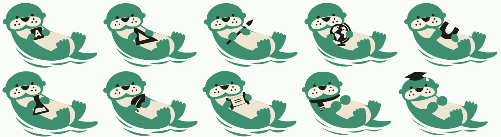

- 道具表示学科，服饰表示场合，可以叠加。每次最多一件道具加一件服饰。
- **学科道具**：通用（石头、书、贝壳；贝壳用在 03 待确认，第 41 条）、语文（毛笔）、数学（三角尺）、英语（字母卡）、物理（U 形磁铁）、化学（烧瓶）、生物（叶子）、历史（卷轴）、地理（地球仪）。八件学科道具都画了，见本节末尾「第 1 轮」。
- **场合服饰**：小书包（开学）、毕业帽（毕业季）、围巾（冬天、节日）。毕业帽和围巾已画；小书包仰躺时会压在背后看不见，所以画在直立场景 U2 里（第 49 条，§4.4）。圆框眼镜画过，拿掉了（下面「服饰不碰脸」）。
- **服饰不碰脸 · Droid 定（第 48 条）**：服饰只戴在头顶、脖子和身上，不戴在脸上。圆框眼镜试了两次：第一次戴到额头上；第二次框住了眼睛，但米白镜片把墨点眼撑成一对鼓眼，脸变了，违反 §4.9「脸永远不变」。
- **跟着教学日历换装 · Droid 定（第 51 条）**：开学、教师节、期中、期末、高考后、寒假、暑假各配一张图，只在登录页和个人空间空态出现，过了时间就换回，不做节日营销。排期、日期和放法见本节末尾「教学日历换装」。
- 道具只用墨和米白，不新增颜色，也不用身体的竹青。身体比例和脸永远不变。
- 学科道具只在海獭插画里表示学科，不是题型图标，也不进图标套件（Owner 2026-09-30 定了「题型不搞图标」）。
- **道具怎么画 · Droid 定（第 48 条）**：① 道具放在米白肚皮上，主体是墨，米白只做里面的小细节（字母、叶脉、两极、液面）。第一批米白字母卡和米白笔杆的毛笔在肚皮上几乎看不见。② 道具至少和脸一样宽，握在两爪之间、露出大半。第一版地球仪只有石头大，150px 下是一团墨，放大、去掉细节重出以后才认得出。③ 细于 150px 下 1px 的细节不画，比如三角尺的刻度。

**道具与服饰 · 第 1 轮 · Droid（2026-10-14，主题 4）**：Owner 说「继续补全獭獭」。Paper 新开「主题 4 · 道具与服饰」页。做法同五个状态：GPT Image 2.5 编辑出位图，再交 Telos 描成矢量（第 36、37、42 条）。学科道具的底图是 01 空闲（有下巴），只把胸口的石头换掉；服饰的底图是浮姿 P。位图出了三批：第一批字母卡、三角尺、毛笔、地球仪、眼镜，得出上面的规则 ①③；第二批按规则重出字母卡、毛笔、眼镜，加磁铁、烧瓶；第三批加叶子、卷轴、围巾、毕业帽，放大重出三角尺、磁铁、烧瓶；最后地球仪按规则 ② 重出一次。挑出的十张存成白底图交 Telos，三张一批都成了。收口只动颜色和格式：颜色收成四色；三角尺的米白刻度删掉；卷轴纸边和两道字线、地球仪的半环原是描边，转成同形填充；毕业帽删掉没用上的渐变定义；地球仪删掉白底，把 Telos 合成一种的两种米白分回脸斑和肚皮；围巾第一次被描成线稿，重描一次。viewBox 收到画出来的边。十个文件在 `design/brand-2026-10-13/mascot/props/`：`prop-en-card`、`prop-math-set-square`、`prop-zh-brush`、`prop-geo-globe`、`prop-phy-magnet`、`prop-chem-flask`、`prop-bio-leaf`、`prop-his-scroll`、`wear-scarf`、`wear-cap`（都是 `.svg`），只用四色，没有描边、渐变和透明。核对：按 150px 高放在内容面 `#FAFCF8` 上（`evidence/props-150.png`），十件都认得出是什么；这是同色底上的实际大小，没有放进真实页面截图。局限：每张都是 Telos 重描的整只海獭，脸和身子有重描偏差，比如毕业帽那张头更低、更往前倾；叶子在 150px 偏小；卷轴的米白纸面靠墨色纸边才和肚皮分开。用量 84 usage（GPT 编辑 18 张各 2，Telos 12 次各 4）。位图、白底参考、矢量和核对卡在 Paper「道具与服饰 · Droid · 第 1 轮（小批试一致性）」。

**教学日历换装 · Droid 定（2026-10-14，第 51 条）**

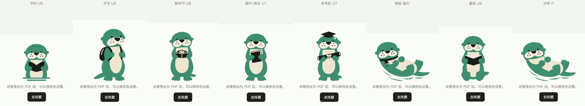

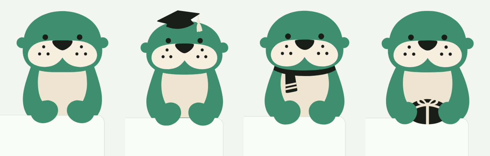 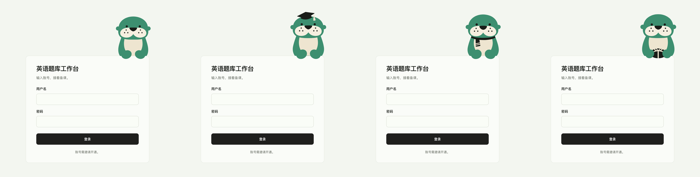

Owner：「教学日历换装排期…都做了」。按第 42 条由 Droid 定，Owner 可以推翻。

| 时段 | 日期（北京时间） | 个人空间空态 | 登录页 | 为什么是这张 |
| --- | --- | --- | --- | --- |
| 平时 | 不在下面任何时段的日子 | 裹藻仰躺（第 57 条；原来是 U5 立在水里看书，第 50 条） | SL | |
| 开学 | 9/1–9/14；春季开学日起 14 天 | U2 背小书包 | SL | 书包是开学最直接的东西；探头时书包在背后，看不见，登录页不换 |
| 教师节 | 9/9–9/11 | U8 捧系丝带的石头（新画） | SL 递石头（新画） | 海獭把最顺手的石头送人，是它能给的最好的礼物；不画花、贺卡和「节日快乐」 |
| 期中 | 11/1–11/14；4/15–4/30 | U1 抱书 | SL | 抱着厚书，复习的样子，不带紧张 |
| 期末 | 1/1–1/20；7/1–7/10 | U1 抱书 | SL | 同期中 |
| 高考后 | 6/7–6/30 | U7 毕业 | SL 戴毕业帽（新画） | 从开考到出分、填志愿；高三老师送走一届 |
| 寒假 | 1/21 到春季开学日前一天 | 戴围巾的浮姿（`props/wear-scarf.svg`） | SL 戴围巾（新画） | 冬天和春节都在里面，不另做春节 |
| 暑假 | 7/11–8/31 | U6 坐着看书 | SL | 坐下来慢慢读，假期的节奏 |

- **重叠时谁赢**：教师节 > 高考后 > 开学 > 期中、期末 > 寒暑假 > 平时。实际只有教师节落在开学的两周里；其余时段不重叠。
- **春季开学日**每年不同，做成一项配置，每年寒假前填；没填时按 3/1 算。各地学校的考试周也不同，上表是全国大致的日子，按年配置时可以改，不按地区分。
- **只在两处**：登录页和个人空间空态。03 待确认、05 没找到、01 空闲这些状态图不换装；顶栏头像和 App 图标永远不换。同一屏仍然只出一只（§4.7）。
- **只换图，不加话**：不弹窗、不加横幅、不改页面文案，也不写「教师节快乐」。图的替代文字跟着换成这张图画的是什么。时段一过自动换回平时，不需要老师关。
- **登录页只换三次**：毕业帽、围巾、石头都在头顶、脖子或两爪之间，探头时看得见；书包和书在探头时看不见或会挡住框沿，那些时段登录页照旧 SL。
- **怎么放 · 提案（Droid，实景里用的值）**：个人空间空态按两眼间距和 150px 高的 P 一样大（尺寸见 §4.4），空态卡片的高度跟着变，最矮 296px（U5）、最高 355px（U2），用 P 时是 304px；平时换成裹藻仰躺以后是 302px（第 57 条）。一年里卡片高度变几次是可以的：它是低密度区，变化也只发生在换时段的那天。登录页横向按两眼中点和 SL 对齐，头心仍离卡片右边 62px；纵向让每张自己身体的平切线落在卡片上沿下 1px，切线在图高的比例是 SL 0.929、毕业帽 0.931、围巾 0.930、递石头 0.945（量法：逐行数画出来的宽度，宽度骤降的那一行，见各文件头的注释）。还是画两份：整只放在卡片后面，前面那份从卡片上沿往下画，位置取整像素，两份的分界不出发丝缝。第一次照 SL 的 0.92 统一放，戴围巾和递石头的两张身体下沿露在卡片上，就是这样改出来的。
- 这只是品牌文件里的试用截图，网站代码没改；真要上线要另开 UI 任务，按上表和这几条来做。

**做法和过程**：Paper 新开「主题 6 · 教学日历换装」页。先清点手上的图：开学、期中期末、高考后、寒假、暑假和平时都能用 §4.4 的直立场景或本节的服饰图，缺的是教师节一张全身、登录页三张探头。四张都用 GPT Image 2.5 编辑出位图：U8 的参考是直立四面 V2 正面和 01 的石头，第一次石头太小，不像要送出去的东西，放大重出一次；登录页三张的参考都是 SL 加对应的服饰图或石头，只加东西，姿势不动。四张白底图交 Telos，一次都成了。收口只动颜色和格式：先删掉导出文件带的 style 属性（它让裁边算错），颜色收成四色，viewBox 收到画出来的边。四个文件：`mascot/upright/upright-08-gift-stone.svg`，`mascot/calendar/peek-login-cap.svg`、`peek-login-scarf.svg`、`peek-login-gift.svg`，只用四色，没有描边、渐变和透明。登录页三张是整只重描的，脸和 SL 有重描偏差，按两眼对齐后头的大小一样，轮廓有细小差别；四张不会和 SL 同屏出现，差别看不出来。用量 26 usage（GPT 编辑 5 张各 2，Telos 4 次各 4）。位图、白底参考和矢量在 Paper「主题 6 · 教学日历换装」，核对卡在同一画板。

### 4.6 动效 · 「正在想」和三个出场动作 Droid 定（第 52、65 条），其余提案

- 母版是分层矢量，可以直接在代码里动（SVG 加 CSS），不必做视频。
- **动作沿部件关系走**：Owner 2026-10-03 审图标动效时，否掉了第一轮的轻交替、旋转和填充（评语「不够灵性」），确认了第二轮的图标内部关系动作（`design/icon-system-2026-09-15/motion-rules.md`）。海獭照此办：石头在两爪之间转，爪子带着书页翻，眼睛跟着石头走；不做整体弹跳和旋转。（第 65 条做 01 转石头时，眼睛没有跟：眼睛一动，一次出场就有两个动作，见下面「出场 · 第 2 轮」。）
- **节奏有性格**：安静、好奇的海獭，动作起得慢、停得稳，不回弹；歪头之前先停一拍。界面控件的利落节奏不受影响。
- **循环只给等待**：状态 02 找题中可以循环，因为等待本身在持续。状态 01 转石头的动作在进入时演一两次就停。motion-rules.md 写明不给高频工具加弹跳、自动循环或无意义旋转。
- 候选小动作：偶尔眨眼、鼻子轻动、状态切换时一个短过渡。转石头、眨一次眼和探头浮上来已做（第 65 条）；鼻子轻动和状态之间的短过渡还没做。
- **「正在想」的两个候选 · 已选 (b)（Droid 定，第 52 条，见下面「正在想 · 选 (b)」）**：记忆点方向 A 留下两种让 ∴ 动起来的办法（§4.2），Owner 2026-10-13 定为到这一步再选，也可以都不用。原来写的是只用于 150px 以上的头像；§4.7 的位置里没有会动的大头像，所以落到状态 02 找题中的全身图上（150px 高），并给 §4.3「胡须点不动」开了这一处例外。画稿在 Paper「记忆点 · 方向 A」两块画板的「04」。
  - (a) 依次脉冲（Astra）：三个点轮流轻轻放大再复原，等待时循环。长处是等得再久也看得出还在想；像不像普通的加载三点，还没验证。
  - (b) 潜下去、浮上来（Droid）：两颊的上点沿直线沉到两个下点之间（距离等于三角的高），三点成一行，两颊合起来正好是省略号「……」；有了结果再浮上来，回到 ∴。潜 220ms、浮 160ms，缓入缓出，不回弹；点不放大、不变色、不闪；等待时停在省略号上，不循环，进度交给旁边的「生成中…」。减少动态时不移动，直接换。长处是只在状态改变时动，合本节「动作沿部件关系走」和「动势极省」两条，省略号不懂数学也认得；短处是停住以后，单看海獭看不出还在不在想。没用转动：试过把 ∴ 转 60° 变成 ∵（因为），但 Owner 否过图标的旋转，∵ 又多一个数学符号。
- 遵守 DESIGN.md §6 的动效 token，UI 动效不超过 300ms。海獭的循环属于签名时刻豁免，代码里要注释。`prefers-reduced-motion` 时完全静止。
- 动势极省：以静态为主，只在状态改变的那一瞬动（图标理念页「动势极省」）。

**正在想 · 选 (b) 潜下去、浮上来 · Droid 定（2026-10-14，第 52 条）**

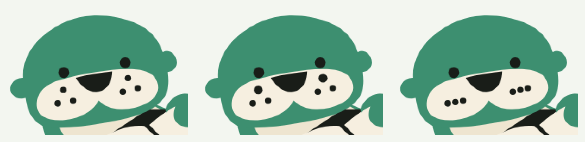 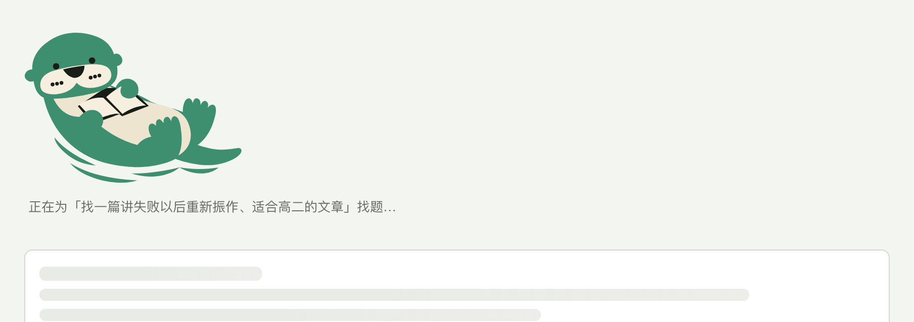

Owner：「獭獭动效：先在『正在想』两个候选里挑一个」。Droid 在状态 02 的矢量上把两个候选都做成原型，逐帧放大看，再放进真实的找题等待页（本地临时服务，用一句模糊的找题请求让页面停在等待上；截图脚本只替换图片，没改页面代码）。

- **(a) 依次脉冲：不用**。点放大到 1.4 倍时，那颗点比别的大一圈，像多出来一只眼睛或一颗雀斑，脸变了，违反 §4.9「脸永远不变」。它还是循环，而等待页下面已经有骨架屏在循环闪（约 1.6 秒一轮），两样一起动，抢老师的注意力。
- **(b) 潜下去、浮上来：用**。上点沉到两个下点的正中间，两颊各成一行三点，读得出「……」；点不变大，脸的分区不变。只在进入和离开等待时各动一次，进度交给旁边的「正在为…找题…」和骨架屏。
- **参数**：进入等待先停 300ms，结果在这之前回来就不动（不为一闪而过的等待演一遍）；然后 220ms 沉下去（DESIGN 动效 token slow），停在省略号上，不循环；想完而 02 还在屏上时 160ms 浮回 ∴（base）；换成 03、04、05 时由换图承担，不先演浮上来。曲线 `cubic-bezier(.45, 0, .55, 1)`，缓入缓出，不回弹。点不放大、不变色、不闪。`prefers-reduced-motion` 时不移动，直接换。都在 300ms 以内，不需要签名时刻豁免。
- **做法**：路径原样，只给两颊的上点加 `class="whisker-top"` 和到两个下点中点的位移（`--dx` / `--dy`，SVG 用户单位），用 CSS `transition` 动。可点的样例在 `design/brand-2026-10-13/mascot/motion/thinking-dive.html`（「开始找题」「想完」两个按钮）。
- **局限**：停住以后，单看海獭看不出还在不在想，这交给旁边的文字和骨架屏。点在 150px 下半径不到 2px，沉下去的距离约 7px，再小就看不出动了，所以只用在 150px 及以上的 02（和第 41 条「02 只用在 150px 及以上」一致）。网站代码没改，02 现在也还没进页面；上线时另开 UI 任务。

**出场 · 第 2 轮 · 转石头、眨一次眼、浮上来 · Droid 定（2026-10-15，第 65 条）**

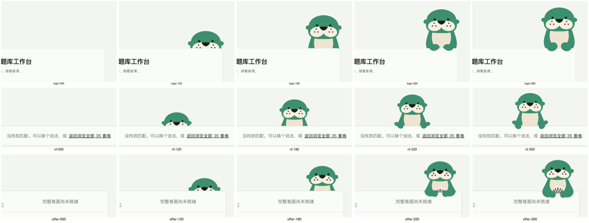 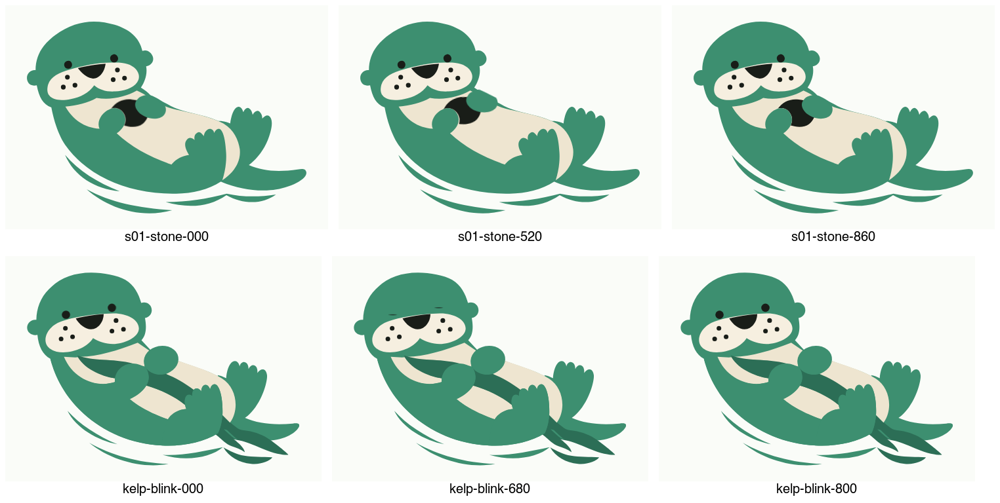

按 §8 第 10 条做「正在想」以外的小动作。Droid 先定范围，再做代码原生原型，逐帧放大看，最后放进真实页面拍帧（本地临时服务；截图脚本只替换页面里的图，没改页面代码）。

- **一条总规矩**：一次出场只演一个动作，演完就停，不循环，不定时再演。每张图配哪个动作：
  - **01 空闲 · 转石头**：出场先停一拍（300ms），右爪带着石头绕左爪托住的那一点转 -10°（220ms），停 120ms，转回来（220ms），一次。眼睛不跟：眼睛再动就是一次出场两个动作，150px 下眼睛约 6px 宽，又是一颗实心圆点，没有眼白，挪一点读不出是在看石头。石头外面包一层用肚皮裁切的组，因为 01 的左爪是肚皮上的一个洞，石头转的时候不能盖到左爪。
  - **空态 · 眨一次眼**：给自己没有动作的图，现在是个人空间的裹藻仰躺（第 57 条），以后直立场景和浮姿 P 当空态时照用。出场 600ms 后眨一次：合上 80ms、张开 120ms，眼睛压成原来的一成高，不完全消失。01 已经有转石头，不再眨。
  - **探头 · 浮上来**：03 待确认、05 没找到、登录页 SL。卡片边就是水面（第 31 条 E1），整只从卡片边后面浮上来（260ms），快到位时两只爪和手里的东西从边上搭下来（120ms，比浮上来晚 180ms 起）。不先停拍：探头是回应老师刚做的事，停一拍像反应慢。不眨眼。
  - 02 找题中照「正在想」；04 完成不动，眯眼抱书本身就是结尾。
- **曲线**：转石头和浮上来用和「正在想」同一条 `cubic-bezier(.45, 0, .55, 1)`，缓入缓出，不回弹。浮上来先试过 DESIGN 的 `--ease-out`，它前 80ms 就走完九成，一百多 px 的距离像弹出来；换成缓入缓出以后，头顶先慢慢露出来，再稳稳停住，合本节「起得慢、停得稳」。爪子搭下来只有十来 px，用 `--ease-out`。眨眼合上用 ease-in、张开用 ease-out。时长都取 DESIGN 动效 token，每一段都在 300ms 以内，不需要签名时刻豁免。
- **探头画两份**：同一张图画两份，后一份放在卡片后面、只露卡片边以上，前一份放在卡片前面、只露卡片边以下（越过边的爪和手里的东西）。前一份要从卡片边上 2px 开始裁，盖住卡片外圈那道发丝边：实景里第一次照「正好从边开始」拍，05 和 03 的卡片边横穿爪子和贝壳，像爪子在卡片后面。浮上来时两份一起动，后一份往上浮，前一份从边上往下落，开头那一帧前一份什么都不露。
- **减少动态效果**：什么都不演，直接是最后那一帧。再演一次时先取消正在演的，不排队。
- **做法**：路径原样，只在 SVG 上加 `data-otter` 标记（`stone`、`stone-paw`、`eye`），用 Web Animations API 动。代码在 `design/brand-2026-10-13/mascot/motion/otter-motion.js`（`OtterMotion.turnStone`、`blink`、`surface`），可点的样例在同一目录的 `otter-motion.html`（每块有「再演一次」）。实景量过：登录页、05、03 都在 300ms 到位，01 在 860ms 回到原样，裹藻在 800ms 眨完；减少动态时 0 个动画。
- **局限**：转石头的 -10° 在 150px 里石头的角只移动约 2–5px，是「刚好能看见」的那一档，再小就看不出；01 现在没有页面在用（个人空间空态是裹藻仰躺），实景是临时放在个人空间空态里拍的。直立场景和 P 的眼睛还没加 `data-otter` 标记，用到时照裹藻的做法加。鼻子轻动和状态之间的短过渡这一轮没做。网站代码没改，上线时另开 UI 任务。

### 4.7 使用场景与尺寸 · 提案

- **出场**：只在等待和结果时刻，包括空态、找题加载、请老师确认、AI 没找到、组卷或导出完成、登录页、App 图标。
- **不出场**：读题、做题、编辑卷面时不出现；卷面上永远不出现。
- **一屏一只**：同一屏最多出现一只海獭。
- **探头 · 已定（Owner 2026-10-13，第 29 条）**：只在登录页、03 待确认、05 没找到这三处从卡片边探头，姿势用 P2，两只前爪画在边的前面；其余位置都不探头（§4.2 方向 D）。卡片边就是水面，不另画水线（第 31 条）。2026-10-14 起三处都用 `mascot/states/` 里的定稿：登录页是照 05 画法重出的 `peek-login.svg`（SL），姿势还是 P2 的搭边，换掉了豆形爪的 P2（第 41 条，§4.4）。
- **贴底规则**：
  - **只露头时不垫底 · 已定（Owner 2026-10-13，第 33 条）**：顶栏这类只露头的地方，绿头直接放在页面上，像半身像，对桌面 3.59。Owner 选 H1 时看的盲比图里，顶栏就是不垫底的头像。D2 时的「只露头时垫竹青」（第 27 条）跟着作废：绿头放在竹青底上会看不见。
  - **App 图标底 · 已定（Owner 2026-10-13，第 34 条）**：暖米白圆角底，绿头对它 3.42。Droid 提了暖米白，备选是墨底（绿头对墨 4.36，更醒目，但大块墨在 §1.5 里没有差事）；Owner 说「听你的」，定为暖米白。
  - **浅色怎么贴页面 · 提案（Droid）**：米白和暖米白不直接贴桌面底色（对桌面 1.15 / 1.05）；口鼻四周是竹青的头，肚皮两边是竹青的手臂和身子。这正好回到最早的规则「米白部分必须被竹青包住」；只露头时肚皮在下沿被裁平，裁边不算贴底。

尺寸以真实页面试用为准（K 画板定的尺寸，2026-10-13 用 H1 大鼻子母版重拍）：

| 位置 | 形式 | 尺寸 |
| --- | --- | --- |
| 顶栏标志 | 图形标志 `logo/mark.svg`，不垫底（第 62 条）；原来试的是头像（第 33 条） | 20px 高；普通屏用 `logo/mark-32` 逐格画版 |
| App 图标 | 头像加暖米白圆角底（第 34 条） | 192 / 64 用 `app-icon.svg`；32 / 16 用 `mascot/small/` 的逐格画版（第 45 条） |
| 行内小头像 | 头像，不垫底 | 16 或 32 CSS px；用 `mascot/small/` 的逐格画版（第 45 条） |
| 空态 | 全身。个人空间空态从浮姿 P 换成直立 U5（第 50 条），又换成裹藻仰躺（第 57 条）；教学日历的时段里换成别的图（第 51 条，§4.5） | P 150px 高；别的图按两眼间距和 P 一样大，U5 约 143px、裹藻仰躺约 148px 高（§4.4） |
| 登录页 | 2026-10-15 起换成 08 雾海（第 67 条）：宽屏右半屏是雾海插画，海獭 v11 潜在雾里；手机上插画压在上半屏，表单落在下半屏。海獭在 7 秒一个来回里轻轻摆动；这台设备第一次打开时描边按笔画画出来，白底和五官随后浮现；减少动态时都不演。素材 `app/public/brand/login-mist.svg`（雾、光、巨藻）和 `app/src/auth/login-otter.svg`（海獭，内联好让描边能画），设计源在 `design/brand-2026-10-13/login/08-tune/`。原来的 SL 探头（第 29、41 条）退下；教学日历换装没接 | 宽屏：插画铺满右半屏；手机：上半屏 430px |
| AI 找题：03 待确认、05 没找到 | 全身，用 P2 探头（第 29 条），从结果卡或「没找到匹配」卡片的上沿露出。03 靠右，结果卡上面的提示不占满整行（第 30 条）；05 居中，「没找到匹配」改成卡片（第 31 条） | 150px 高（第 31 条） |

  

登录页这张截图 2026-10-13 用 P2 重拍了（第 30 条）：框取和原来一样，只换了海獭，身子在登录框后面，两只前爪画在框沿前面，头还在原来的位置。同一天换成 H1 大鼻子以后，三张又照原来的框取重拍了一次（第 33 条）。2026-10-14 正面浮姿换成矢量 P（第 39 条），个人空间空态这张照原来的框取重拍：150px 高，宽从约 138px 变成约 208px；登录页用 P2 探头、顶栏用头像，都不受影响，没有重拍。同一天登录页的 P2 换成 SL（第 41 条），登录页这张照原来的框取重拍，头的大小和位置不变。03、05 的实景在 Paper「五个状态 · Droid · 第 1 轮」的实景区；方向 D 时的旧稿在「记忆点 · 方向 D · Droid · 第 2 轮」的 R1–R3。

**直立场景放进真实页面 · Droid 定（2026-10-14，第 50 条）**

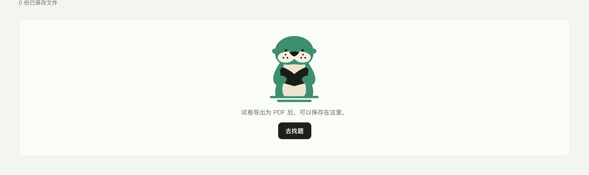 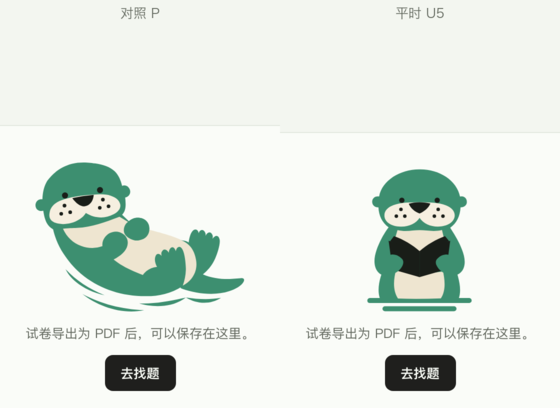

Owner 让 Droid 挑直立场景放在哪（「听你的」）。Droid 在本地临时服务上用 demo 账号拍了第 49 条提案里的三类位置，截图脚本只替换图片，没改页面代码：

- **个人空间空态：换成 U5 · Droid 定**。同一位置并排比了 P、U5、U6、U1，各拍 150px 高和「脸和 P 一样大」两种。选 U5：立在水里捧着书，接得上「水上的备课桌」（§1.1）和「卷面导出后存在这里」的意思；水线是两道墨色短横，下沿是平的，卡片里站得稳。U6 坐姿的尾巴往右伸，重心偏；U1 最高，书斜着，书页只剩一道细边。**2026-10-14 订正**：当时比的尺寸被 viewBox 的空白骗了（§4.4「viewBox 订正」），写的「150px 下直立的脸只有 P 的三分之二」「按脸缩放后 U6 约 202px、U5 约 218px、U1 约 238px 高」「卡片高出约 70px」都不对。收紧后按脸缩放，U6 174px、U5 143px、U1 183px 高；U5 的空态卡片 296px，比用 P 时的 304px 还矮一点。挑 U5 的理由不靠尺寸，结论不变；两张截图已重拍，第二张只留 P 和 U5。
- **首页欢迎：不放**。DESIGN §1「首页是归来，不是迎宾」，首页给老师自己的工作，不给海獭打招呼。U3 打招呼留给第一次登录这类时刻，登录页仍是 SL 探头（第 41 条），同一屏只出一只。
- **单词复习的筛选空态：不放**。试的是「词组」页签的「没有符合条件的词组」：它是筛选没结果，老师每天用、换个搜索词就会出现，现在只有一个小图标和两行字；把图标换成 150px 的 U1 以后卡片被撑高约一倍，海獭比要做的事还抢眼。
- 这只是品牌文件里的试用截图，网站代码没改；真要换要另开 UI 任务，按 §4.7 的尺寸来做。旧的 P 截图 `evidence/my-space-empty.png` 留着作对照。

**个人空间空态换成裹藻仰躺 · 已定（Owner 2026-10-14，第 57 条）**

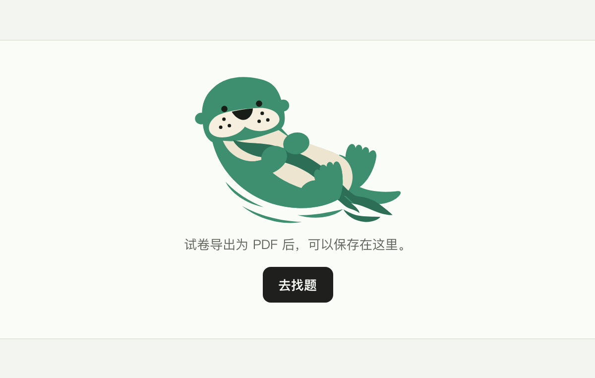

照上面直立场景同样的放法：按两眼间距和 150px 高的 P 一样大，约 148px 高、209px 宽，居中放在文案上面，空态卡片 302px。裹着巨藻不漂走，就是「保存在这里」（§1.1、§4.4）。上面 U5 那两张截图留作对照。这只是品牌文件里的试用截图，网站代码没改；真要换要另开 UI 任务。

**小尺寸怎么挑文件 · 提案（Droid，第 45 条）**：按设备像素挑，不按 CSS 尺寸。16 CSS px 的位置（浏览器标签、行内小头像），普通屏用 16px 版，高清屏用 32px 版；32 CSS px 的位置，普通屏用 32px 版，高清屏要 64 设备像素，用母版。逐格画版只按原尺寸显示，不放大也不缩小。

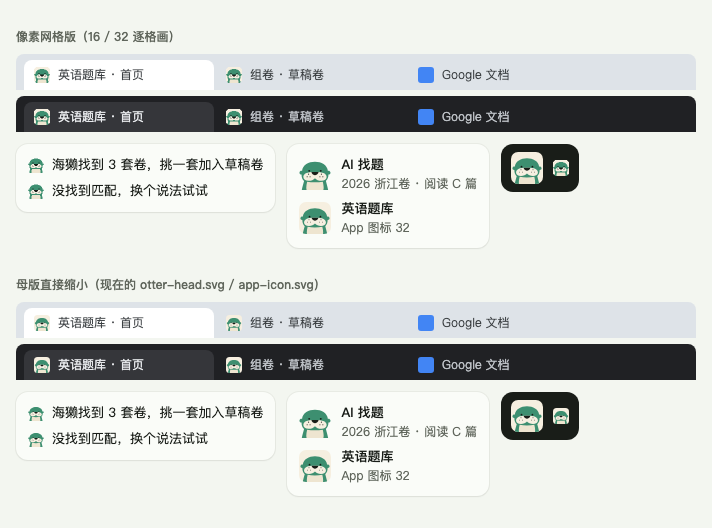 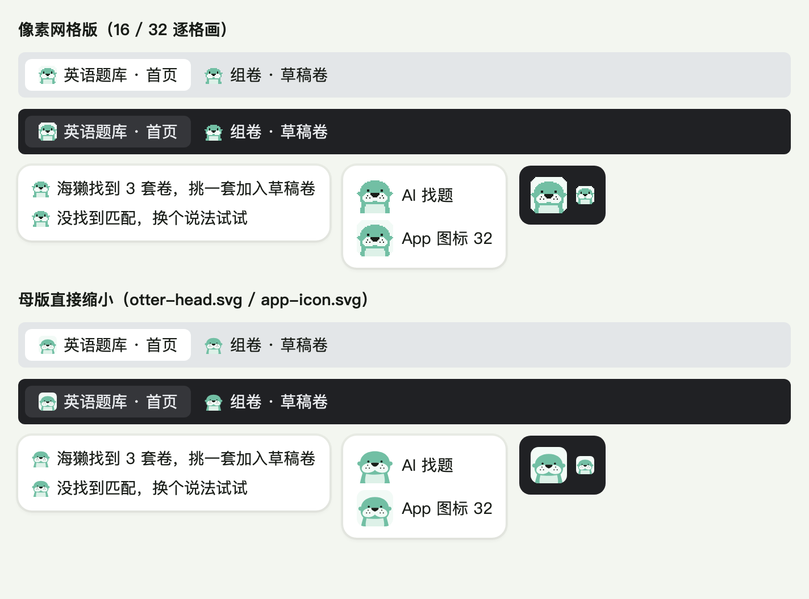

### 4.8 两种画法 · 分工提案；3D 宣传版 Droid 定（2026-10-15，第 66 条）

- **界面**：平涂矢量，只用从母版派生的矢量文件。
- **宣传**：3D 版，从同一母版派生，只用于开屏、宣传和周边。
- **换介质要重新设计**：贴纸、横幅、毛绒、3D 各自调整，不直接把 2D 放大或挤出。

**3D 宣传版 · Droid 定（2026-10-15，第 66 条）**

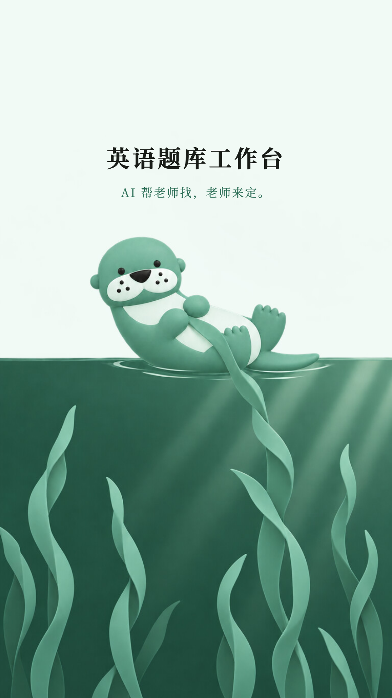 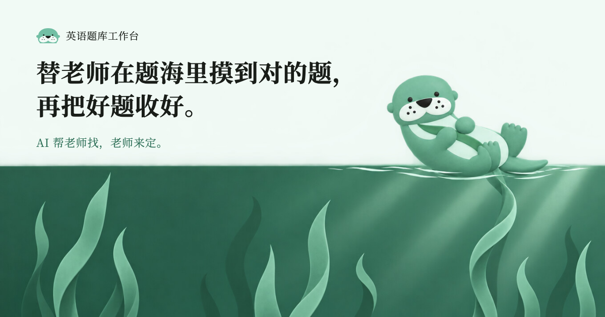

- **材质**：哑光搪胶，像一只软胶公仔。同一张母版 P 出了三种材质，各用 GPT Image 编辑和 Nano Banana 出一张（`evidence/3d-materials.jpg`）：A 哑光搪胶，轮廓和 P 一样，色块干净，只多一层柔和的明暗，用 GPT 那张；B 羊毛毡的绒面把 ∴ 和下巴的边吃糊了，小尺寸读不出，像手工摆件；C 平色卡通渲染表面有反光，像塑料玩具。Nano Banana 那几张都带落地阴影，羊毛毡还改了脸型；GPT 出的是透明底，可以直接铺进场景。
- **3D 母版**：`illustration/promo-3d/otter-3d.png`，透明底，1010×983，空手、爪子搭在胸前，和平面母版的「永远保留」逐条对过：竹青的头、下巴、手臂和脚，暖米白脸斑，米白肚子，墨点眼、宽墨鼻、∴，四趾。以后的周边和别的 3D 场景都从这张出，不回到平面母版重新生成，免得每次长得不一样。
- **颜色**：还是五色，明暗只是同一色的深浅，不加新色相。§4.9 的「平涂，无渐变，无纹理」管平面版；3D 版是唯一允许有明暗的地方，但不加描边、不加纹理、不加眼睛高光。
- **两张图**：开屏 1080×1920、横版 1200×630，构图照平面宣传大图（第 63 条）：上面暖米白的天写字，下面深竹青的水铺满，巨藻和米白光束，獭獭裹着一根巨藻漂在水面上。画是拿草图和 3D 母版让 GPT Image 编辑出的；Nano Banana 不按参考图的比例，出成了方图，不用。GPT 出的天是透明的，统一铺暖米白；水下边缘有几处半透明的洞（铺上去会透出米白），水面以下改成不透明。
- **字**：横版和平面宣传大图同一套字号和位置（§3.3「宣传标题字」）。开屏只放名字和副句，不放标题，开屏只停一两秒，读不完长句；也不放图形标志，3D 獭獭本身就是标志，再摆一个平面头像，画面上就是上下两只獭獭头。名字和副句都是占位，名字定了一起换（第 61 条）。
- **缩略**（`evidence/promo-3d-sizes.jpg`）：手机开屏 390×844 按 cover 铺，左右各裁约 40px，名字约 28px，獭獭和水面完整；链接卡片 300px 宽时标题约 12px，读得出，脸和四趾还看得清；开屏缩到 150px 宽时名字约 9px，读不清，獭獭还认得出。
- **限制**：画是 768×1360 和 1360×768 放大来的，开屏放大了 1.4 倍，近看偏软；要印周边，得用 3D 母版重新出高清图。场景里的巨藻和光束是模型画的，不是原语巨藻的形状。
- **文件**：`illustration/promo-3d/` 下 `splash-art.jpg`、`wide-art.jpg` 是画，`promo-3d.html` 是排版，`promo-3d-splash.png`、`promo-3d-wide.png` 是按 1 倍从它截出来的（两款字都已加载）。用量 10 次生成，15 次额度。Paper「主题 14 · 3D 宣传版」页有两轮的生成记录和定稿核对卡。

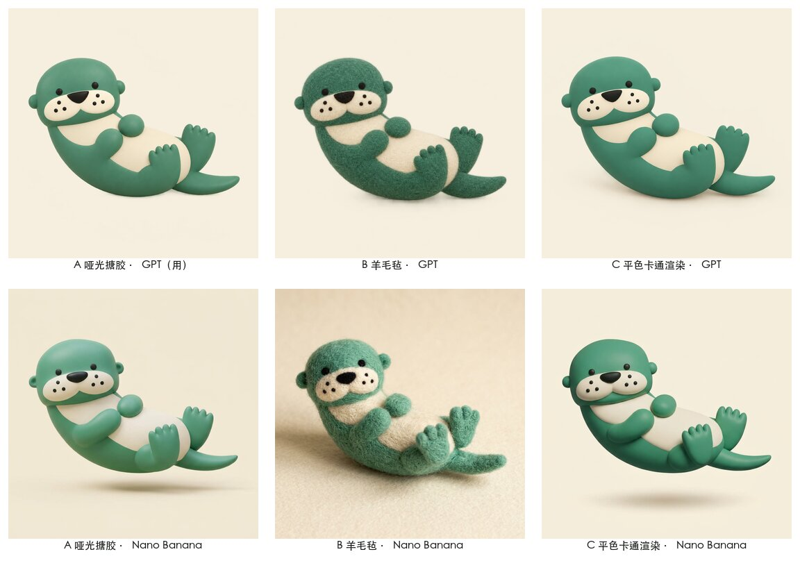 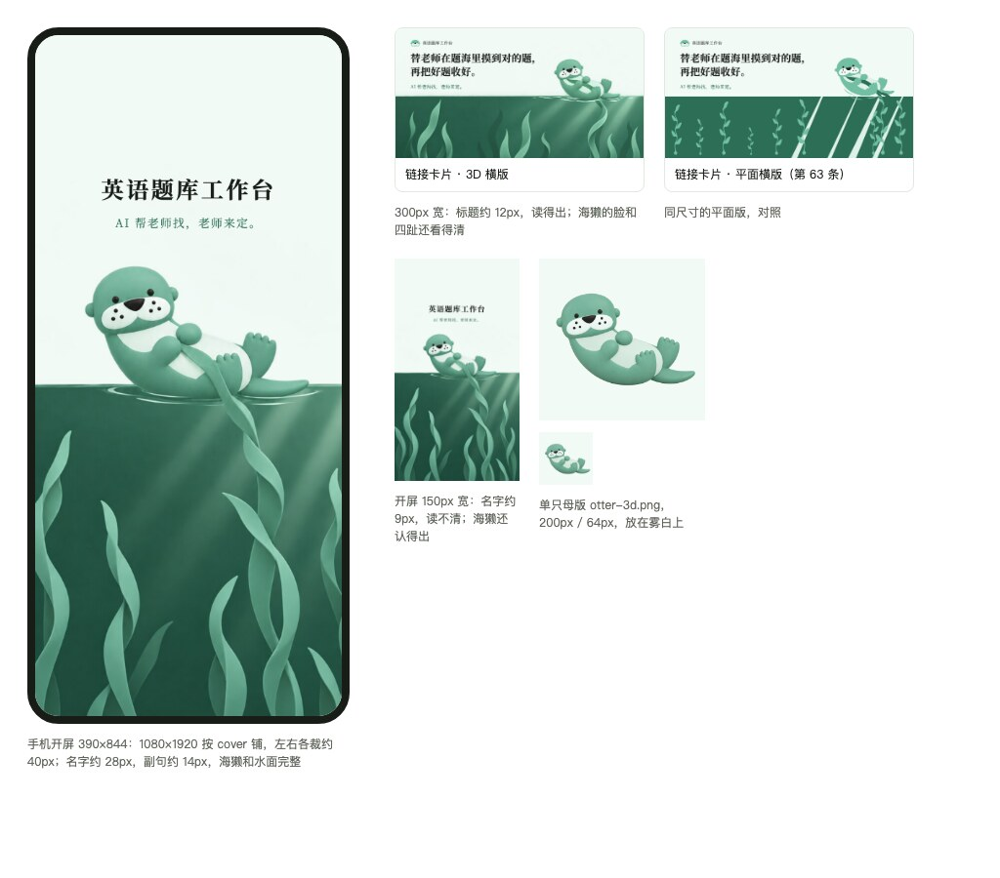

### 4.9 永远保留 / 永远不做 · 提案（「永远保留」的前两条和空手一条已在 §4.2 定下）

**永远保留**

- 竹青的头、耳朵、下巴、背、手臂、尾巴和脚；暖米白的脸斑四周被竹青包住；米白的喉咙、胸口和肚子，和脸斑之间隔一道竹青下巴（2026-10-14 加下巴，第 44 条；2026-10-13 换 H1 大鼻子时是「米白的喉咙、胸口和肚子接进口鼻外圈，口鼻里层暖米白」，第 33 条；D2 时是「竹青的背、手臂、尾巴和脚，沙白的头、耳朵、喉咙、胸口和肚子」，第 27、28 条；最早是「竹青身体，暖米白口鼻和脸颊，米白肚皮」）
- 墨点眼、宽墨鼻、墨胡须点（每颊三个点排成 ∴，§4.2）。宽鼻是 2026-10-13 定的（第 27 条），原来是「小墨鼻」
- 小圆耳长在头的两侧、短前爪、带趾的短后脚、短而扁的尾巴（2026-10-13 按海獭改；原来是水獭的粗而渐尖。形状以海獭版母版为准，§4.2）
- 平涂，无描边，无渐变，无纹理（例外两处：64px 以上单色介质用的墨线稿头像，§3.1，第 53 条；3D 宣传版允许同色明暗，仍不加描边和纹理，§4.8，第 66 条）
- 头身比例与母版一致
- 基础形象空手，爪子搭在胸前；石子只在状态插画里出现

**永远不做**

- 腮红、眼睛高光、眉毛、张嘴大笑、流泪
- Q 版大头小身体、超大眼睛
- 整套拟人衣服，拿手机或电脑
- 新增 §1.5 以外的颜色，或用回已停用的沙白（第 33 条）；身体用墨黑（像戴面具）；道具用竹青（和身体糊在一起）
- 出现在卷面上，或打断读题、编辑
- 用对话气泡讲道理、喊口号

### 4.10 伴学阶段的演进 · 未开始

- **时间**：PRODUCT.md 的第 4 阶段（伴学），排在教师任务之后。
- **不变**：物种、形体、配色、性格，以及 §4.9 里防幼稚的条款。
- **可以放宽**：表情范围（比如鼓励、陪练时的姿势）、出场频率、学生场景的新状态。
- **到时候要先回答**：在学生场景里，海獭说不说话。

## 5. 界面视觉

### 5.1 品牌怎么在界面里出现（不靠海獭）· 提案

老师每天看的是界面，海獭只偶尔出场，所以界面本身要认得出是本产品。下面这些 DESIGN.md 已经定义，本文件不重复写，只要求它们与品牌底层一致：

- **备课桌**：Daydream 桌面色阶，内容面只比桌面白一点，纸张像搁在桌面上（DESIGN.md §1、§2、§4）。
- **字**：工具字道与卷面衬线字道各守一层（DESIGN.md §3）。
- **线**：胖而干净的图标线，和旁边的中文同重（DESIGN.md §5 同重法）。
- **圆**：只用一个圆角家族 {4 / 8 / 12 / 16 / 999 / 0 / 50%}（DESIGN.md §5）。
- **墨**：黑填充只给短动作（DESIGN.md §2）。
- **竹青色阶**：竹青和深竹青只出现在标志、头像、海獭和插画里。
- **语气**：像同事说话（§1.3；格式见 DESIGN.md §9）。

### 5.2 插画体系 · 第 1 轮 Droid 提案（2026-10-14，第 54 条）

Owner：「插画体系：空态、错误、引导、完成时刻的画法规则，先出几张样张」。Droid 先清点了网站里真有的这几类时刻，再用 Arrow 2 出了五张样张，放进真实页面比。下面的规则都是提案，Owner 可以推翻。

**什么时刻配图**

| 时刻 | 配不配 | 用什么 | 例子 |
| --- | --- | --- | --- |
| 首次空态，整页、低密度 | 配 | 对象本身就是卷子、纸、书时，用原语插画 64px；整页只有一个空态、而且像「水上的备课桌」时，用海獭 150px | 生词本「在试卷中选中单词，点击加入生词本」用 `spot-paper.svg`；个人空间空态用裹藻仰躺（第 57 条，原来是 U5） |
| 页签或面板里的空态 | 不配，留 EQB 图标 | | 听写页签「还没有听写」、复习页签「现在没有待复习单词」 |
| 筛选、搜索没有结果 | 不配，留图标和文字 | | 「没有符合条件的词组」（第 50 条） |
| 错误 | 不配 | 只写发生了什么和下一步（DESIGN.md §9） | 「没找到这份卷面」、个人空间读取失败 |
| AI 等结果、确认、没找到 | 用状态图 | 02、03、05（§4.4） | |
| 完成 | 用状态 04，只在出结果的那一屏 | toast 不配图 | 导出完成、组卷完成 |
| 引导 | 网站现在没有引导流程；以后要做时，第一次登录用 U3 打招呼，一屏一只，不做多步插画 | | |
| 宣传 | 配，用宣传大图（第 63 条） | 水铺满下部、獭獭裹藻漂在水面上，字写在上面的天上 | 链接卡片、文章头图用横版 1200×630；朋友圈、海报用竖版 1080×1440 |

判断顺序：先问这一刻老师会不会天天看见（会就不配），再问插画说的是不是这件事本身（不是就不配），最后才问怎么画。

**两类插画**

- **只用原语**：由折角纸、正文行、药丸空、书签、点拼成（§3.4），不画海獭。纸用竹青面，正文行和药丸空用米白，书签用墨。不和海獭同框，所以竹青可以做主体；和海獭同框时，手里的东西照 §4.5 用墨。
- **有海獭**：先用 `mascot/` 里现成的状态图和直立场景；要新场景时按 §6 用 Arrow 2 从母版直出。海獭手里只拿书、石头、贝壳和 §4.5 的道具，**不拿单张纸**：墨色单张纸两次都读成平板或手机，违反 §4.9。

**画法**

- 平涂，只用 §1.5 的四色（竹青、暖米白、米白、墨），无描边，无渐变，无阴影，透明底。§1.4 末尾「插画沿用待确认」按这条落实。第五色深竹青只给巨藻（§3.4，第 55 条）、林冠透光中图的水（第 58 条）和宣传大图的水（第 63 条）。不透明底的只有这两种：林冠透光中图自带一块水；宣传大图是一整张图，天是暖米白。
- 米白和暖米白不直接贴在桌面上（对桌面 1.05–1.15），外面要有竹青包住，和海獭的规则一样（§4.7）。
- 水只用一两道细弧（§3.4）。细弧在 96px 下几乎看不见，只在 150px 以上、而且有主体时当陪衬。

**尺寸档**

- 原语小图 64px 高。96px 在面板里比标题还抢眼。
- 海獭 150px，按 §4.4、§4.7 的眼距规则放。
- 中图 240–480px（第 55、56、58 条，下面「巨藻林」几节）。
- 宣传大图按画幅出：横版 1200×630、竖版 1080×1440（第 63 条，下面「宣传大图」一节）。

**样张和实景（第 1 轮）**

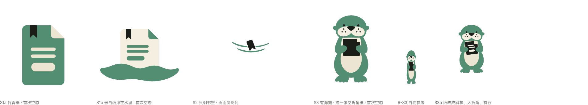 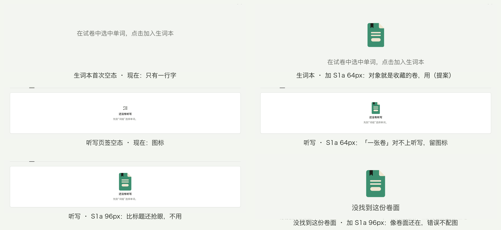

- **S1a 竹青纸 · 用**：放进生词本首次空态，64px 在一行字上面，整页不再空得像没加载完；生词本列表里每一项就是一张收藏的卷，书签也对得上「收藏」。文件 `design/brand-2026-10-13/illustration/spot-paper.svg`。放进听写页签，「一张卷」对不上听写，留原来的图标。
- **S1b 米白纸 · 不用**：纸的上沿和两边在桌面上看不见，只剩正文行和书签浮着。
- **S2 只剩书签 · 不用**：96px 下读不出是什么。另外试了把 S1a 放进「没找到这份卷面」，像卷面还在，所以错误页不配图。
- **S3、S3b 海獭抱单张纸 · 不用**：S3 的空纸像黑色平板；S3b 改成斜拿、加大折角和正文行，放大看是纸，原尺寸下黑块加几道白线仍容易看成手机屏幕。没放进真实页面。
- **做法**：Paper「主题 8 · 插画体系」页。Arrow 2 编辑（quiver-arrow-edit），原语的参考是状态 01 的白底渲染图（只给画风），海獭的参考是 V2 正面和 U1；S3b 的参考是 S3 的白底渲染图。S1a 出来就是四色（正文行用了米白 `#EEE5D0`，不是提示词里的暖米白，对桌面差别看不出，不改），收口只删了宽高和 style、收紧 viewBox。实景在本地临时服务上用 demo 账号拍，截图脚本只插入图片，没改页面代码。用量 5 次生成，15 次额度。
- 网站代码没改。生词本空态真要加图，另开 UI 任务。

**巨藻林 · 第 1 轮 · Droid 提案（2026-10-14，第 55 条）**

Owner：「加一个生态，巨藻林」。世界观见 §1.1，巨藻的画法见 §3.4。这一轮收了三个文件：

| 文件 | 是什么 | 用在哪 · 提案 |
| --- | --- | --- |
| `illustration/kelp.svg` | 原语巨藻，深竹青一色 | 拼插画的零件；单独不当空态图（「一株海草」说不出任何一件老师的事） |
| `mascot/kelp/otter-kelp-wrap.svg` | 裹藻仰躺（§4.4） | 「保存、收好」的空态和完成时刻，150px 档 |
| `illustration/kelp-forest.svg` | 巨藻林中图：裹藻的海獭漂在水面，缠在身上的那株从海底长上来；远处三株米白；一道竹青细弧是水面 | 240–480px 的品牌位置（介绍、宣传），不进工具界面 |
| `mascot/kelp/otter-dive.svg` | 潜水（§4.4，第 56 条） | 只拼进潜水中图，不单独用 |
| `illustration/kelp-dive.svg` | 潜水中图：海獭从水面往左下潜进巨藻林，近处一株深竹青，远处三株米白，上沿一道竹青细弧是水面（第 56 条） | 和巨藻林中图成对，用在同样的品牌位置 |
| `illustration/kelp-canopy.svg` | 林冠透光中图：一块深竹青的水，三束米白光从右上斜照进五株竹青巨藻，海獭裹藻漂在水面上（第 58 条） | 一次性的大品牌位置，240–480px；不做空态、不当背景 |

- **中图第一次有了样子**：上面「尺寸档」里 240–480px 的中图原来没试。巨藻林中图在 240px 和 360px 下，放在桌面和内容面上都读得出「漂在水面，被一株巨藻拴着」；远处的米白巨藻对桌面只有 1.15，是故意的，只当景深（`evidence/kelp-forest-desk.png`）。还没放进真的介绍页或宣传位，因为网站现在没有这类页面。
- **巨藻不当界面底纹**：在登录页卡片后面试了一片巨藻，让卡片上沿当水面。米白版像墙纸，看着像花草装饰，读不出是海底；加一株深竹青以后比登录框还抢眼。两版都不用，登录页照旧只有 SL 探头（§4.7）。这和 §1.6「界面不加品牌花纹」一致。
- **画法**：水面上一只海獭，水下的巨藻从画面下沿长上来；巨藻用 §3.4 的原语，不重画。巨藻林中图是用另外两个文件原样拼的（巨藻横向压到 0.62），没有另外生成；以后要别的林中场景，也先拼，拼不出再生成。

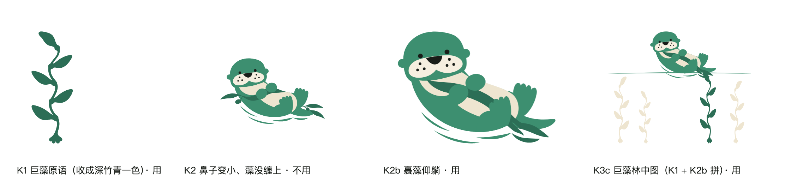 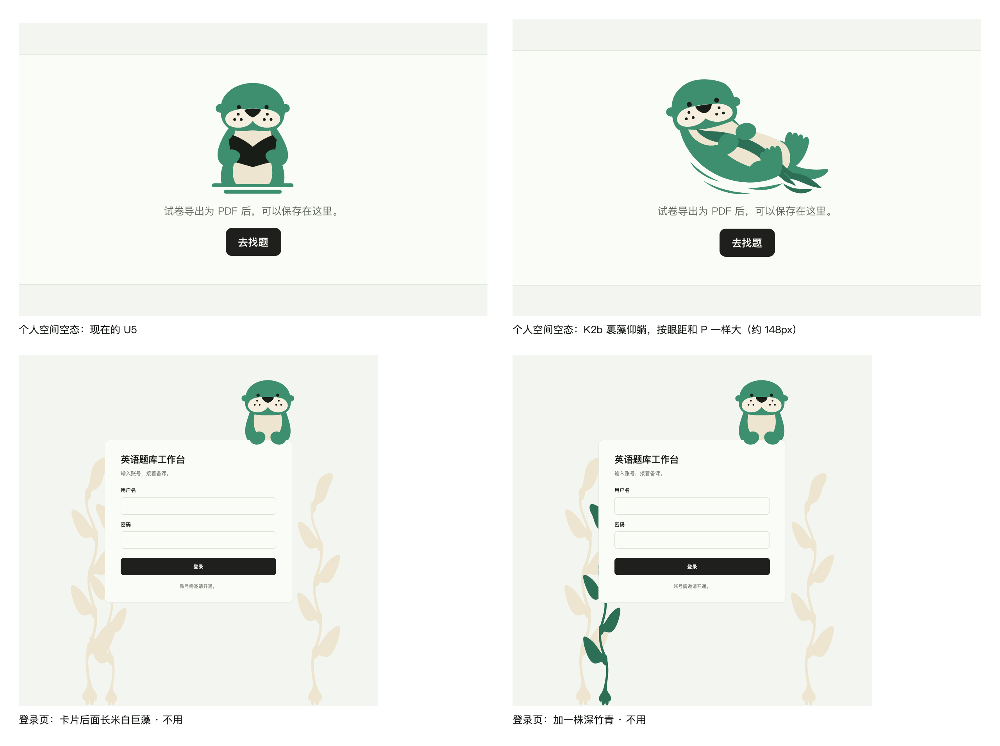

- **样张**：Paper「主题 9 · 巨藻林」页，Arrow 2 编辑。K1 原语巨藻：参考是状态 01 的白底渲染图，只给画风；出来是一株竹青叶片配深竹青茎，收成深竹青一色。K2 裹藻仰躺：参考是 P 加照片，鼻子变小、下巴没了、巨藻只搭在身边，不用；K2b 只给 P 作参考，巨藻斜缠过肚皮，脸对得上，收口删了六个漂在身外的暖米白碎点。K3 巨藻林中图生成失败；K3b 简化重出，只画了半张，海獭太小，不用，改成拼图 K3c。用量 5 次生成（K1、K2、K3、K2b、K3b），按每次 3 次额度算最多 15 次；K3 失败的那次扣没扣额度没查。实景在本地临时服务上用 demo 账号拍，截图脚本只插入图片，没改页面代码。
- 网站代码没改。个人空间真要换图，等 Owner 定了另开 UI 任务。

**潜水中图 · 提案（Droid，2026-10-14，第 56 条）**

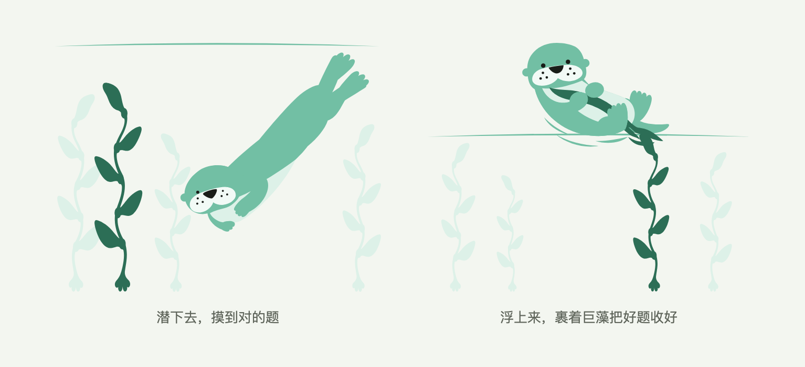

- **成对用**：潜水中图和巨藻林中图放在一起，就是 §1.1 那句「替老师在题海里摸到对的题，再把好题收好」：左边潜下去摸，右边浮上来收。适合介绍页、宣传图这类要讲产品在做什么的位置；单独用时，巨藻林中图讲「收好」，潜水中图讲「找」。
- **构图**：照 Owner 的照片，海獭在右上、往左下潜，巨藻在左下；水面是上沿一道竹青细弧，后脚刚离开水面。巨藻和水面都照 §3.4，不画光束、气泡和蓝色。两张的海獭大小和水面高度还没对齐，等真有介绍页再统一（宣传大图没用这一对，第 63 条）。
- **样张**：Paper「主题 9 · 巨藻林」页的「潜水」一节。D1 给了照片和 V2 四面，用；D2 只给 V2 四面、姿势靠文字，头更大，但前爪像一块贴在身上的补丁，远侧耳朵压在胳膊上，不用。潜水中图是 D1 和原语巨藻拼的，没有另外生成。用量 2 次生成，6 次额度。

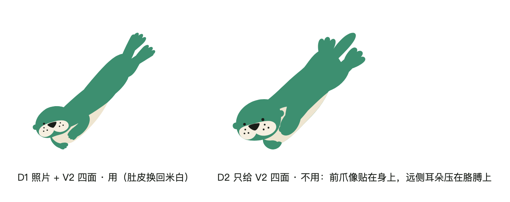

**林冠透光中图 · 提案（Droid，2026-10-14，第 58 条）**

Owner 在问卷里选了「再试一张巨藻林场景（比如林冠透光、手拉手睡觉）」。手拉手睡觉要画两只海獭，违反「一屏一只」（§4.7），不做；做 Owner 第一批照片里的林冠透光。

- **为什么要一块水**：林冠透光讲的是光。米白光放在桌面上看不见（对桌面只有 1.05–1.15），所以这张自带一块深竹青的水，上沿就是水面，海獭漂在上沿上。这是 §3.4「水只用细弧」的唯一例外。
- **光怎么画**：三束米白光，每束同一斜度（往左下约 22°），水面处窄、往下变宽，一直出下沿。第一版两头尖的细梭形看着像爪子划痕，不用。光画在巨藻后面，巨藻挡住光，才读得出是从林冠里漏下来的。
- **配色**：深竹青水、米白光、竹青巨藻、海獭照原样。竹青水（C3）和海獭同色，海獭漂在上面糊成一片；米白水配暖米白光（C6、C7）最安静，可光几乎看不见，「透光」没了；深竹青水配墨色巨藻（C4）太沉，墨一大片抢过了海獭的眼鼻。竹青巨藻对深竹青水只有 1.54，靠形状分开，作背景景物够用；米白光对深竹青水 4.83。
- **代价和用法**：一大块深色，比巨藻林、潜水两张中图重得多（`evidence/canopy-trio.png`）。所以只给一次性的大品牌位置，比如以后的介绍页头图、宣传图，240–480px；不做空态，不当登录页或卡片背景（巨藻底纹已在第 55 条否掉），不进工具界面。和另两张放在一起时，它当主图，另两张当配图，不三张等大并排。
- **做法**：用原语巨藻和裹藻仰躺原样拼成（巨藻横向压到 0.55），没有另外生成，0 次额度。样张在 Paper「主题 9 · 巨藻林」页的「林冠透光 · 核对卡」。

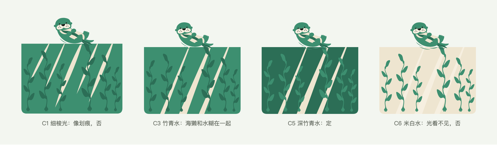 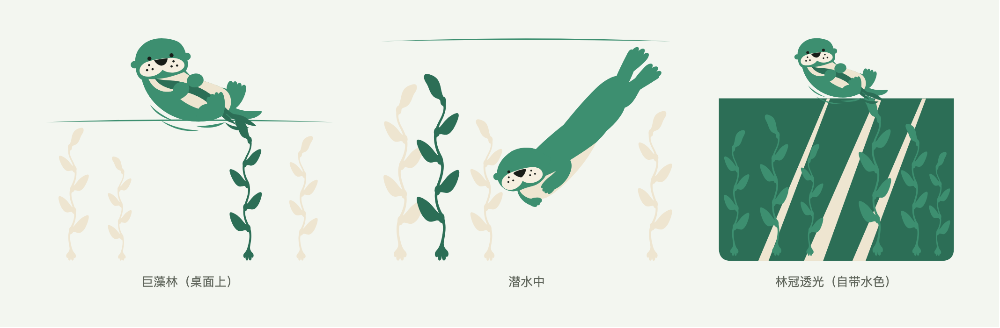

**宣传大图 · Droid 定（2026-10-14，第 63 条）**

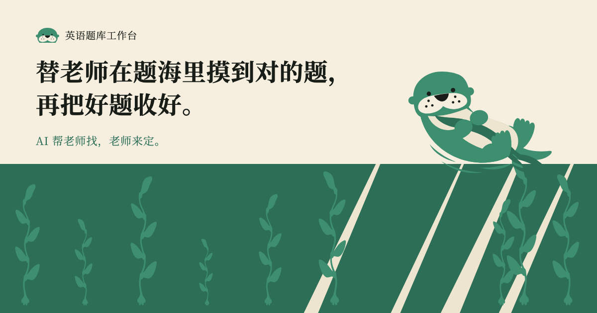 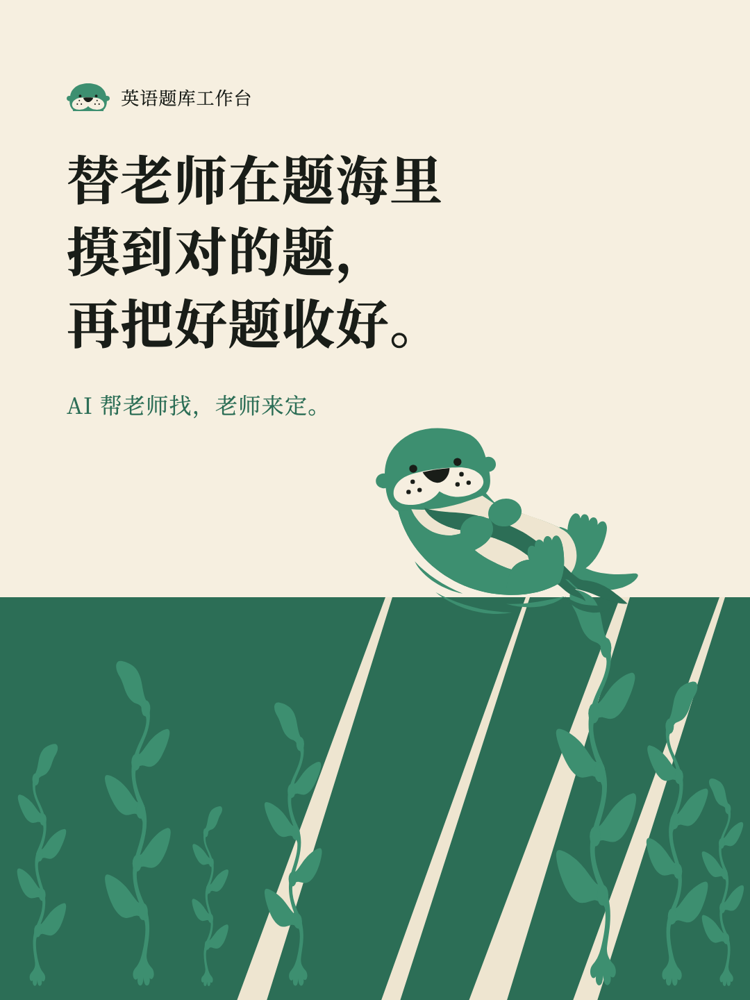

- **构图**：林冠透光中图（第 58 条）放大成整张图。一整块深竹青的水铺满画面下部，上沿平直就是水面；米白光束从右上斜照进巨藻林，画在巨藻后面；獭獭裹着巨藻漂在水面上，缠在身上的那株从海底长上来。字写在上面的天上，左对齐。整张只有一只獭獭（§4.7）。
- **两个画幅**：横版 1200×630，链接卡片和文章头图，水面在 y=330，8 株巨藻、4 束光；竖版 1080×1440，朋友圈和海报，水面在 y=860，6 株巨藻、4 束光，标题分三行。
- **配色**：天暖米白 `#F6EFE0`，水深竹青，光米白，巨藻竹青，獭獭照原样。标题墨（对天 14.91），副句深竹青（对天 5.28），都照 §1.5「写字只用三种组合」。天先用过网站桌面 `#F3F6F0`：不在五色里，宣传图贴在别人的页面上，上半像没画完；换成暖米白以后，天和水里的米白光同一条色阶，光像从天上照下来。
- **字**：思源宋体，标题 Bold，副句和名字 Regular（§3.3「宣传标题字」）。标志用图形标志 `logo/mark.svg`（§3.1）。标志旁的「英语题库工作台」是现在网站的标题，只是占位；标题和副句是 §1.1 的提案。名字定了以后，名字换成字标，两句话一起改（第 61 条）。
- **比过的版本**（`evidence/promo-compare.png`）：A 把林冠透光中图当一块图放在右边，像在海报上贴了一张卡片，水只在框里，不用；B 水铺满，用。B 第一版的光束太宽、四条一样粗，像斑马线；巨藻一样高、太粗，像墙纸；改成光束变窄、粗细不一、斜度放缓，巨藻横向压到 0.55、高矮错开。
- **缩略**：链接卡片约 300px 宽时标题字约 12px，读得出；朋友圈约 150px 宽的竖版标题约 10px，读不清，但獭獭和水面还认得出。所以以后换标题时不能比现在更长。
- **没用的**：潜水中图和巨藻林中图那一对（第 56 条）没放进宣传大图，一张图里两只獭獭就破了「一屏一只」。那一对的獭獭大小和水面高度，等真有介绍页再统一。
- **文件**：`illustration/promo/` 下 `promo-wide-art.svg`、`promo-tall-art.svg` 是画（五色，没有描边和渐变，天也画在里面）；`promo.html` 是排版，用浏览器直接打开就能看；`promo-wide.png`、`promo-tall.png` 是按 1 倍从 `promo.html` 截出来的，截图时确认过两款字都已加载。画是用原语巨藻和裹藻仰躺原样拼的，0 次生成。Paper「主题 12 · 宣传大图」页有核对卡。
- **和 3D 的分工 · Droid 定（第 66 条）**：开屏和周边用 3D（§4.8）。链接卡片和文章默认用这两张平面图：平面版和界面里的獭獭是同一种画法，小尺寸也更利落；3D 横版（同尺寸、同一套字）留给要更打眼的推广位。朋友圈和海报的竖版暂时只有平面版。

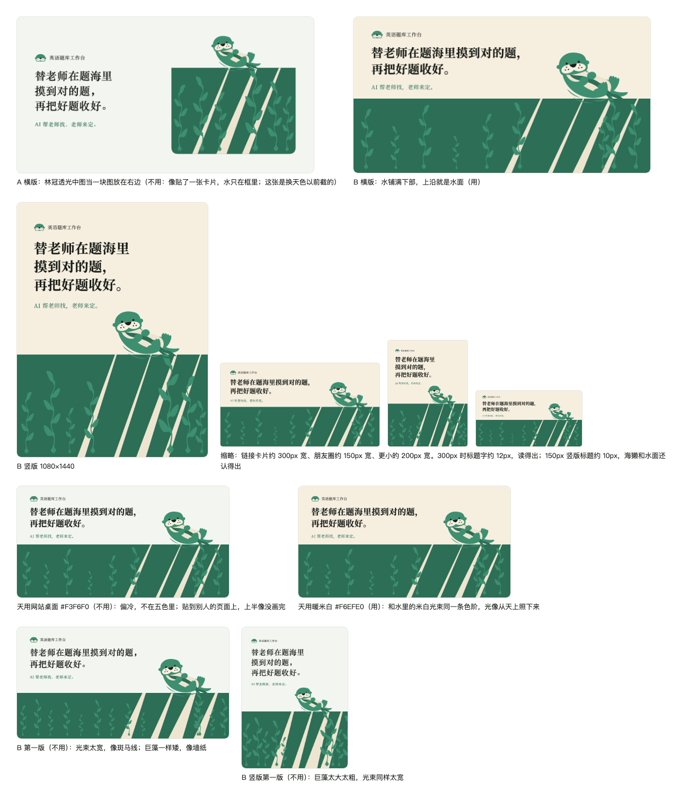

### 5.3 图标 · 已定（沿用 EQB 图标套件）

- **来源**：`app/src/icons`，源文件 `design/icon-system-2026-09-15/icons-v3.mjs`，理念见同目录的 `principles.md`。#497（2026-10-06）已把最新图标用到全站。
- **Owner 后来的决定**：图标要「微妙、生动」（2026-09-28，principles.md §5）；题型不搞图标（2026-09-30），首页已移除题型图形，只留文字；图标状态动效沿对象关系运动（2026-10-03，motion-rules.md）。
- **和品牌的关系（提案）**：图标是界面里的线条语言，海獭和插画是面的语言。两者共用圆润、清爽、留洞的形状规则，但图标不上品牌色，也不做表情和拟人。
- **边界**：图形标志（§3.1）不是图标，不进图标套件。海獭的学科道具也不是图标（§4.5）。

### 5.4 动效与语气 · 已定（沿用 DESIGN.md）

动效 token 见 DESIGN.md §6，图标状态动效见 `design/icon-system-2026-09-15/motion-rules.md`，文案法见 DESIGN.md §9。海獭动效的额外规则见 §4.6。

## 6. 工作方法 · 提案

两批参考文章的做法，落到本项目是这样：

1. 先定目的、出场位置和情绪，再画形象。先在小处证明：新东西先放进一个低风险的位置试，比如登录页或一个空态，站住了再推广。
2. 形体用简单的形，AI 才画得稳。人先定骨架（母版和三视图），AI 负责发散，人再把结果收成矢量。
3. 用滑杆调参数，不靠口头说「大一点、小一点」（调参页 `.scratch/brand-mascot/v5/tuner.html`，结果见 J 画板）。
4. 放进真实页面再判断：起临时本地环境，把形象注入真实页面截图（K 画板）。
5. 只有一个母版：所有派生都从 `design/brand-2026-10-13/mascot/` 的母版来，改一处，全部同步。
6. 状态对应产品语义（§4.4）。
7. 不再用代码手画角色：形象由 AI 出图，再描成矢量，在矢量上精确修改。出图由 Astra 自己调用 GPT Image 2.5（Banana 作备选），矢量交给 Paper 里的 Arrow 2，修改也回 Arrow 2，不在代码里改形体（Owner 2026-10-13，第 36 条）。浮姿修订这一次，Owner 指定由 Droid 用 GPT Image 2.5 出位图，再交给 Telos 描（第 37 条）。2026-10-14 起 Droid 负责主要审美，可以按需要选用 Paper 里任何生图模型，位图和矢量都一样（第 42 条）。
8. 在现有基础上长：不推翻已验收的界面，包括 Daydream 桌面色阶、图标套件和圆角家族。品牌长在它们上面，不替换它们。
9. 一种手感：标志、海獭、插画、图标出自同一套形状规则（§1.4），放在一起要像同一只手画的（§1.8 第 4 问）。

工具：

- **位图发散**：Codex 出图，再用 potrace 描成分层矢量。
- **矢量直出**：Paper 里的 QuiverAI Arrow 2 和 Arrow 2 Telos，可以吃参考图，直接出可编辑的 SVG。每张花 3 到 4 次生成额度，先小批试一致性。
- **新场景先试 Arrow 2 直出 · Droid 定（2026-10-14，第 53 条）**：把母版矢量渲成白底图当参考，交给 Arrow 2 编辑（quiver-arrow-edit），一步出矢量。试了 U1 抱书和 U7 毕业两张：按脸斑宽度归一后，眼距、鼻宽、脸斑高和四面 V2 差不超过 3.6%，和「GPT Image 2.5 出位图 → Telos 描」两步的 U1、U7（不超过 2%）同一档；颜色直接是 H1 四色、没有描边，不用收口；一张 3 次额度，两步法一张约 6 次。所以新场景先走 Arrow 2 直出，脸偏了再退回两步法。局限：只比了 2 张；下巴厚度的量法不可靠，没比。Arrow 2 的原始 SVG 带白底矩形和近墨色，进仓库前去掉白底、颜色收到 §1.5，再收紧 viewBox。并排图：

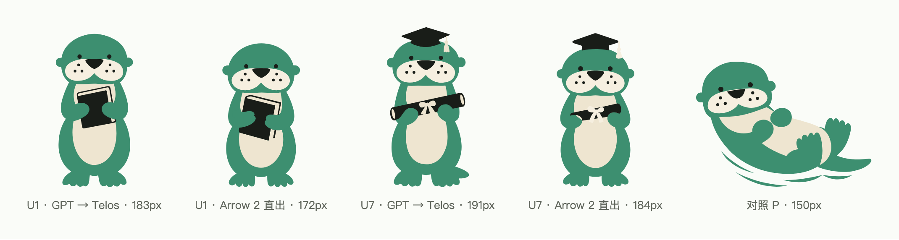
- **出图后统一收口**：颜色收成 §1.5 的色值，去掉描边和渐变，对照三视图检查比例。

参考文章：

- Roman Yakovlev，[Making Complex Products Feel Human: Designing Mascots for B2B SaaS](https://uxmag.com/articles/making-complex-products-feel-human-designing-mascots-for-b2b-saas)，UX Magazine，2026-10-01
- Jess Riley，[How to Design a Mascot](https://elements.envato.com/learn/how-to-design-a-mascot)，Envato，2026-02-02
- Jack Watson，[How to Design a Brand Mascot with AI](https://www.youtube.com/watch?v=EEL4CAMWKSI)，YouTube，2026-10-05
- 第二批：Owner 2026-10-13 又转来一批文章，标题和链接没有记进仓库。从中得到的经验已写进 §1.1（信念、世界）、§1.6（导出物靠排印说话）、§2（口号）、§3.1（16px 像素网格、按场合用标志）、§3.3（字标在现成字体上改）、§4（差事、状态 05、教学日历换装、动效节奏）和本节第 1、8、9 条，全部是提案。

## 7. 决策记录（截至 2026-10-15）· 已定

1. **做吉祥物**：Owner 推翻 DESIGN.md 和 PRODUCT.md 里「不做吉祥物」的旧规定。
2. **物种**：先试鸭嘴兽，形象难看，放弃；改成水獭，泛指水獭，不做海獭。后来改成海獭（第 24 条）。
3. **形体**：以 v2 正面为母版。v3 和 v4（骨白脸包住眼睛、头罩式分色）越调越像土匪，放弃。
4. **配色打法**：身体就是品牌主色，两色加墨，墨只留给小细节。原因是墨黑身体和浅色脸的强对比会形成面具边。
5. **配色**：六组配色放进真实页面对比后，Owner 选 c3：竹青 `#3D8F70` 加暖米白 `#F6EFE0`。K 画板对 c3 的评语是更亮更活泼、16px 和 32px 小图标最好认，代价是比网站身份色亮一档；§1.5 的深竹青提案就是为了处理这个色差。其余几组在 K 画板上的评语：c0 墨黑（浅脸被黑头框住，像土匪）；c1 松烟青加暖米白（原推荐，主色就是网站现有的身份色）；c2 松烟青加冷纸白（偏冷，远看像熊猫）；c4 黛青（小尺寸几乎读成黑色）；c5 栗棕（和网站的绿色身份打架）。
6. **石子**：从基础形象拿掉，只在状态插画里出现。原来的位置并进肚皮，重新描成一整块。
7. **眼睛**：换色后，下一轮再调（第 19 条定下）。
8. **角色定位**：先服务老师，到伴学阶段再做学生的学伴。
9. **命名**：在本文件里一起想（§2）。
10. **文件分工**：BRAND.md 管品牌，DESIGN.md 只留界面执行，PRODUCT.md 只留产品。
11. **效力门槛**：和 Owner 原话对得上，或经过真实页面验收，才算已定；agent 的概括和推广一律是提案。
12. **文章经验**：两批参考文章的经验全部先记为提案，不直接当规定。
13. **胡须**：形象不改，改文档。胡须只画成墨点（§4.2）。点的排法后来按第 23 条换成 A2。
14. **旧条款整批确认**：清点表里标「提案（沿用中）」的条款（现网在用、但没有原话或验收记录的旧规则）整批确认为已定。
15. **题型六色**：删除，历史留在 git。
16. **三份文件改写**：按清点表最后一列改写 BRAND.md、DESIGN.md、PRODUCT.md；Owner 没有逐条提到的条目，照最后一列执行。
17. **Paper Mono**：三种用法放进真实页面并排对比，看过再定（§3.3）。
18. **Paper Mono 用法**：看过 L 画板后按建议定。整个界面不换；只换数字不单独做；字标和宣传标题留到定名字时，三版字标一起比（§3.3）。
19. **眼睛**：六个版本放进真实页面对比后（M 画板），Owner 选 e5：大小和位置用 J 画板的预设 p2，颜色从暖米白改成墨（§1.5、§4.2）。
20. **协作方式**：接下来的形象和视觉识别由 Astra 在 Paper 上先画；Droid 复制 Astra 的画板接着画（原稿留着对比），也写批注、做真实页面对比，并且只有 Droid 改仓库；Owner 拍板。四条约定：各画各的画板，批注放旁边，不改对方的节点；每个主题一页，第一块画板是协作看板，每人结束自己那一轮时更新；每个主题最多来回两轮（主题分几个方向时，每个方向最多两轮），两人一致只是提案，谈不拢的留成选项交给 Owner；画稿从现在的母版出发，保留七个部位的图层名，只用 §1.5 的颜色。谁先画、谁定审美，2026-10-14 按第 42 条改了。
21. **先做记忆点**：Owner 担心现在的样子没有记忆点，主题 1 从三视图改成记忆点，三视图排到后面。四个方向按顺序一个一个做（§4.2）。顺序后来按第 25 条改过。
22. **长远定位**：以题库起家，后面要做教育 agent（§1.2）。
23. **记忆点方向 A**：Owner 看过 Astra 和 Droid 的第 1 轮后说「听你的」，采纳 Droid 批注里的三条建议。A2 留下，作近看的签名：每颊三个点排成 ∴，等边三角形，点心距 116，点半径 20；四个母版的胡须点换成 A2。「正在想」先不定，Astra 的依次脉冲和 Droid 的潜下去、浮上来记成两个候选，到 §4.6 动效那一步再选；§4.3「胡须点不动」暂时不改。方向 A 不画第 2 轮，进方向 B（§4.2）。
24. **物种改成海獭**：Owner 拿来 8 张照片作参考，指出其中 2 张是海獭，用石头当工具也是海獭的习性；Droid 一查，本文件的来历和状态表里，石头和仰躺漂浮都是从海獭借来的。Owner 认为海獭的习性在正向引导上更有借鉴价值；听完 Droid 列的好处和代价，说「那就还是海獭」。第 2 条的「不做海獭」作废。母版 v0 是照水獭画的，海獭版母版由 Astra 先画（§4.2）。跟着改的 §1.1 世界、§1.4 第 5 条、§2 的典故和口号、§4.1 来历、§4.4 状态 01 和 03、§4.9 尾巴，都是 Droid 的提案。记忆点的新顺序也是 Droid 提的，Owner 随后同意了（第 25 条）。
25. **记忆点的新顺序**：物种改成海獭以后，Owner 同意 Droid 的提议，记忆点改按这个顺序走：A（已定）→ 海獭版母版（方向 B 并进来）→ 方向 D → 5 秒测试。方向 C 毛笔尾作废，因为海獭的尾巴短而扁，做不成毛笔。这一条改的是第 21 条的顺序。同一天，Paper 文件从「全科题库品牌 · 水獭」改名为「全科题库品牌 · 海獭」。
26. **海獭版母版第 2 轮**：Owner 看过第 1 轮（Astra 的 H1、H2，Droid 的 H2b、H3，都放进了真实页面）后说有点像海豹，四周留绿边也纠结；Droid 收回「以 H2 为底、四周留绿边」的建议。Owner 定第 2 轮三条路都画，放进同样的真实页面比：① 白头换成浅沙色（候选 `#DCCBAA`），② 白头保持暖米白、只露头时垫竹青底，③ 绿头 H1 作对照；每条路再试一版大一号的鼻子。三条都把耳朵画得伸出脸颊、尾巴多露一点、后脚画成带趾的脚，身体这一轮继续画 F2。浅沙色是第 20 条「只用 §1.5 的颜色」的一次例外，只在这一轮试。选哪条路、鼻子大不大、身体用 F2 还是 S、换不换母版，第 2 轮看过再定；到时候跟着要改的 §1.5、§4.7、§4.9 记在 §4.2。
27. **海獭版母版选 D2**：Owner 看过 Astra 和 Droid 的第 2 轮后说「那我决定是你推荐的那个」，即 Droid 的建议：毛色用 D2，头、喉咙、胸口、肚子连成一片浅色，竹青只留在背、手臂、尾巴和脚上；只露头时（顶栏、App 图标）垫竹青；宽鼻、侧耳、尾巴、带趾的脚和 F2 照 Astra 的 S+；换成海獭版母版。随后 Owner 问 W+ 和 D2 之间能不能再白一点，浅色见第 28 条。
28. **海獭版母版的浅色**：Droid 把那片浅色从浅沙往暖米白走了三档（往白 ¼、往白 ½、米白），和 D2、W+ 一起放进真实页面。Owner 看过后选往白 ½ `#E9DDC5`，即 Droid 的建议；§1.5 记作沙白，是米白色阶上最深的一档。母版换成海獭版，`evidence/` 重拍（§4.2）。
29. **记忆点方向 D**：Owner 看过 Astra 和 Droid 的第 1 轮后，选了 Droid 的建议：D 不当所有出场的规矩，只在登录页、03 待确认、05 没找到这三处从卡片边探头，其余地方不探头；姿势用 P2，两只前爪画在边的前面，不用 P1（§4.2、§4.4、§4.7）。
30. **记忆点方向 D 第 2 轮**：Owner 看过 Astra 和 Droid 的第 2 轮后，在问卷里选了：03 待确认「照提案定，石头留到五个状态」，即姿势和位置照 Astra 的稿子，两只前爪和石头画在边的前面，靠右，结果卡上面的提示不占满整行；石头的样子（高光、大小、石头还是贝壳）和歪头的角度留到五个状态。05 没找到「先不定，再看看」。登录页截图「现在重拍」，已用 P2 重拍（§4.2、§4.4、§4.7）。
31. **方向 D 收尾**：Droid 列出还开着的问题后，Owner 说「听你的」，即照 Droid 的提案定：05 没找到照 Astra 的稿子，页内 150px，居中，「没找到匹配」改成卡片，上面给海獭留约 90px；03 也用 150px；卡片边就是水面，不另画水线（E1）；「你看对不对」靠 AI 结果卡的语境，不加问号、眉毛或气泡。方向 D 全部定了（§4.2、§4.4、§4.7）。
32. **记忆点结束，进三视图**：Owner 说「不搞 5s 测试，下一个议程」。5 秒测试不做，记忆点（主题 1）到此结束；下一个议程是 §8 第 3 条三视图与比例规范（主题 2）。没测的两件事（28px 里海獭和海豹分不太开，∴ 其他学科读不读得出）留作已知局限（§4.2）。
33. **母版换成 H1 大鼻子**：Owner 听到的意见不一，Droid 把四版做成不标名字的盲比图（1 D2 现母版，2 A2，3 D2 直立，4 H1 原鼻），每版都放进登录页、个人空间空态和顶栏。Owner 说「我决定 4 号，H1，但是要大鼻子」。母版换成绿头 H1，鼻子用 S+ 的宽鼻：头、耳朵、背、手臂、尾巴和脚竹青，喉咙、胸口、肚子米白，接进口鼻外圈。第 27 条的 D2 毛色、第 28 条的沙白，以及「只露头时垫竹青」跟着换下；顶栏头像照盲比图不垫底。第 27 条里的宽鼻、侧耳、尾巴、带趾的脚和 F2 不变。App 图标的底色见第 34 条（§1.5、§4.2、§4.7、§4.9）。
34. **App 图标底和顶栏头像**：Droid 交完 H1 母版后列了两件待定：App 图标的底色（提案暖米白，备选墨）；顶栏头像不垫底（Droid 照盲比图记成已定，请 Owner 核对）。Owner 说「听你的」：App 图标用暖米白圆角底，顶栏头像不垫底（§1.5、§4.2、§4.7）。
35. **三视图先补生图**：Astra 交了三视图第 2 轮后，Owner 说 SVG 画的手指和脚趾有点怪，水里的躺姿也不自然，让 Astra 先生图（「你直接叫他先生个图」）。三视图在两轮以外加这一步：Astra 用 AI 出前爪和后脚、仰躺漂浮和转面的图，再描成矢量；Droid 第 2 轮排在它后面。新的仰躺姿势要 Owner 定了才换母版（§4.2、§6 第 7 条）。
36. **矢量交给 Arrow 2**：Droid 第 2 轮用代码手画整理了 Astra 的 F3 身体、前爪和后脚，Owner 说「我觉得你这个复制的不太行」，SVG 交给 Paper 里的 Arrow 2，「我们搞 SVG 的话就交给 Arrow」；Paper 里的 Arrow 和 Banana 出得挺好，Astra 就是 GPT，自己能调用 GPT Image 2.5 生图。修改也回 Arrow 2，不在代码里改形体。Droid 的整理稿和以它为底的三个选项收回；Droid 不再用代码画角色身体，只放进真实页面、写批注（§4.2、§6 第 7 条）。
37. **浮姿修订由 Droid 出位图，浮姿可以歪头**：Owner 让 Droid 写提示词用 Telos 修 Telos 02（「提示词你来，让你用提示词让 Telos 再修一次」）。Telos 两次没改出五趾后，Owner 选了「位图先画五趾，Droid 来做：用 GPT 2.5 编辑出图，再交给 Telos 描矢量」，并定浮姿里的头可以像 Telos 02 这样歪着、略转向。头像和 App 图标仍用母版正脸。随后 Owner 看了五趾的 G，说五趾「有点抓注意力了，很密密麻麻」，要四趾或弱化；外侧趾和头身分层「听你的」。浮姿用哪版见第 38 条（§4.2）。
38. **浮姿定矢量 P**：Owner 看了 B、P、Q、G 的实景对照，说 P、Q「都挺好的」，问 Droid 建议。Droid 建议 P：四趾、没有趾垫，小尺寸下脚是纯绿轮廓最安静；米白亮点只留给脸；大小尺寸只用一个版本。Owner：「那就P」。浮姿（仰躺漂浮）就用 Paper「修订 · Droid 提示词 · Telos 02」里的矢量 P：歪头、四趾、无趾垫、水线实心、只用 H1 四色。头像和 App 图标仍用母版正脸。母版正面浮姿换成 P 见第 39 条（§4.2）。
39. **母版正面浮姿换成 P**：Owner 问 F2 要不要换成 P，Droid 建议换，但先按第 35 条核对 P 的脸和 H1 母版头像是否一致。核对结果一致（鼻宽、∴ 位置、脸斑都对得上；眼睛和胡须点略大、鼻子是半圆，实际尺寸下看不出），Owner：「okok」。`otter-front.svg` 换成矢量 P，路径和颜色原样，只按部件分组命名；F2 在这次提交之前的 git 历史里。个人空间空态的截图照原来的框取重拍。头像、App 图标和登录页 P2 探头不变（§4.2）。
40. **直立四面定 V2**：Droid 照 P 的画法重出直立四面：先用 GPT Image 2.5 编辑出位图，再让 Telos 描成矢量。V1、V2 两版都只用四色，脸和 H1 头像对得上；V2 侧面干净，比例更贴 Astra 的比例表，Droid 提案整张用 V2。Owner：「ok」。三视图（正面、四分之三侧、侧面、背面）就用 Paper「三视图 · Droid · 第 3 轮（GPT 生图 → Telos）」里的矢量 V2。比例表照旧（§4.2）。
41. **五个状态定稿**：Droid 交了五个状态第 1 轮，列了四条提案，并问登录页的 P2 要不要重出。Owner：「上面四条提案同意，照 05 的画法重出」。01、02、04、05 用第 1 轮的矢量，02 只用在 150px 及以上；03 用贝壳、不歪头，状态表里的「头微微歪」删掉；03 的细描边进仓库前去掉；登录页探头照 05 的画法重出。Droid 重出了 SL，替换 P2（按第 42 条由 Droid 定）。定稿在 `design/brand-2026-10-13/mascot/states/`（§4.4、§4.7）。
42. **分工：Droid 定主要审美**：Owner：「我决定你来负责主要审美，然后你可以选择性使用paper里面任何生图模型，Astra 只负责起头和独立审稿。」这改了第 20 条「Astra 先画、Droid 接画」的分工：Droid 负责主要的审美判断，按需要选用 Paper 里任何生图模型；Astra 只负责起头和独立审稿。第 20 条里其余的约定（各画各的画板、每个主题一页加协作看板、只有 Droid 改仓库、只用 §1.5 的颜色）照旧。怎么落地 · 提案（Droid）：Owner 布置的题目里，Droid 挑出的版本记成「Droid 定」，Owner 随时可以推翻；起头指新主题开头的发散稿，Astra 画；独立审稿指 Droid 交稿以后，Astra 不看 Droid 的批注，自己写一份审稿意见；「每个主题最多来回两轮」改成 Droid 自己掌握轮数。
43. **统一下巴**（已作废，见第 44 条）：Owner 指出有的探头有绿下巴、有的没有，要统一。按母版的「部位与配色」（第 33 条），由 Droid 统一成不留绿：喉咙的米白在两颊之间接进脸斑，绿只在脖子两侧。05 和登录页探头重出，其余本来就对（§4.2、§4.4）。
44. **要下巴**：Owner 看了第 43 条的结果问没有下巴时脸上的白色是什么，要统一的理论。Droid 推荐「脸斑是口鼻，属于五官；米白是身体的围兜；竹青下巴把两块隔开」，Owner 说「要下巴要下巴」。全套都加竹青下巴：05 和登录页探头换回原来有下巴的版本，头像、P、App 图标、四面 V2 和 01–04 重出。第 43 条作废（§4.2、§4.4）。Astra 独立审稿后改了 04 闭眼、V2 侧面和 03／05 实景，Owner 回「OK OK」，第 4 轮成稿定稿。
45. **小尺寸简化版 · Droid 定**：第 4 轮定稿后 Droid 问接下来做什么，Owner 只选了「16px / 32px 简化头像（Droid 定）」。Droid 照 §3.1 在像素网格上逐格画了 16px、32px 的头像和 App 图标，放进真实页面和母版直接缩小比过，定了 `mascot/small/` 里的四个文件：16px 不画 ∴、眼睛 1×2；32px 保留 ∴、眼睛 2×2、大鼻子 8／8／6／4 格（§4.2「小尺寸版本」，§4.7）。按第 42 条记为 Droid 定，Owner 可以随时推翻。
46. **命名条件第 9 条**：两个外部 AI 的命名回答里，第二个提出「名字不解释典故时，也应该像一个愿意每天打开的产品」。Droid 问要不要加成第 9 条、记进本文件，Owner：「加」（§2）。
47. **命名**：Owner 提议「不如就叫他石？然后吉祥物叫獭獭」。Droid 按 §2 的 9 条查了出处、谐音、域名和同名品牌，改推他石，不再推青案；吉祥物名建议只在品牌位置用。Owner 在问卷里选了「定为獭獭，只在品牌位置用」「用 Tashi」，又问「它石」还是「他石」；听完 Droid 的想法（通行成语写「他」，「它石」像错字、像宠物牌子，名字的主角会从老师变成海獭），选了「他石」。商标和应用商店还没查，域名等商标查完再定（§2、§4.1）。
48. **道具与服饰第 1 轮 · Droid 定**：Owner 问「一定要定好名字然后再继续完善品牌吗」，Droid 答不用，建议先做和名字无关的部分；Owner：「继续补全獭獭」。Droid 画了八件学科道具和围巾、毕业帽，定了三条画法（道具主体是墨、至少和脸一样宽、细于 1px 的细节不画）和「服饰不碰脸」，圆框眼镜拿掉。文件在 `mascot/props/`（§4.5）。按第 42 条记为 Droid 定，Owner 可以随时推翻。
49. **直立场景第 1 轮 · Droid 定**：Owner：「能不能做多点直立场景，单单躺着有点单调」。Droid 以直立四面 V2 为底画了七张：抱书、背小书包、打招呼、端详贝壳、立在水里看书、坐着看书、毕业。身份照 V2 不变，道具照 §4.5。文件在 `mascot/upright/`（§4.4）。直立和仰躺怎么分、放进页面多高，是提案。按第 42 条记为 Droid 定，Owner 可以随时推翻。
50. **直立场景进个人空间空态 · Droid 定**：Owner 让 Droid 挑直立场景的位置（「听你的」）。Droid 在真实页面比了 P、U5、U6、U1，个人空间空态从 P 换成 U5，按脸和 P 一样大放（当时记成约 218px 高，是 viewBox 空白造成的错数，订正为约 143px，见第 51 条和 §4.4）；首页按「归来不是迎宾」不放，单词复习的筛选空态出现得太频繁、卡片太紧，也不放。网站代码没改（§4.7）。按第 42 条记为 Droid 定，Owner 可以随时推翻。
51. **教学日历换装 · Droid 定**：Owner：「教学日历换装排期…都做了」。Droid 定了七个时段（开学、教师节、期中、期末、高考后、寒假、暑假）各配什么、日期窗口和重叠时谁赢；只在登录页和个人空间空态换，只换图、不加话，过了时段自动换回。缺的四张补画了：U8 捧系丝带的石头，登录页探头戴毕业帽、戴围巾、递石头（`mascot/upright/`、`mascot/calendar/`）。放进真实页面时发现登录页卡片边要按每张自己的身体平切线放，SL 的 0.92 订正为 0.93；同时查出第 48、49 条 17 个文件的 viewBox 多留了空白，已收紧，第 49、50 条的尺寸数订正，证据图重拍（§4.4、§4.5、§4.7）。网站代码没改。按第 42 条记为 Droid 定，Owner 可以随时推翻。
52. **「正在想」选 (b) · Droid 定**：Owner：「獭獭动效：先在『正在想』两个候选里挑一个」。Droid 把两个候选做成原型，放进真实的找题等待页比：(a) 依次脉冲放大的那颗点像多一只眼睛，循环又和骨架屏一起闪，不用；选 (b) 潜下去、浮上来，只用在 150px 及以上的状态 02：停 300ms，220ms 沉成省略号，不循环，160ms 浮回，减少动态时直接换。§4.3「胡须点不动」只给这一处开例外。样例 `mascot/motion/thinking-dive.html`（§4.6）。网站代码没改。按第 42 条记为 Droid 定，Owner 可以随时推翻。
53. **Arrow 2 试验 · 新场景先试直出（Droid 定），头像单色版（提案）**：Owner 转来 QuiverAI Arrow 2「One style. Endless characters.」和一组复古头像图，Droid 建议借它的变体家族和强调色克制、不借蓝色和描边，提议试一下；Owner：「试一下」。Paper 新开「主题 7 · Arrow 2 试验」页。试验 A：Arrow 2 直接吃母版渲染图出 U1、U7，脸的偏差和两步法同一档、一步、四色，定为新场景先试的画法（§6）。试验 B：出了墨色单色版、墨线稿和竹青底反白版，收前两种进 `mascot/variants/`，墨线稿限 64px 以上单色介质、作 §4.9 无描边的唯一例外，反白版脸变了不用（§3.1）。现有的 U1、U7 不换。共 6 次生成，18 次额度。网站代码没改。
54. **插画体系第 1 轮 · 提案（Droid）**：Owner 说名字还在想、先做别的，在问卷里选了「插画体系」。Droid 清点了网站里的空态、错误、完成时刻（网站现在没有引导流程），用 Arrow 2 出了五张样张，放进生词本、听写页签和「没找到这份卷面」比。提案：只有整页的首次空态配图，页签空态、筛选无结果和错误都不配；原语插画的纸用竹青面、64px；海獭不拿单张纸。收了一张 `illustration/spot-paper.svg`，给生词本首次空态（§5.2）。共 5 次生成，15 次额度。网站代码没改。
55. **巨藻林 · 提案（Droid）**：Owner：「加一个生态，巨藻林」，附四张照片。Droid 查了海獭和巨藻林的关系（休息时裹藻防漂；吃海胆，是巨藻林的关键种），把巨藻林定成「水上的备课桌」下面的那片水（§1.1）。不加新色相：巨藻用深竹青，§1.5 给它加了这件差事。收了三个文件：原语巨藻 `illustration/kelp.svg`（§3.4），裹藻仰躺 `mascot/kelp/otter-kelp-wrap.svg`（§4.4），巨藻林中图 `illustration/kelp-forest.svg`（两个文件拼成，§5.2）。在登录页试了巨藻底纹，不用，巨藻只进插画。个人空间空态要不要从 U5 换成裹藻仰躺，交 Owner 定。共 5 次生成，最多 15 次额度。网站代码没改。
56. **潜水 · 提案（Droid）**：Owner 转来一张海獭潜进巨藻林的照片：「可以试试这个吗？我觉得这个很美」。Droid 用 Arrow 2 出了两版，D1（照片加 V2 四面）姿势最顺，收了 `mascot/kelp/otter-dive.svg`（§4.4）；再和原语巨藻拼成潜水中图 `illustration/kelp-dive.svg`，和巨藻林中图成对，讲「潜下去摸到、浮上来收好」（§5.2）。头朝下拉长时剪影偏海豹，所以潜水只进 240px 以上有巨藻的中图。共 2 次生成，6 次额度。网站代码没改。
57. **个人空间空态换成裹藻仰躺**：Owner 回「可以的」后，Droid 在问卷里问个人空间空态要不要从 U5 换成裹藻仰躺，Owner 选「换成裹藻仰躺」。第 50 条的 U5 从平时的空态退下；教学日历的「平时」一格跟着换（§4.4、§4.5、§4.7、§5.2）。网站代码没改。
58. **林冠透光中图 · 提案（Droid）**：同一份问卷里 Owner 选了「再试一张巨藻林场景」。手拉手睡觉要两只海獭，违反一屏一只，改做林冠透光。米白光在桌面上看不见，这张自带一块深竹青的水，是 §3.4「水只用细弧」的唯一例外，深竹青因此多了一件差事（§1.5）。比了竹青水、深竹青水、米白水几版，定深竹青水 + 三束上窄下宽的米白斜光 + 竹青巨藻，收进 `illustration/kelp-canopy.svg`（§5.2）。比另两张中图重，只给一次性的大品牌位置。原样拼成，0 次生成。网站代码没改。
59. **色板定稿 · Droid 定**：Owner 在问卷里选了「品牌色板定稿」。Droid 清点了仓库里 43 个品牌 SVG（全部只用五色），算了五色对白、桌面、内容面的对比度矩阵，量了几张图的用色面积，定下：五色两条色阶加墨，深竹青从提案改为 Droid 定（三件差事：写字的身份色、巨藻、林冠透光的水），六条搭配规则和一条用量规则（§1.5），以及标志、海獭、插画、界面、导出物、印刷各用哪几色（§3.2）。订正了一个错数：白字放在竹青上是 3.92，不是 3.79。印刷色要打样，没做；网站里色板外的 `#1E4A3A` 和身份色的其他用法记下，另开 UI 任务。Paper「主题 10 · 色板」页。0 次生成。网站代码没改。
60. **新候选：青玉案 / Touchstone**：Owner 提出中文名「青玉案」、英文名「Touchstone」，口号「他山之石，可以攻玉」或选和琢磨有关的句子，并说「暂定吧，后面定商标再说，现在真的决定不太好」。第 47 条不作废，两套名字都等商标查完再定。Droid 初步看法：青玉案和备课桌、竹青、「众里寻他」都对得上；Touchstone 和剑桥英语教材同名，风险较大（§2）。网站代码没改。
61. **命名先放着**：Owner：「先不查商标网，先不干这些，先定个大概吧。这个真的很难定品牌名。」问卷里选了中文「两个都留，先不管名字」、英文「暂用 Touchstone」。他石和青玉案都留着不选；Touchstone 只是工作名；商标、域名先不查；字标、口号、出版标记等名字定了再做（§2）。网站代码没改。
62. **图形标志 · Droid 定**：Owner：「按顺序来」，§8 第 6 条标志里先做和名字无关的图形标志。Droid 定了标志和头像的分工：头像是半身像、带围兜，是角色出场；标志只有头，是品牌签名。从母版头像拼了三版放进顶栏、登录页和浏览器标签比，定 L1 平切头：去掉围兜、在下巴下沿平切，獭獭的头浮出水面，和探头是同一个动作；L2 圆脸章没有耳朵像海豹，还和用户头像的圆撞在一起，L3 圆标的底在桌面上看不见。交了彩色、墨色单色和 32 格、16 格逐格画版（`design/brand-2026-10-13/logo/`），定了安全距离（¼ 标志高）和最小尺寸（矢量 20px 高）；反白版像土匪，不做。顶栏换成标志；浏览器标签和 App 图标仍用 App 图标；有 SL 探头的登录卡片里不放标志。字标和组合等名字。Paper「主题 11 · 图形标志」页。0 次生成。网站代码没改（§3.1、§3.2、§4.7）。按第 42 条记为 Droid 定，Owner 可以随时推翻。
63. **宣传大图 · Droid 定**：Owner：「继续」，按 §8 第 8 条做插画体系里剩下的宣传大图。把林冠透光中图放大成整张图：深竹青的水铺满下部，獭獭裹藻漂在水面上，字写在上面的天上；出横版 1200×630 和竖版 1080×1440（`design/brand-2026-10-13/illustration/promo/`）。和「中图当一块图放在右边」比过，那版像贴了张卡片，不用；第一版光束像斑马线、巨藻像墙纸，改细改错落；天从网站桌面色换成暖米白。宣传标题字定为思源宋体 Bold / Regular（§3.3）。标志旁的名字和两句话都是占位，名字定了一起换。§1.5 记下两处例外（暖米白天、宣传大图的水）。Paper「主题 12 · 宣传大图」页。0 次生成。网站代码没改（§1.5、§3.2、§3.3、§5.2）。按第 42 条记为 Droid 定，Owner 可以随时推翻。
64. **视觉规范手册草案 0.1 · Droid 定**：按 §8 的顺序做第 9 条。在 Paper「主题 13 · 规范手册」页做了 22 页：封面、目录与怎么读和 20 页内页，章的顺序照 §3.5 原来列的目录，按实际内容合并了几处（图标、动效、语气沿用 DESIGN.md，并进「不靠海獭」那一页）。每页先给图、再写规则，页脚注明出处；手册只抄本文件，不另定规矩，状态标记照各节，名字还没定的地方都是占位。版式和页上的取舍按第 42 条记为 Droid 定，Owner 可以随时推翻；内容的效力照各节原来的状态。PDF 放进 `design/brand-2026-10-13/manual/`。0 次生成。网站代码没改（§3.5、§8 第 9 条）。
65. **出场三个小动作 · Droid 定**：Owner：「继续」，按 §8 第 10 条做「正在想」以外的海獭动效。一次出场只演一个动作，演完就停，不循环：01 空闲停一拍后右爪带着石头转 -10° 再转回来，眼睛不跟；没有动作的空态图（现在是裹藻仰躺）出场 600ms 后眨一次眼；03、05 和登录页 SL 从卡片边后面浮上来，两只爪最后搭过边，不先停拍。转石头和浮上来用「正在想」那条缓入缓出曲线，`--ease-out` 浮上来像弹出来，不用；每段都在 300ms 以内；减少动态时不演。实景里发现卡片外圈的发丝边会横穿搭在边上的爪子，探头前一份改成从边上 2px 开始裁。代码 `mascot/motion/otter-motion.js`，样例 `otter-motion.html`，实景 `evidence/motion-surface.png`、`motion-empty.png`。手册 14、21 页跟着改，草案号升到 0.2（§3.5）。鼻子轻动和状态之间的短过渡没做。0 次生成。网站代码没改（§4.6、§8 第 10 条）。按第 42 条记为 Droid 定，Owner 可以随时推翻。
66. **3D 宣传版 · Droid 定**：Owner：「继续」，按 §8 第 11 条做 3D 宣传版。同一张母版 P 出了哑光搪胶、羊毛毡、平色卡通渲染三种材质，各用 GPT Image 编辑和 Nano Banana 出一张；定哑光搪胶（GPT 那张）当 3D 母版，羊毛毡把 ∴ 和下巴吃糊了，卡通渲染像塑料玩具。再用草图和 3D 母版出开屏 1080×1920 和横版 1200×630，构图照平面宣传大图；Nano Banana 不按比例，不用。开屏只放名字和副句，不放图形标志，免得上下两只獭獭头。3D 版允许同色明暗，§4.9 的平涂条款记下这处例外。分工：开屏和周边用 3D，链接卡片和文章默认用平面版。画是放大来的，印周边要重出高清。手册补一页，草案号升到 0.3（§3.5）。10 次生成，15 次额度。Paper「主题 14 · 3D 宣传版」页。网站代码没改（§4.8、§4.9、§5.2、§8 第 11 条）。按第 42 条记为 Droid 定，Owner 可以随时推翻。

67. **网站调性定为 08 雾海 · Droid 定**：Owner 说竹青「俗」，要重定网站调性和登录页。Droid 出了六轮 30 个方向，Owner 选 08 雾海：冷雾白底，晨黄、青、薄荷、长春蓝的雾团加一点薰衣草蓝 `#C3C9F4` 只在插画里，界面只用石板墨 `#29424D` 一种动作色。海獭从竹青色块改成白身石板墨线稿，腮色 `#DCEDF5`；几轮手修以后 Owner 仍说前爪一粗一细「怪」，改用 Paper 生图重画（Nano Banana 出位图 → Telos 描矢量 → 补回身体描边，6 号线宽），Owner：「那就8，挺好的」，定 v11（`design/brand-2026-10-13/login/08-tune/otter-redraw/otter-v11.svg`）。随后做了 390 宽手机版，并把登录页和全站色值换过去（DESIGN.md §1）。Paper「登录页 · 海獭」的「08 雾海 · 微调」页。约 17 次额度。按第 42 条记为 Droid 定，Owner 可以随时推翻。

## 8. 接下来（按顺序）

1. Owner 审 2026-10-13 的三份文件改写和清点表的更新。Owner 2026-10-13 选先本地提交、不推送；PR 等记忆点定了再一起开。
2. 记忆点（主题 1，Paper 页「主题 1 · 记忆点」）：按第 20 条的方式和 Astra 协作（§4.2）。方向 A 已定（第 23 条）。物种改成海獭以后（第 24 条），先做海獭版母版，方向 B 并进来。第 1 轮 Astra 和 Droid 都交了；Owner 看了说像海豹，定第 2 轮画三条路，每条再试大鼻子（第 26 条，§4.2）。第 2 轮两人也都交了：Astra 推荐 S+ 浅沙头，Owner 看了说像「绿衣服，然后沙环领」；Droid 推荐 D2，把肚皮也换成浅沙，头和肚子连成一片。Owner 选了 D2（第 27 条），又问能不能再白一点；Droid 做了往白三档，Owner 选了往白 ½（第 28 条）。母版已换成海獭版，evidence 已重拍（§4.2）。方向 D 探头出场的第 1 轮两人也都交了：Astra 推荐 P1 + E1 + R2；Droid 把前爪挪到边的前面（P2），建议 D 只用在登录页、03 待确认和 05 没找到，空态不探头。Owner 选了 Droid 的建议（第 29 条，§4.2）。方向 D 第 2 轮（最后一轮）两人也都交了：Astra 画了 05 向上摊开的短爪和 03 双爪托石越边；Droid 放进 AI 找题的真实页面，05 读得出空着，03 的位置成立、石头读成黑球，建议 05、03 都照 Astra 的稿定，石头的样子留到五个状态（§4.2）。Owner 定了 03，石头留到五个状态；05 先不定、再看看；登录页截图已用 P2 重拍（第 30 条，§4.7）。随后 Owner 说「听你的」，05 和 E1 照 Droid 的提案定，方向 D 全部定了（第 31 条）。方向 C 作废（第 25 条）；5 秒测试不做，记忆点到此结束（第 32 条）。
3. 三视图与比例规范（主题 2，已完成，第 32、40 条）：Paper 新开「主题 2 · 三视图」页和协作看板，Astra 先画，Droid 接画并放进真实页面，Owner 拍板（第 20 条，§4.2）。第 1 轮两人都交了：Astra 画了直立四面和比例表；Droid 改了侧面的口鼻和鼻子、背面的后颈和尾巴，建议四分之三侧作常用角度、转面可以镜像（§4.2）。其间 Owner 把母版换成 H1 大鼻子（第 33 条），Astra 第 2 轮改用 H1 配色。App 图标底定为暖米白，顶栏头像不垫底（第 34 条）。Astra 第 2 轮交了，五条建议都认同。Owner 看了说手指、脚趾怪，躺姿不自然，让 Astra 先生图（第 35 条）。Astra 生图后描成横躺的 F3；Droid 第 2 轮用代码整理了 F3，Owner 说不行，矢量交给 Arrow 2（第 36 条）。Astra 自己生图、用 Paper 里的 Arrow 2 出了矢量，横向小船 F3 不达标；Owner 点了 02、03 两张原图让 Telos 画，Astra 各出了一版。Droid 把四版原样放进个人空间空态，Telos 02 最好认。Owner 让 Droid 写提示词、用 Telos 修 02；两次四版都还是四趾。Owner 定由 Droid 用位图先画五趾、Telos 再描，浮姿可以歪头；描出的矢量 G 五趾、四色合格。Owner 看了说五趾太密，要四趾或弱化，细节交 Droid 定；Droid 定四趾、去掉趾垫、外侧趾不加长、头身不强求分开，描出矢量 P；Owner 定浮姿用 P（第 38 条，§4.2）。P 的脸和 H1 头像核对一致，母版正面浮姿换成 P，个人空间空态截图重拍（第 39 条）。直立四面照 P 的画法重出：先出位图，再用 Telos 描，Owner 定整张用 V2（第 40 条）。三视图到此做完。
4. 五个状态（主题 3，已完成，第 41 条）：Droid 第 1 轮交了五个状态各一版矢量，03 另出贝壳版，都放进了真实页面。Owner 同意四条提案：01、02、04、05 照第 1 轮定，03 用贝壳、不歪头，并让登录页 P2 照 05 的画法重出。第 2 轮 Droid 重出了登录页探头 SL，去掉了 03 的细描边，定稿进了 `mascot/states/`；第 3 轮按 Owner 的意见统一了下巴，05 和登录页探头重出（第 43 条，§4.4）；第 4 轮 Owner 改成要下巴，全套都加了竹青下巴，母版和状态图已替换（第 44 条，§4.2、§4.4）。分工从这里起按第 42 条：Droid 定主要审美，Astra 只负责起头和独立审稿。Astra 已独立审过第 4 轮，她提出的三处必须改的问题已改（§4.4）；Owner 看过修正后回「OK OK」，第 4 轮成稿定稿（第 44 条）。之后的道具与服饰（主题 4）第 1 轮也做了：八件学科道具、围巾和毕业帽（第 48 条，§4.5）。Owner 嫌只有躺着单调，又画了七张直立场景，小书包画在里面（第 49 条，§4.4）；放进真实页面以后，个人空间空态换成 U5（第 50 条，§4.7）。教学日历换装的排期也定了，补画了四张：教师节的 U8 和登录页递石头，登录页戴毕业帽、戴围巾（第 51 条，§4.5）；「正在想」选了 (b)（第 52 条，§4.6）。
5. 命名：长名单 → 短名单 → 查重 → 字标草稿放进真实页面。字标草稿做三版：Inter、Paper Mono、在 Paper Mono 上改字（§3.3）。口号和名字一起定，要能跟着长到教育 agent 阶段（§1.2）。名字和形象的联系按海獭重看：「题塘」「獭祭」都对不上海獭（§2）。2026-10-14 长名单和初筛已做，短名单提案和玉、石典故那一轮见 §2「进度」。同一天 Owner 定了产品名「他石」、拉丁写法 Tashi、吉祥物名「獭獭」（第 47 条）；后来又提了新候选「青玉案 / Touchstone」，暂不定（第 60 条）。商标和应用商店的第三方初查已做，9 类 0901 有在先的「它石」，见 §2「风险和待办」②。接下来：中国商标网官方近似查询或请代理检索（9、41、42 类，「他石」「TASHI」「青玉案」「TOUCHSTONE」四个一起查，Touchstone 加查 16 类）；做字标草稿，Tashi 比三版，中文「他石」另选中文字体（§3.3）；改一句话、口号和 PDF 出版标记（§1.1、§1.6、§2）。 **2026-10-14 起先放着（第 61 条）**：中文他石、青玉案两个都留，英文暂用 Touchstone，商标和域名先不查；上面「接下来」里的几件都等重新拿起命名时再做。
6. 标志：图形标志、16px 简化版、字标、组合、按场合的用法、禁止用法。头像和 App 图标的 16px、32px 简化版已画（第 45 条）；头像的墨色单色版和墨线稿已出（提案，第 53 条）。图形标志已做（Droid 定，第 62 条）：平切头，彩色、墨色单色、32 格和 16 格逐格画版，安全距离、最小尺寸和按场合的用法。网站顶栏已换成标志，浏览器标签已换成 App 图标（2026-10-15，§3.1）。还没做：字标、横竖组合（等名字，第 61 条）。
7. 品牌色板定稿（已做，第 59 条，§1.5、§3.2）。还没做：印刷色打样；字标的颜色等字标时一起定；网站里身份色的其他用法和 `#1E4A3A` 另开 UI 任务。
8. 插画体系。第 1 轮已做：什么时刻配图、两类插画、画法、尺寸档和一张原语插画（提案，第 54 条，§5.2）。巨藻林第 1 轮已做：原语巨藻、裹藻仰躺和第一张中图（提案，第 55 条，§5.2）；又加了潜水和潜水中图，两张中图成对（第 56 条）；个人空间空态已换成裹藻仰躺（第 57 条）；又加了林冠透光中图，自带一块水，只当主图（第 58 条）。宣传大图已做（Droid 定，第 63 条）：林冠透光放大成整张图，横版 1200×630、竖版 1080×1440，宣传标题字定为思源宋体。还没做：更多原语插画（等真有对应的首次空态再画）；潜水和巨藻林那一对的海獭大小和水面高度，等真有介绍页再统一；宣传大图上的名字和两句话等命名（第 61 条）。
9. 视觉规范手册（草案 0.1 已做，第 64 条；0.2 补进第 65 条，0.3 补进第 66 条，0.4 记顶栏上线，§3.5）：Paper「主题 13 · 规范手册」23 页，PDF 在 `design/brand-2026-10-13/manual/`。还没做：等名字的几页（字标、组合、口号、出版标记）；以后每改一次本文件，照 §3.5「怎么改」改手册。
10. 海獭动效（代码原生）。「正在想」已选 (b)，样例已做（第 52 条，§4.6）。出场三个小动作已做（Droid 定，第 65 条，§4.6）：01 转石头、空态眨一次眼、03 / 05 / 登录页探头浮上来，代码和样例在 `mascot/motion/`。还没做：鼻子轻动、状态之间的短过渡；直立场景和 P 的眼睛标记；03、05 和空态的动作放进网站要另开 UI 任务。登录页 SL 浮上来曾进网站（2026-10-15），同日随 08 雾海退下（第 67 条，§4.7）；现在登录页的海獭是 v11 线稿，每台设备第一次打开时描边逐笔画出，之后只有 7 秒一个来回的轻摆，不用 `surface`。
11. 3D 宣传版（已做，Droid 定，第 66 条，§4.8）：材质定为哑光搪胶，出了透明底的 3D 母版和开屏 1080×1920、横版 1200×630 两张图，在 `illustration/promo-3d/`。还没做：印周边用的高清图（用 3D 母版重新出）；竖版 1080×1440 的 3D 版；贴纸、毛绒等别的介质；开屏和横版上的名字和副句等命名（第 61 条）；放进 App 开屏要另开任务。
