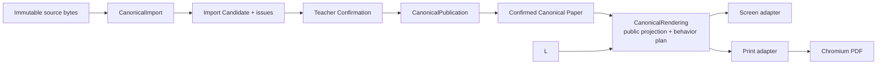

# EQB Project Cleanup Cut — 外部审查底稿

Status: proposal-only
Source snapshot: `f9753974dbf77c85fe17d667c124044c37583180`
Prepared: 2026-08-03
Execution authority: none

## 结论先行

这次清爽化不是“再做一套治理”，而是一次删除导向的架构与测试改革：

- 让普通 UI 微调只经过目标页面、受影响检查和 Owner QA；
- 让已知形状的新试卷只经过导入、教师确认、原子发布和一个实际成品 canary；
- 让共享 Paper 行为只在一个深模块中定义一次；
- 让高风险改动仍保留一次最终全套、一次独立 review lineage 和真实成品检查；
- 删除不再独立防止真实故障的 verifier、镜像契约、兼容壳、历史活引用和流程文档。

目标不是降低质量，而是让每一份质量成本只支付一次。

## 1. 为什么必须再清爽一次

昨日的 deletion-first 改革已经把中央治理从约 26 文件 / 4,004 行压到
22 文件 / 1,187 行，并删除 phase machine、manifest/digest approval、发布任务
和治理恢复任务等流程负担。这一步是有效的，但它只清了“任务怎么走”。

现在真正拖慢项目的是“一个共享行为要在多少地方重复解释和证明”：

- 当前 `verify:all` 平铺运行 120 个 verifier；仓库共有 143 个
  `verify-*.mjs`，其中约 50 个直接属于 Paper canonical、normalization、
  PaperSurface、Print/PDF 或 pagination；
- `scripts/` 一共有 253 个文件；
- `docs/cuts/paper-canonical-unification/` 当前有 191 个文件、36 张现行票；
  排除 `history/` 后仍约 51,235 行，其中大量是不可变数据、manifest 和证据；
- PaperSurface、paperAssembly 和 paper-intelligence 三个代码簇合计约 12,498 行；
- 旧审计已经确认 Screen 与 Print 分别维护约 291 行和 381 行相同的题型顺序、
  chrome、rhythm、前后关系和 block role 推导；
- Ticket 35 的一个视觉修复触发了 renderer authority、manifest、geometry
  fixture、consumer contract、publication、历史 rederive 和多层 verifier 的连锁，
  完整套件还把具体公共 seam 失败与历史错误码、旧索引断言混在一起报告。

这说明目前最浅的地方不是 UI，而是共享 Paper 行为的 Interface：调用者和测试
都需要知道太多内部版本、路径、digest、fixture 与历史兼容细节。

## 2. 不可删除的七条底线

清爽化只能删除重复机制，不能删除下列产品与安全不变量：

1. 原始输入 bytes、Source Capture、candidate、Teacher Confirmation、
   Canonical Paper 和 publication identity 必须可绑定，不能由调用者伪造语义。
2. 有歧义或缺失的 active content 必须 fail closed；不得为了 `ready` 合成内容。
3. Canonical Paper 必须整卷原子发布、精确 reload、可幂等重试、可恢复和可回滚。
4. Screen、Student Print、Teacher Print 和 PDF 必须消费同一个 renderer-neutral
   semantic projection；PDF 是 Print 输出的真实浏览器产物，不是另一套语义实现。
5. 学生版不得泄露答案/解析，教师版必须保留它们；公开 DOM 不泄露内部来源与
   provenance 字段。
6. 共享 renderer、Print/PDF、schema、publication、auth、persistence 或 migration
   改动仍属于高风险，必须有受影响公共 seam、最终全套和一条独立 review lineage。
7. 生产配置、用户隔离、隐私、备份与不可逆操作继续要求明确授权；本清爽 Cut
   不触碰生产、R2 或真实用户数据。

任何删除若不能说明“删后由哪个更轻的机制继续拦住同一个真实故障”，就不删。

## 3. 目标架构：四个深 Module，两个真正 renderer



### 3.1 `CanonicalImport`

保留现有两步 Interface：

- immutable source bytes + bounded operator choices -> candidate + issues；
- candidate + teacher decisions -> Canonical Paper 或 unresolved issues。

解析、Source Capture、candidate binding 和确认语义留在实现内部。调用者不得提交
authoritative Questions、answers、Profile 结构或 renderer 语义。

### 3.2 `CanonicalPublication`

一个 public Interface 负责 pre-write admission、整卷写入、精确 reload、幂等重试、
恢复、digest conflict 和 rollback。SQLite、文件树、journal 与 current ref 是内部实现，
不应分别向调用者暴露成多个“需要正确排序”的步骤。

### 3.3 `CanonicalRendering`

这是第一优先级的架构修复。它只有一个外部 Interface：接收 confirmed Canonical
Paper、公开模式（Student/Teacher）和已解析的 render contract，返回 renderer-neutral
的有序 blocks、题型关系、section chrome、block roles、answer visibility 和必要的
layout tokens。`public projection` 与 `RenderedBehaviorPlan` 是其内部阶段，不额外暴露
两个浅 Interface。

它必须同时做到：

- paper identity 由已验证 asset 自身携带，不扫描数据库“猜”当前 paper；
- provenance 留在内部 Canonical Paper，不进入公开投影和 DOM；
- Continuation starter、Application 注意块、inactive Listening、题号/挖空关系等
  共享语义只推导一次；
- Screen 与 Print 只负责各自 media 的布局与绘制，不再分别重建题型语义；
- PDF 直接复用 Print adapter 输出。

### 3.4 `VersionedRenderContract`

一个 resolver Interface：

```text
resolveVersionedRenderContract(authorityRef, family)
  -> immutable schema + profile + fixture + consumer capabilities
```

调用者不再分别知道 manifest 文件、profile 路径、fixture version、consumer contract
版本和各自 digest。resolver 内部保留旧 authority 的精确可重演链，并只把 current
authority 用于新 import；未知、冲突或缺项继续 fail closed。

这不是把版本检查删掉，而是把五六个浅 Interface 收进一个深 Interface。

## 4. 四刀执行方案

四刀串行完成；每一刀都必须能单独合并、单独回滚、单独带来净删除。不得先增加一层
“临时框架”再承诺以后删除。

### 第一刀：统一 `CanonicalRendering`

目标：修复当前最高收益的重复语义 seam。

实施：

- 提取纯 `CanonicalRendering`，把 public projection 与 Rendered Behavior Plan 留作
  内部实现；
- 让 Screen、Print 两个 adapter 消费同一计划；PDF 继续走 Print；
- 把 paper identity、Student/Teacher visibility、公开 provenance 剔除、family/chrome/
  predecessor/following、writing block roles 统一收进计划；
- 保留 Screen DOM、Print HTML 和真实 PDF 的 media-specific geometry 实现；
- 新 Interface 测试覆盖 family 插入/重排、section transition、重复/缺失 occurrence、
  writing starter、answer visibility 和 paper identity；
- 当新 Interface 测试接住同一 mutant 后，立即删除对应 Screen/Print 的镜像推导与
  source-regex/shallow fixture 断言，不保留双轨。

验收：

- 修改一个共享题型规则只改 plan 实现和该 Interface 测试，不再同时改 Screen 与
  Print 的语义推导；
- Screen/Print 对同一个 fixture 的语义 plan byte-equivalent；
- Student/Teacher 和 provenance mutants 在 plan Interface 被拒绝或正确投影；
- 代表性 Screen、Student/Teacher Print/PDF 成品无语义与视觉回归；
- diff 产生净删除，不能只把旧代码包进新函数。

### 第二刀：收拢 versioned authority 闭包

目标：让一次共享 renderer change 只注册一个 immutable render-contract bundle，
而不是人工同步 manifest/profile/fixture/consumer/migration 的散落知识。

实施：

- 盘点当前 runtime 真正读取的 authority/profile/fixture/consumer 字段；
- 建立一个 resolver 和一个内部 bundle schema；
- 迁入 current authority 与仍可达的历史 authority；
- 将历史 replay 与新 import 的选择规则写进 resolver，不让调用者自行判断；
- 保留不可变旧 bytes；删除只做路径转发、重复 digest 比较或锁死某个版本号的浅层
  loader/verifier；
- 把“未知 authority”“已知 authority 但 source tamper”“fixture mismatch”三类
  fail-closed 诊断顺序在 resolver Interface 一次定义。

验收：

- 新 shared renderer version 只需增加一个 bundle + 一个迁移入口；
- current 和至少一个历史版本可独立重演；
- 删除任一 bundle 必须被 reachability check 拦住；
- 调用者代码不含 manifest path、fixture path、consumer version 或历史版本枚举；
- 不出现 compatibility fallback、current publication 扫描或“碰巧能解析”的兜底。

### 第三刀：把 120 项平铺全套改成风险分包，并替换重复测试

目标：开发时跑受影响检查，最终高风险候选才跑完整全套；测试在深 Interface 上证明
行为，不再跨过 Interface 检查内部文件形状。

保留三个入口，禁止继续扩散：

```text
verify:changed   日常默认；根据 diff 选择最小已知 pack，未知影响则升级
verify:paper     Canonical/PaperSurface/Print/PDF 共享行为的受影响公共 seam pack
verify:all       高风险最终候选、release、未知或 cross-cut fallback
```

实现原则：

- 复用现有 `scripts/lib/verifyScope.mjs` 与 `verify-ci.mjs`，不新建测试编排框架；
- 给每个保留 verifier 记录唯一的 named failure、所属 pack 和触发路径；
- 一个 verifier 没有唯一 mutant，或另一个更早/更快 Interface test 已捕获同一 mutant，
  就删除；
- 拆解 import-pilot 巨型 verifier 为 admission、publication、visibility、render plan、
  QA lifecycle 的 Interface tests，只保留一个薄的真实 whole-flow canary；
- QA lifecycle 使用注入的本地 adapter 测 cleanup/retry，不再为了测服务清理而重跑整条
  import pilot；
- static regex 只保留在没有行为 seam 的极少数结构守卫；一旦 public Interface test
  存在，就删除 regex 镜像语义；
- 完整套件 fail-fast 于 build，但各 pack 内可 collect；最终摘要区分产品行为失败、
  测试基础设施失败、off-repo SKIP，不把它们混成一种 FAIL；
- 任何完整套件重跑必须由最终候选变化或真实基础设施故障解释，不能为了“刷绿”随意
  重跑。

风险矩阵：

| 变更 | 默认检查 | 独立 review | 真实成品 |
| --- | --- | --- | --- |
| 原子 CSS/copy/spacing 微调 | build + direct check + target page | 无 | target page + Owner QA |
| 已知形状试卷数据 addition | deterministic import + confirmation + atomic publish/reload + canary | 无 | 一份实际卷 canary；异常才升级 |
| 普通局部功能 | affected pack + browser when visible | 通常无 | 仅受影响页面 |
| shared Paper/renderer contract | affected public seams + final `verify:all` | 一条 lineage | 受影响 Screen/Student/Teacher Print/PDF |
| auth/persistence/migration/production config | affected adversarial/recovery + final `verify:all` | 一条 lineage | 仅可见行为变化时 QA |

验收：

- 五种代表变更的必跑命令由 diff 稳定选择；未知 diff 保守升级；
- qualifying UI 微调不会触发 backend、Paper、authority 或全套；
- known-shape data addition 不触发 authority bump、独立 review 或 universal multi-surface；
- shared Paper mutant 仍能在 merge 前被 affected pack 或 final full suite 拦住；
- retained verifier 总数和重复执行次数必须下降，但不以任意 LOC 百分比代替 mutant 证明。

### 第四刀：删除遗留操作面、空壳 Interface 和历史活引用

目标：让新 agent 只看到当前产品路径，历史仍可追溯但不再参与日常理解和验证。

删除候选：

- 已被深模块替代的 renderer-local 推导、重复 validator 和重复 fixture adapter；
- 无调用者或只做 pass-through 的 loader/helper/compatibility Interface；
- no-op writer 和仅为旧测试存在的 export；
- 未注册、无唯一 mutant、无人工 runbook caller 的 verifier；
- 指向 superseded ticket/manifest/phase/approval 的活文档引用；
- `scripts/README.md` 中过时、重复、逐文件长篇叙述，改为 pack、用途、触发方式和
  调试入口；
- 只复述 `AGENTS.md`、testing cadence、model routing 或 dispatch rules 的重复说明；
- 已完成 cut 的大体量历史材料移入明确 non-authoritative archive；默认搜索与 agent
  入口排除 archive，但 Git 历史仍可查。

保留候选：

- `server/api.mjs`、`PaperBrowsePage`、`DraftPaperWorkbench` 等大文件不能因 LOC 大就拆；
  只有 change simulation 证明多个调用者需要知道同一复杂度时，才提取深模块；
- legacy Print adapter 在 persisted data 仍可达时保留；等 reachability census、迁移和
  Screen/Print/PDF 证明其不可达后再删；
- immutable paper assets、current publication bytes、必要旧 versions 和 exact rollback
  证据不因“看起来多”而删。

验收：

- `rg` 默认结果不再把 superseded route 当成当前指令；
- 每个保留兼容路径都有真实 caller 或 persisted-data reachability；
- 每个保留 verifier 都有 unique named failure 和入口；
- 删除后 current Paper、auth、persistence、release 与 production safety 文档仍有唯一
  authority owner；
- 这一步不新增治理文档、receipt、manifest approval 或下一轮 cleanup ticket set。

## 5. Review、模型与任务节奏

这次 Cut 自己也必须服从清爽原则：

- 规划/全项目审计：一次 Sol xHigh，目标 20–30 分钟，输出对本计划的删改版；不用
  Sol Max，不展开无边界哲学讨论；
- 实施：语义与架构使用 Terra xHigh；边界已经证明、结果机械可验时使用 Luna xHigh；
- review：只有共享高风险 diff 使用一次 Sol Medium 独立 lineage；Must Fix 修复后只做
  同一 lineage 的 focused re-review，不循环追求完美；
- 每一刀一个可合并结果，最多四个实施任务；不得为拆票、发布计划、记录审批再创建
  顶层治理任务；
- 一刀若没有净删除、没有减少 caller/test fan-out、也没有缩短一个真实工作流，就停止，
  不因计划写了就硬做；
- 外部模型审查后，由 owner 只批准最终计划一次；异常或扩大产品范围时再停下来问。

## 6. 成功指标

不使用“代码少了多少百分比”作为唯一 KPI。最终必须同时满足：

### 效率

- UI 微调、普通功能、known-shape paper addition、shared renderer change、auth/migration
  五种代表工作流都有唯一、可预测的最小路径；
- 日常改动默认不运行 120 项平铺全套；
- 同一个真实行为不再由 Screen、Print、PDF、source regex 和多个 fixture 重复推导；
- full suite 的失败摘要能直接指出 pack、公共 Interface 与失败类别。

### 架构

- CanonicalImport、CanonicalPublication、CanonicalRendering、
  VersionedRenderContract 四个 Module 各有一个小 Interface；
- 调用者不需要知道内部 manifest/profile/fixture/consumer 路径和排序；
- 新 known-shape paper 主要是 source bytes、Teacher Confirmation 和 publication data，
  不改共享 code/authority/renderer。

### 安全与质量

- caller semantic forgery、wrong candidate、digest drift、partial publish、retry conflict、
  answer leakage、provenance leakage、unknown authority、历史 authority drift、Screen/Print
  semantic divergence 和 PDF 输出破损 mutants 仍全部被拦住；
- shared renderer 的真实 Student/Teacher Screen/Print/PDF 仍可生成和检查；
- auth、per-user isolation、migration recovery 和 production authorization 不降级。

### 删除质量

- 每个删除都有 caller inventory、named failure、替代 closure 和回滚方式；
- 新 Interface test 上线时，旧浅测试在同一刀删除，不留“以后再清”；
- 新增文件数不是净增长的遮羞布；每刀必须报告新增、删除、净变化和减少的 caller/test
  fan-out。

## 7. 明确不做

- 不重写整个 Canonical Paper domain；
- 不把所有历史版本合并成 current，也不改写 immutable bytes；
- 不把 PDF 做成第三套语义 renderer；
- 不建立新的 workflow engine、test framework、approval ledger 或 architecture committee；
- 不为低风险 UI/docs/data addition 建独立 review；
- 不借清爽 Cut 改产品需求、重做 UI、启用 Listening、恢复 DOCX 输出或触碰生产；
- 不因大文件、旧文件或测试慢就直接删除，必须先做 deletion test；
- 不追求“零 bug”或无限 review；守住一条 review lineage 和已命名的高风险 mutants。

## 8. 给外部模型的审查任务

外部模型应基于当前仓库和本计划，直接产出一份“删改后的最终计划”，而不是只写意见。

必须回答：

1. 四个目标 Module 中是否有不该存在的 hypothetical seam？若删除，复杂度会在哪里
   重新出现？
2. 哪些 safety invariant 可以由更轻机制关闭，哪些绝不能降级？
3. 四刀顺序是否会造成长期双轨或先加后删？给出更短的串行顺序。
4. 120-entry full suite 应如何分 pack；每个 pack 的触发路径与 unknown fallback 是什么？
5. 哪些现有 verifier 有 unique mutant，哪些明显重复，哪些必须先补 Interface test 才能删？
6. Ticket 35 暴露的 authority/fixture/consumer/历史 replay 连锁，能否被一个 resolver 真正
   隐藏，还是本计划仍在包装复杂度？
7. 是否遗漏 auth、persistence、production、student/teacher、atomic publication、真实
   Screen/Print/PDF 中的安全回归？
8. 给出最多四个可合并实施 Cut；每个 Cut 列出 write surfaces、删除清单、保留清单、
   验收命令、真实成品证据和停止条件。

审查约束：

- 使用 `KEEP / DELETE / DEEPEN / SPLIT` 分类；
- 每个保留项必须写出它独有的 named failure；
- 每个新增 Interface 必须通过 deletion test，并至少有两个真实 caller/adapter；
- 不新增 Wayfinder、票集 manifest、digest approval、phase receipt、发布任务或审查循环；
- 不使用“更完整、更企业级、更规范”作为理由；只讨论实际题库产品风险与开发效率；
- 若计划过大，优先删 scope，不得拆成十几二十张票来假装可执行。

## 9. 审查时应直接读取的仓库证据

- `AGENTS.md`
- `docs/agents/testing-cadence.md`
- `docs/agents/dispatch-protocols.md`
- `scripts/verify-ci.mjs`
- `scripts/lib/verifyScope.mjs`
- `scripts/README.md`
- `docs/cuts/paper-canonical-unification/spec.md`
- `docs/cuts/paper-canonical-unification/tickets/35-post-retirement-owner-qa.md`
- `docs/cuts/proportionate-engineering/research/burden-baseline-and-risk-language-2026-08-02.md`
- `docs/cuts/proportionate-engineering/wayfinder/tickets/03-audit-verification-review-and-visual-proof.md`
- `docs/cuts/proportionate-engineering/wayfinder/tickets/04-audit-canonical-data-and-contract-fanout.md`
- `docs/cuts/proportionate-engineering/wayfinder/tickets/05-audit-module-depth-and-hotspots.md`
- `docs/cuts/proportionate-engineering/wayfinder/tickets/06-design-the-ui-micro-change-lane.md`

Ticket 35 的 case study 来自仍在收口的独立实现 worktree；外部审查应以它最终通过
focused re-review 的精确 HEAD 复核，不把本文件中的运行中观察当作已发布事实。

## 10. 进入实施前的唯一批准点

外部模型提交最终计划后，owner 只需要批准一次：

```text
批准 Project Cleanup Cut 最终计划，按最多四刀串行执行；共享高风险改动使用一条
独立 review lineage，低风险改动不新增 review；不得新增治理层、不得触碰生产。
```

批准前本文件仅供审查，不授权修改产品代码、测试注册、authority、历史资产或发布状态。
